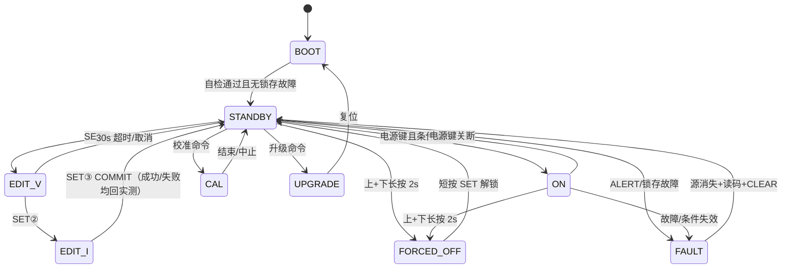
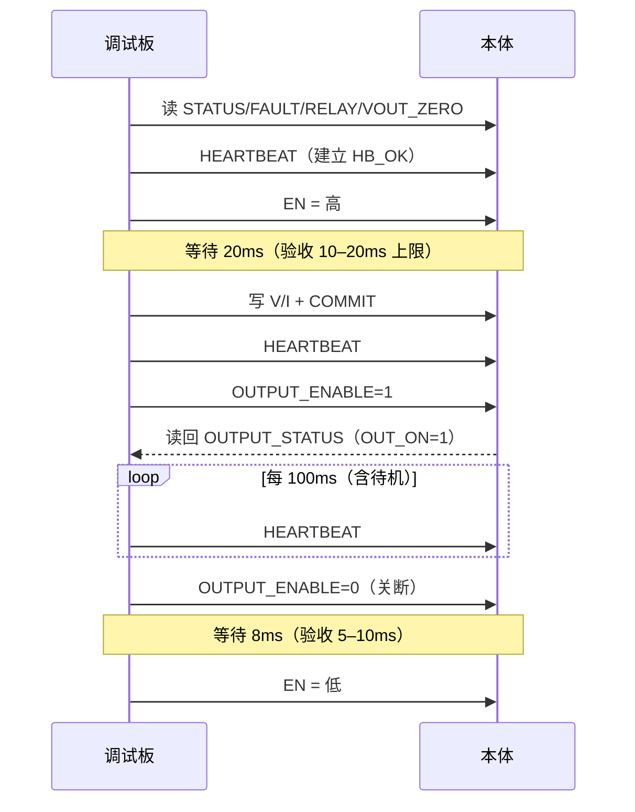

# 小型PSU电源 · 需求文件（唯一事实源）

> 版本：v2.0（正文归并版）｜更新时间：2026-11-18（+08:00）｜维护：T-0032（正文归并）/T-0034（TOC 与验证）
>
> 唯一事实源：自 T-0032 起，本项目需求正文的唯一事实源为本文件 `.agent/docs/requirements.md`。原 `.agent/requirements.md` v1.2 正文（1607 行）已逐章迁入本文件，原文件顶部已标注“已迁移，仅作历史”，不再作为审查/验收依据。
>
> 来源：正文自 `.agent/requirements.md` v1.2 逐章迁入，保留原章节编号（§1–§5、附录 A–J）、表格、数值与验收口径；未改任何已定验收阈值。逐条映射见附录 K。
>
> 审查与验收口径：从 T-0032 起，需求审查、设计审查与验收只以 `.agent/docs/requirements.md`（需求）、`.agent/docs/architecture.md`（架构）、`.agent/docs/modules.md`（功能模块设计）三份为唯一依据。三份之外的既有文件（`docs/` 四份、`.agent/requirements.md`、`.agent/requirements-draft.md`、`.agent/mech-draft.md`）一律降为历史或引用，不得再作为审查依据；三份之外新建需求/设计文档一律不认。
>
> 报告落点：每张后续工单的 done 报告必须写明「写入文件:章节」，且路径必须是上述三份之一（示例：`.agent/docs/requirements.md:3.3.3`、`.agent/docs/architecture.md:7.2`、`.agent/docs/modules.md:1.6`）；未写落点或写到三份之外视为交付不完整。
>
> T-0034：只补正文前置 TOC 与迁移验证，不改任何章节正文/验收阈值；T-0032 的正文归并为来源。
>
> 冲突处理：已定验收口径以本文件对应章节为准；历史文档（含附录 D/F/H 中出现的旧路径与旧表述）只作追溯；发现新旧冲突时以最新看板验收为准，裁决依据单号记入附录 K.3。后续改需求走变更单，不在本文件直接改验收口径。

## 目录（TOC）

> 本节由 T-0021 的章节索引改造；T-0032 归并后章节扩展，T-0034 按当前标题重建。只列章节与标题，正文见对应章节。

| 章节 | 标题 | 状态 |
|---|---|---|
| [§1](#1-定位与范围) | 定位与范围 | 已定稿 |
| [§1.1](#11-一句话定位) | 一句话定位 | 已定稿 |
| [§1.2](#12-不是-ups) | 不是 UPS | 已定稿 |
| [§1.3](#13-项目名与历史命名) | 项目名与历史命名 | 已定稿 |
| [§1.4](#14-系统构成) | 系统构成 | 已定稿 |
| [§1.5](#15-使用边界) | 使用边界 | 已定稿 |
| [§1.6](#16-范围外) | 范围外 | 已定稿 |
| [§1.7](#17-编号与来源追溯) | 编号与来源追溯 | 已定稿 |
| [§2](#2-系统级) | 系统级 | 已定稿（§2.11 待确认） |
| [§2.1](#21-跨板-64-针金手指接口) | 跨板 64 针金手指接口 | 已定稿 |
| [§2.2](#22-i2c-电气与协议) | I2C 电气与协议 | 已定稿 |
| [§2.3](#23-alert-规范) | ALERT 规范 | 已定稿 |
| [§2.4](#24-上电掉电使能升级时序定版) | 上电/掉电/使能/升级时序（定版） | 已定稿 |
| [§2.5](#25-引用标准与合规基线定版) | 引用标准与合规基线（定版） | 已定稿 |
| [§2.6](#26-环境与安规定版) | 环境与安规（定版） | 已定稿 |
| [§2.7](#27-整机方位尺寸与机械基线定版) | 整机方位、尺寸与机械基线（定版） | 已定稿 |
| [§2.8](#28-性能指标与验收口径定版) | 性能指标与验收口径（定版） | 已定稿 |
| [§2.9](#29-风道散热噪音与重量定版) | 风道、散热、噪音与重量（定版） | 已定稿 |
| [§2.10](#210-生产追溯与成本定版) | 生产、追溯与成本（定版） | 已定稿 |
| [§2.11](#211-系统级待确认清单owner) | 系统级待确认清单（owner） | 待确认（owner） |
| [§2.12](#212-参考设计对照定版) | 参考设计对照（定版） | 已定稿 |
| [§3](#3-电源本体) | 电源本体 | 已定稿 |
| [§3.1](#31-本体功能清单p-类) | 本体功能清单（P 类） | 已定稿 |
| [§3.2](#32-为什么-05v-以下不保证指标) | 为什么 0.5V 以下不保证指标 | 已定稿 |
| [§3.3](#33-i2c-寄存器表初稿) | I2C 寄存器表（初稿） | 已定稿 |
| [§3.4](#34-校准数据接口定版) | 校准数据接口（定版） | 已定稿 |
| [§3.5](#35-本体电气规格功率拓扑与结构热设计定版) | 本体电气规格、功率拓扑与结构热设计（定版） | 已定稿 |
| [§4](#4-电源调试板) | 电源调试板 | 已定稿（§4.3 待确认） |
| [§4.1](#41-调试板功能清单d-类) | 调试板功能清单（D 类） | 已定稿 |
| [§4.2](#42-按键交互显示与主机侧时序t-0009-定稿) | 按键交互、显示与主机侧时序（T-0009 定稿） | 已定稿 |
| [§4.3](#43-调试板待确认项) | 调试板待确认项 | 待确认（owner） |
| [§4.4](#44-硬件接口与结构t-0010-定稿) | 硬件接口与结构（T-0010 定稿） | 已定稿 |
| [§4.5](#45-pc-工具usb-c必需服务工具) | PC 工具（USB-C，必需服务工具） | 已定稿 |
| [§5](#5-附录) | 附录 | 已定稿 |
| [附录 A](#附录-a验收覆盖对照) | 验收覆盖对照 | 已定稿 |
| [附录 B](#附录-b边界声明) | 边界声明 | 已定稿 |
| [附录 C](#附录-c变更记录) | 变更记录 | 已定稿 |
| [附录 D](#附录-d合并来源删除说明与历史差异留痕) | 合并来源、删除说明与历史差异留痕 | 已定稿 |
| [附录 E](#附录-e初稿边界与待确认清单) | 初稿边界与待确认清单 | 待确认（owner） |
| [附录 F](#附录-ft-0017-安全与使用边界变更单v08) | T-0017 安全与使用边界变更单（v0.8） | 已定稿 |
| [附录 G](#附录-gt-0018-能力补齐需求v09) | T-0018 能力补齐需求（v0.9） | 已定稿 |
| [附录 H](#附录-ht-0019-输出能力包络与环境降额边界变更单v10) | T-0019 输出能力包络与环境降额边界变更单（v1.0） | 已定稿 |
| [附录 I](#附录-it-0020-对标补缺变更单v11) | T-0020 对标补缺变更单（v1.1） | 已定稿 |
| [附录 J](#附录-jt-0031-显示职责pc-工具变更单v12) | T-0031 显示/职责/PC 工具变更单（v1.2） | 已定稿 |
| [附录 K](#附录-kt-0032-正文归并与迁移对照v20) | T-0032 正文归并与迁移对照（v2.0） | 已定稿 |
| [附录 L](#附录-lt-0032-校验与规模v20) | T-0032 校验与规模（v2.0） | 已定稿 |

## 填写规则（v2.0，后续所有工单必须遵守）

1. **报告必写落点**：每张后续工单的 done 报告必须写明「写入文件:章节」与章节范围，路径只能是 `.agent/docs/requirements.md`、`.agent/docs/architecture.md`、`.agent/docs/modules.md` 三份之一（示例：`.agent/docs/requirements.md:3.3.3`、`.agent/docs/architecture.md:7.2`）。禁止新建独立需求/设计文档；未写落点或写到三份之外视为交付不完整。
2. **需求改动**：只改本文件对应章节，并在附录 C「变更记录」追加一行（日期/单号/改了什么）；不得另起文件，不得把需求正文复制到 `docs/` 或任何第四份文档。
3. **设计展开**：设计细节只写 `.agent/docs/architecture.md`（系统架构/接口/时序/升级/测试）或 `.agent/docs/modules.md`（模块设计）的对应章节；`docs/` 四份自 T-0032 起只是摘要引用页，不再承载正文。需求与设计不得互相复制——需求只写“要什么”，设计只写“怎么做”。
4. **未成文不预造**：未完成章节写「待填（来源：T-00xx）」；待 owner 拍板的写「待确认（owner）」，不猜默认值。
5. **单一事实源**：需求以本文件为唯一入口，架构以 `.agent/docs/architecture.md` 为唯一入口，模块设计以 `.agent/docs/modules.md` 为唯一入口；针脚/寄存器/ALERT/校准的数值细节在需求对应章节，设计文档只引用章节号，不复制表格。三份之外的任何需求/设计文档不参与审查。

## 完成度表（章节 × 状态 × 负责单号）

> 状态只用三档：已定稿 / 待填写 / 待确认。文档地图见 `README.md` §7。T-0032 只做正文归并，不改变下表任何章节状态；迁移后章节号与内容不变。

| 章节 | 状态 | 负责单号 |
|---|---|---|
| 第 1 章 定位与范围（1.1–1.7） | 已定稿 | T-0004（T-0013 修订；T-0017 使用边界收口；T-0020 范围外补全） |
| 第 2 章 系统级：针脚/I2C/ALERT（2.1–2.3） | 已定稿 | T-0005（T-0013 修订；T-0020 插拔寿命指针） |
| 第 2 章 系统级：上电/掉电/使能/升级时序（2.4） | 已定稿 | T-0006（2026-11-18） |
| 第 2 章 系统级：安全/指标/热/成本/参考对照（2.5–2.10、2.12） | 已定稿 | T-0007（2026-11-18；T-0017 急停/风扇口径收口） |
| 第 2 章 系统级：待确认清单（2.11） | 待确认 | owner（默认值已给） |
| 第 3 章 电源本体：功能/寄存器/校准（3.1–3.4） | 已定稿 | T-0004、T-0005（T-0013 修订；T-0017 增 P-15/OTP） |
| 第 3 章 电源本体：电气规格/拓扑/结构热设计（3.5） | 已定稿 | T-0011（2026-11-18）；owner 图/BOM 细节待实施单 |
| 第 4 章 电源调试板：功能（4.1） | 已定稿 | T-0004、T-0009（T-0031 修订显示/职责/故障历史） |
| 第 4 章 电源调试板：按键/显示/使能时序（4.2） | 已定稿 | T-0009（T-0031 修订：只显示实测 V/I、组合键关断） |
| 第 4 章 电源调试板：接口与结构（4.4） | 已定稿 | T-0010（T-0031 修订显示/故障灯/PC 工具） |
| 第 4 章 电源调试板：PC 工具（4.5） | 已定稿 | T-0031（页面需求归 T-0025～T-0028 实现） |
| 第 4 章 电源调试板：待确认项（4.3） | 待确认 | owner（含 T-0009/T-0010/T-0031 建议项） |
| 第 5 章 附录 C 变更记录 | 已定稿（后续只追加） | T-0016、T-0017、T-0018、T-0019、T-0020、T-0031、T-0032 |
| 第 5 章 附录 E 待确认清单 | 待确认 | owner |
| 第 5 章 附录 F T-0017 变更单 | 已定稿 | T-0017（2026-11-18） |
| 第 5 章 附录 G T-0018 能力补齐需求 | 已定稿 | T-0018（2026-11-18） |
| 第 5 章 附录 G.6 待 owner 确认项（4 项） | 待确认 | owner |
| 第 5 章 附录 H T-0019 输出能力包络与环境降额 | 已定稿 | T-0019（2026-11-18） |
| 第 5 章 附录 I T-0020 对标补缺变更单 | 已定稿 | T-0020（T-0031 修订 I.2/I.4） |
| 第 5 章 附录 J T-0031 显示/职责/PC 工具变更单 | 已定稿 | T-0031（2026-11-18） |
| 第 5 章 附录 I.7 待确认项（连接器力值/可见性布局/T-0008 形态） | 待确认 | owner |
| 第 5 章 附录 K/L T-0032 迁移对照与校验 | 已定稿 | T-0032（2026-11-18） |

---

# 1. 定位与范围

## 1.1 一句话定位

本项目是**数控可调直流电源（PSU, Programmable DC Power Supply）**：220VAC 市电输入，输出 0.5–48V / 0–5A，输出电压与电流由 I2C 设定，具备本地显示、按键、保护与状态回读。产品由**电源本体（P 类）**与**电源调试板（D 类）**两块板组成。

## 1.2 不是 UPS

- 不是 UPS（Uninterruptible Power Supply，不间断电源）；不含电池、不含逆变器、不做市电中断备份、不做双电源切换。
- 不承诺任何“不间断供电”“续航”“备电”能力；市电断开即无输出。
- 项目名中的“UPS”只存在于历史命名，不代表产品类型。

## 1.3 项目名与历史命名

- 现行项目名：**小型PSU电源**；项目名为历史命名，沿用旧仓库/工单，仅用于追溯。
- 仓库名 `small_UPS`、旧工单标题中的“小型 UPS”同样为历史命名。
- 后续文档、BOM、丝印、说明书、UI 一律使用“数控可调直流电源 / PSU”，不再用 UPS 表述产品。

## 1.4 系统构成

| 代号 | 名称 | 职责（功能级） |
|---|---|---|
| P | 电源本体 | 市电输入、隔离变换、输出调压/限流、输出使能与隔离、采样/保护/状态、I2C 从机、掉电保存、热替换所需能力（本版不实现多机均流） |
| D | 电源调试板 | 与本体金手指对接、本地显示实测 V/I 与按键（只设 V/I、开关输出）、EN/软使能/心跳主机侧、ALERT 监视、PT100 温度采集；不显示温度/故障文字/模式文字，不在板上设温度阈值 |
| 外部系统 | 系统级编排 | 热替换的系统级主控、机架、线束与更换流程（本版不实现多机并联均流）；不在本产品两板交付范围内 |
| PC | PC 工具（服务/标定，必需） | USB-C 连调试板；温度阈值配置、故障码/故障历史读取、校准与升级；不替代本地面板，不随整机 BOM |

## 1.5 使用边界

- 由 220VAC 市电供电，内部存在高压；仅限受过电气安全培训的人员操作。
- 产品为室内使用；具体环境/安规/EMC/认证口径见 §2.5–§2.7，本章只定使用边界。
- 本体与调试板为竖立式，接插面 60（宽）×120（高）；必须按确认的方向与到位状态插合；不得在输出使能状态下插拔（热替换流程见 3.1 的 P-12）。
- **输出串并联与浮地**：输出负极（−）为**浮地**（与 PE/机壳隔离，仅在本机内与信号地单点连接；输出− 对 PE/机壳绝缘 ≥10MΩ@500V）；需要接地时只允许在输出− 与系统地之间单点连接，禁止将输出+ 接地。**禁止输出串联**（多台本机、其他电源或电池串联升压）；本版不支持并联扩流，禁止直接并联输出。多台同时使用时，各台输出− 必须接到同一系统地（单点），用专用接地导体承载，不得仅靠 I2C/ALERT 信号地或 PE 线承担负载回流。USB-C/RS485 连接外部系统时，外部地可能引入共地；仍须保持单点共地，不得形成多点接地/地环。
- **禁止接电池/储能负载**：输出端不得连接电池、超级电容、储能柜、其他电源或任何可向输出端回灌能量的负载；本机不是充电器，不允许对电池充电。反灌判定：反向电流 >0.2A 且持续 >10µs → 硬件关断并锁存 REVERSE_CURRENT（0x0C）；由线缆/输出电容引起的瞬态反向电流 <0.2A 且 <10µs 允许；输出针不得高于 55V 母线。
- 急停为独立机械安全件（见 P-15/§3.1.1）；急停切断市电后仍须按维修流程验电/放电，不得把“已按急停”当作输出端已无电的依据。

## 1.6 范围外

| ID | 范围外内容 | 说明 |
|---|---|---|
| O-01 | UPS、电池、逆变、备电、市电切换 | 不做不间断供电、不做电池管理、不做逆变输出、不做双电源切换；市电断开即无输出。 |
| O-02 | 上位机产品功能：云平台、无线/网络通信、手机 App、仪器程控（见 O-08） | 不提供上位机产品功能或仪器程控接口。**PC 配置/标定工具是必需交付项（软件，不随整机 BOM）**：USB-C 连调试板，用于 PT100 温度阈值配置、故障码/故障历史读取、校准与固件升级；不允许 PC 设定 V/I 或开关输出，不替代本地面板。见 §4.5、§4.2.6、§4.4.3、附录 J、附录 I.4。 |
| O-03 | 硬件工程入库 | 硬件用立创EDA 维护于本地 `Hardware/`，原理图/PCB/工程/BOM/Gerber 一律不进 git；产品代码仓库只放固件，`.agent/` 仅放需求/流程文档。 |
| O-04 | 系统级热替换编排、机架、线束（本版不实现多机并联均流） | 本体只提供热替换所需能力；系统级主控、机架、线束与更换流程不在两板范围；SHARE/SYNC 仅预留。 |
| O-05 | 本文件不覆盖的详细设计 | 针脚表、I2C 寄存器表、按键/使能时序、指标与测法、机械/热设计、BOM/成本等由后续分单定稿后回写本文件；T-0007 已回写系统级安全/指标/机械热/成本（§2.5–§2.12），保护阈值见 §3.3.3/§3.5.12，按键/显示见 §4.2，接口/结构见 §4.4。 |
| O-06 | 模拟编程/模拟控制接口（0–10V、4–20mA 等） | 不提供模拟编程输入或模拟控制口；V/I 设定只经本地面板与 I2C（调试/服务经 UART/USB-C）。模拟编程需额外隔离、校准与连接器，且与数字设定源并存会引入优先级/校准歧义；不在本产品功能范围。 |
| O-07 | 外部监测输出（0–10V/4–20mA、缓冲模拟监视、隔离变送） | 不提供外部模拟监测输出；实测值只经本地面板、I2C 回读与 USB-C 服务口读取，USB-C 不是产品监测接口。增加监测输出需额外缓冲/隔离/校准与连接器，不在本产品功能范围。 |
| O-08 | USB/LAN/GPIB/SCPI 仪器程控 | 不作为产品程控接口：不实现 SCPI 命令集、USB-TMC、LAN/GPIB 接口或对应连接器；调试板 USB-C 仅数据/服务/标定/升级（O-02 例外），不得当作程控口。 |
| O-09 | 序列/扫描/定时输出（List/Step/Ramp/Scan/Timer/编程输出） | 不提供自动序列、扫描、定时或编程输出；只支持静态 V/I 设定、手动/远程使能与 8 组静态预设（附录 G.4）。预设调用是静态工作点切换，不是定时/序列执行；斜率仅用于 §2.4.2 热调。 |
| O-10 | 电池充电模式（CC/CV 充电、终止判据、温度补偿） | 不提供充电模式；§1.5 禁止连接电池/储能负载，本机不是充电器；反灌保护按 §3.3.3 的 0x0C（>0.2A/10µs）。任何充电曲线、终止逻辑、温度补偿不在范围。 |

> 范围外不等于禁止服务/维护使用：PC 标定工具与 USB-C 的服务用途见 O-02 例外与附录 I.4；O-06～O-10 的理由与可判定验收见附录 I.3。

> “仓库只放固件”的准确含义：产品代码只放固件；`.agent/` 只放需求、看板、证据等工作流文件；硬件工程绝不入库。

## 1.7 编号与来源追溯

- `P-xx`：电源本体功能；`D-xx`：电源调试板功能。两条线只写“功能与验收要点”，不展开电路、针脚、寄存器地址或性能指标。
- “来源”列使用以下确认项代码；同一功能有多个来源时全部列出。

| 代码 | 确认来源 | 位置 |
|---|---|---|
| T4-1 | T-0004 验收第 1 条：定位 + 功能清单 + 范围外 | T-0004 工单文本 |
| T4-2 | T-0004 验收第 2 条：10 项必须覆盖的功能 | T-0004 工单文本 |
| T3-2 | T-0003 验收第 2 条：本体侧掉电保存（V/I 必存；原文允许含保护阈值；不含 PT100） | T-0003 验收 2 |
| T3-3 | T-0003 验收第 3 条：使能四条件、任一方否决 | T-0003 验收 3 |
| T3-4 | T-0003 验收第 4 条：EN 默认不使能、状态位 | T-0003 验收 4 |
| T3-8 | T-0003 验收第 8 条：测量链、校准系数存 EEPROM | T-0003 验收 8 |
| T3-11 | T-0003 验收第 11 条：风扇 FG 堵转告警与降额 | T-0003 验收 11 |
| T3-13 | T-0003 验收第 13 条：本体两级过温、PT100 走 Modbus | T-0003 验收 13 |
| T3-14 | T-0003 验收第 14 条：控制/采样/状态机/校准 | T-0003 验收 14 |
| T3-16 | T-0003 验收第 16 条：保护与输出隔离 | T-0003 验收 16 |
| D-P04 | 需求草稿 P-04：I2C 地址 0x30–0x3F、无广播 | `.agent/requirements-draft.md:13` |
| D-P07 | 需求草稿 P-07：本体 12V 待机供调试板 | `.agent/requirements-draft.md:16` |
| D-7 | 需求草稿第 7 节：范围外 | `.agent/requirements-draft.md:74-75` |

> 说明：T4-* 是 T-0004 的直接确认项；T3-* 是拆分前已确认、由 T-0004 承接的条目。若两者冲突，以 T4-* 为准并在变更单中记录。
>
> 说明：T-0005/T-0006/T-0007/T-0009/T-0010/T-0011 为后续变更单；本文件按其验收核对事实性冲突，只引用不改变验收口径。

# 2. 系统级

## 2.1 跨板 64 针金手指接口

### 2.1.1 机械与工艺基线

- 64 针 = A 面 32 + B 面 32，间距 2.54mm；PCB 1.6mm；金手指倒角 30°；硬金 ≥1µm。
- 接插面 60（宽）×120（高）竖面；本体竖立式（整机 60×120×180、PCB 立式 180×120，见 §2.7），调试板 60×120×35 贴前面。
- 金手指竖条偏左：中心距左约 15mm、宽 10–12mm、长 79mm；竖排由上到下 A1–A32 / B1–B32。上销 Ø5 距上边 10mm、下销 Ø8 距下边 20mm；右侧 4 位拨码（沉孔）。
- 不做防呆键位；代偿：A30–A32/B30–B32 GND 护边、功率/信号分区、短针、丝印方向、插反检测（信号针 >16V 立即断输出并报警）。
- 输出+ 20 针、输出− 20 针并联；单针按 ≥1A 设计，5A 总电流留裕量；接触电阻 ≤20mΩ/针。
- 短针铜箔比信号针短 3–5mm；短针最后啮合、最先断开。
- 金手指竖条约 79mm（插入承插腔，承插腔见 T-0010 第 2 条）；定位销前伸 15–18mm；插到底后前面板齐平。
- 插拔寿命（按热插拔循环计）、接触电阻劣化、插拔力/保持力判据见附录 I.1；本节只保留选型与机械基线，不重复数值。

### 2.1.2 针脚定义（A/B 各 32）

> 排布：竖立式，由上到下 A1–A32 / B1–B32；A/B 两面同序，1 在上、32 在下。

| 针位 | A 面 | B 面 | 方向（源→宿） | 用途 / 电平定义 |
|---|---|---|---|---|
| 1–10 | 输出+ | 输出+ | 本体→调试板/负载 | 功率输出正；0–48V，A/B 各 10 针并联，合计 5A |
| 11–20 | 输出− | 输出− | 负载→本体 | 功率回路返回；0V，A/B 各 10 针并联，与信号地单点连接 |
| 21 | 信号地 | 信号地 | 双向参考 | 0V 信号/采样参考；与功率地单点连接 |
| 22 | +12V 出 | +12V 回 | A：本体→调试板；B：调试板→本体继电器 | 12V±5%；A22 待机供电，B22 经短针构成继电器使能回路；两端各串 PTC |
| 23 | 短针 | 短针 | 12V 回路 | 短针，最后啮合/最先断开；与 B22 共同构成继电器使能回路，不在位则继电器不能吸合 |
| 24 | SDA | SCL | 双向 | I2C 数据/时钟；3.3V 开漏，4.7k 上拉，≤400kHz |
| 25 | ALERT | EN | A：本体→调试板；B：调试板→本体 | ALERT 低有效开漏；EN 3.3V 高有效，本体 10k 下拉，未驱动即不使能 |
| 26 | SENSE+ | SENSE− | 调试板/负载→本体 | 开尔文远端采样差分输入；0–48V，100Ω 串联 + TVS；不用时就近短接到输出端 |
| 27 | SHARE 预留 | SYNC 预留 | 双向（预留） | 3.3V 预留；本版不启用，悬空不接，不得驱动 |
| 28 | UART_TX | B28 备用 | A：本体→调试板 | 3.3V TTL 串口发送，空闲高，默认 115200 8N1；B28 保留不接 |
| 29 | UART_RX | B29 备用 | A：调试板→本体 | 3.3V TTL 串口接收，空闲高，默认 115200 8N1；B29 保留不接 |
| 30–32 | GND 护边 | GND 护边 | — | 0V 护边/插反检测参考；与信号地单点连接 |

> 计数核对：输出+ 20 + 输出− 20 + 信号地 2 + 12V 2 + 短针 2 + I2C 2 + ALERT/EN 2 + SENSE 2 + SHARE/SYNC 2 + UART 2 + 备用 2 + GND 护边 6 = 64 针。

### 2.1.3 每类针的用途与方向

- 功率针（1–20）：输出+ 由本体经调试板到负载，输出− 由负载回本体；A/B 双面并联降低接触电阻与电流密度；严禁输出+/−反接。
- 信号地（21）：只做信号参考，不承载功率电流；与输出− 在输出采样点单点连接，避免地环。
- 12V/短针（22/23）：A22 为本体待机 12V 供调试板；B22 为调试板回送本体继电器线圈的 12V，回路为 B22 → 继电器线圈 → A23/B23 短针 → 地。短针不在位 → 继电器不能吸合，输出不能使能。12V 两端各串自恢复保险（PTC）。
- I2C（24）：本体为从机，调试板为主机；3.3V 开漏；总线上 4.7k 上拉到 3.3V，全总线只保留一处（默认调试板/主机侧，本体侧预留但默认不贴；最终位置待 owner 确认，T-0012 D4）；总线电容 ≤400pF；100kHz 默认、400kHz 最大。
- ALERT/EN（25）：ALERT 仅通知，不参与保护；EN 为硬件使能门，低电平直接关断，不依赖 MCU/I2C。
- SENSE（26）：远端采样，差分；断线时本体回退本地采样并置故障；不使用时就近短接。
- SHARE/SYNC（27）：预留，本版不启用；不得接错或驱动。
- UART（28/29）：调试/服务口，3.3V TTL 非 RS-232；A28 本体发、A29 本体收；默认 115200 8N1；与 I2C 共用校准命令语义。
- 备用（B28/B29）：保留，不接；不得挪作其他用途。
- GND 护边（30–32）：插合时最先接触、最后断开，做插反检测参考；与信号地单点连接。

### 2.1.4 插拔与短针时序

- 插入方向：沿本体前后方向水平推入竖直接插面，不得斜插/旋转；拔出反向直拉。
- 不允许带电插拔（输出使能状态下）：先 I2C 关输出 → 等 RELAY_STATE=0 且 VOUT_ZERO=1 → 再拔。
- 插入：GND 护边先接触 → 信号/12V → 短针最后啮合；拔出相反。短针丢失立即释放继电器并置 SHORT_PIN_LOST。
- 插反检测：信号/低压针（21–29）任一脚 >16V 持续 >1ms → 硬件立即断 EN/继电器并置 REVERSE_INSERT；该保护不替代 ALERT。

## 2.2 I2C 电气与协议

### 2.2.1 电气

- 总线 3.3V；上拉 4.7kΩ 到 3.3V，全总线只装一处（默认调试板/主机侧；本体侧预留 4.7k 位置但默认不贴；最终位置待 owner 确认，T-0012 验收 3 登记 D4）；开漏；不接 5V，不做 5V 容忍。多机共线时禁止每台从机都并联上拉。
- 速率 ≤400kHz（100kHz 默认）；总线电容 ≤400pF（含针脚、连接器、线束）；串联 100Ω + ESD 保护。
- 7 位地址 0x30–0x3F（0x30 + 4 位拨码）；多机共线时地址必须唯一；不实现广播/General Call；只响应本机地址。
- 共地：调试板与本体通过信号地/输出− 单点共地；I2C 以该地为参考。
- 时钟拉伸 ≤10ms；主机连续拉低 SCL >25ms 视为总线异常，从机复位 I2C 状态机但不改变输出状态；总线死锁时主机发 9 个 SCL + STOP 恢复。

### 2.2.2 帧格式与数据编码

- 写：START + 地址+W + 寄存器地址 + 数据… + STOP；读：START + 地址+W + 寄存器地址 + Repeated START + 地址+R + 数据… + STOP。
- 寄存器地址自动递增；多字节小端（低字节在前）；有符号数为 16 位二进制补码；16 位占 addr、addr+1；32 位占 addr…addr+3。
- 保留寄存器读 0、写忽略；越界/只读写 NACK；多字节设定写影子寄存器，COMMIT=0x5A 后原子生效。
- 复位后所有输出关闭、软使能 0；V/I 设定从 EEPROM 恢复；校准表无效时用恒等映射，不改变设定值。

### 2.2.3 地址与多机

- 4 位拨码上电读取，运行中改变需重新上电；地址 0x30–0x3F；同一总线不得重复。
- 不支持广播；主机逐地址读写；多机 ALERT 共线，按 2.3.4 逐地址读取。
- 地址冲突表现为仲裁失败/读回异常；调试阶段逐台标记。

## 2.3 ALERT 规范

### 2.3.1 电气

- 引脚 A25；低有效开漏；调试板 10kΩ 上拉到 3.3V；本体仅 100Ω 串联 + ESD，不加上拉。
- 最大灌电流 10mA；耐压 ≥30V；ESD ≥±8kV 接触；未上电/故障机高阻，不得反向供电。
- 多机共线 wired-OR：任一机拉低即低。ALERT 只做通知，不替代保护；保护由硬件比较器/定时器 + 继电器/MOS 门独立完成。

### 2.3.2 锁存与释放

- 任一锁存故障（FAULT_FLAGS.LATCHED=1）→ ALERT 拉低。
- 主机必须先读 FAULT_CODE + FAULT_FLAGS（置“已读码”），再写 CLEAR=0xA5；仅当源消失且满足清除条件时清位。
- 未读码写 CLEAR 无效；源仍在写 CLEAR 无效；ALERT 保持低并再次触发。
- 全部锁存位清完且无实时故障 → 释放；释放时间 ≤1ms（条件满足后）；故障消失但未读码/CLEAR，ALERT 仍保持。
- 上电自检期间 ALERT 可短暂低；自检通过且无故障后释放，主机应忽略 <10ms 的上电毛刺（或等 10ms 再读）。

### 2.3.3 关键故障硬件直拉

- 以下故障不经 MCU GPIO，由硬件锁存/比较器直接拉低 ALERT 并同时关断输出：OVP、OCP/SCP、OTP、REVERSE_CURRENT、HEARTBEAT_LOST、SHORT_PIN_LOST。
- MCU 只负责锁存/上报/清位；MCU 死机不影响上述拉低与关断。
- EN_LOST 由 EN 信号本身直接关门（EN 低 → 驱动门低），不依赖 MCU；ALERT 由硬件状态机置位。
- 硬件直拉与软件置位为线与关系；软件不得单独释放硬件锁存，必须源消失 + CLEAR。

### 2.3.4 多机共线按地址逐读

- 主机在 ALERT 下降沿后，按 0x30–0x3F 逐地址读 FAULT_FLAGS；仅非零地址处理；不得广播。
- 每台读码后按各自条件 CLEAR；全部故障机清完，线才释放。
- 若所有地址均无故障而 ALERT 仍低：查总线/上拉/某机硬件锁存或短路，不得强行拉高。
- 地址唯一（0x30–0x3F）；冲突时先解决地址再谈 ALERT。

### 2.3.5 时序

- 硬件关键故障：硬件比较器/定时器触发 → 输出关断 ≤10µs；同一触发 → ALERT 拉低 ≤10µs（硬件锁存）。OVP 的 50µs 是确认窗口，不是 ALERT 延迟。
- 软件检测故障：检测到 → ALERT 拉低 ≤1ms。
- 读码 → CLEAR → 释放 ≤1ms（源已消失）；若源仍在，保持并置位。
- ALERT 不得作为唯一保护或唯一关断路径。

## 2.4 上电/掉电/使能/升级时序（定版）

> 本节由 T-0006 填写，只定系统级时序与动作；ALERT 电气/锁存见 §2.3，寄存器语义见 §3.3，校准见 §3.4。设计展开见 `.agent/docs/architecture.md` §5（时序总览）、§7（时序与状态机）、§8（升级）、`.agent/docs/modules.md` §1.6–§1.8。

### 2.4.1 上电、自检与掉电

- 上电顺序固定：辅助电源 → MCU 自检 → PFC 建 400V → LLC 建 55V → READY。任一步失败即停在安全态（输出级关断、继电器断开、ALERT 按 §2.3 上报），不得跳步使能。
- 异常分支：辅助电源超窗 → 不驱动 I2C/ALERT、不使能；MCU 自检失败 → INTERNAL 锁存、禁输出；PFC 母线 <320V → PFC_FAULT 锁存、禁输出；55V 母线 <50V → UNDERVOLTAGE（0x04）锁存、禁 buck；AC <180VAC → POWER_LOST（欠压）；AC <150VAC 或丢失 → POWER_LOST（掉电）。均不自动重试、不自动输出。
- READY 前 I2C 只读状态，写 OUTPUT_ENABLE 被忽略；READY 后才接受使能命令。上电默认 OUTPUT_ENABLE=0、继电器断开、PWM 关断；EEPROM 只恢复 V/I 设定，不恢复输出状态。
- 关断/掉电顺序：先禁 buck，再释放继电器；输出电容经反灌比较器（>0.2A、10µs）与理想二极管/ORing 阻断向 55V 母线倒灌；输出针不得高于 55V 母线。掉电后不再写 EEPROM。
- 去抖窗口由设计定；欠压确认不得短于 1 个工频周期，掉电可更快，但不得把已确认的掉电/欠压再放行输出。

### 2.4.2 使能、心跳与热调

- 使能链：OUTPUT_ENABLE 写 1 仅当 EN 高、I2C 软使能、短针在位、无锁存故障、心跳 <500ms、设定已 COMMIT、校准有效/恒等同时成立；任一项失效即关断并清软使能（单票否决）。EN 高有效、本体 10k 下拉；EN 由低变高需稳定 10–50ms 才参与使能，由高变低立即关门（≤1ms），低电平持续 20ms 去抖后锁存 EN_LOST。
- 开启：DAC/限流先置 0 → 吸合继电器（≤50ms 确认）→ buck 软启动 → OUT_ON。关断：禁 buck → 释放继电器（命令到释放 ≤50ms）→ 针侧泄放，100ms 内 VOUT_ZERO=1 → OUT_ON=0；100ms 后仍 >1V 置 VOUT_NOT_ZERO。
- 心跳：主机 100ms/次写 HEARTBEAT；500ms 未更新 → 关断并锁存 HEARTBEAT_LOST；心跳恢复后不自动输出，需重新使能。
- 热调：输出 ON 时允许实时改 V/I 设定。电压按 5–20V/s（默认 10V/s）软变化；电流限流在 100ms 内平滑过渡；OVP 阈值随 ramp 设定 +2V 跟踪（绝对 50V 不变）；不得产生输出冲击或误触发 OVP/OCP/UNDERVOLTAGE；进入故障按 §2.3/§3.3 锁存。
- 热调期间使能链仍逐周期检查；任一条失效立即走关断序列，不等待 ramp 完成。状态机见 `.agent/docs/architecture.md` §7.4。

### 2.4.3 固件升级（Bootloader/IAP）

- 通道：金手指 UART A28/A29，3.3V TTL，115200 8N1；调试板 USB-UART 与本体 UART 字节流直通，不解析、不改写、不因版本拒绝。任何版本组合（调试板/本体）均可升级对方与自身；版本寄存器仅显示/记录，不作门禁。
- 独立 bootloader 16–24KB，仅 SWD 首烧，不随应用升级擦除；应用单区 + 镜像 CRC。上电先校验应用 CRC：有效且未收到升级请求则跳应用；CRC 失败或收到请求则停在 bootloader 等重传。
- 升级期间 EN 硬件拉低、继电器断开、PFC/LLC 输出级停止、buck 禁用；帧格式/状态机/失败恢复见 `.agent/docs/architecture.md` §8。
- 升级中断（掉电/超时/CRC 错/帧错）不得跳转到无效应用；停在 bootloader，可重传；bootloader 自身不被应用区写操作覆盖。

### 2.4.4 保护动作、耐受与恢复

- 过流/短路/过压/过温/反灌/欠压/心跳丢失/短针丢失等触发后：≤10µs（硬件）或 ≤1ms（软件）切断输出并锁存；不自动重试、不自动重合闸。OTP 二级按 §3.1 P-09 仅关断输出、停 PFC/LLC/buck 并保持辅助/风扇（若可用），**不切整机 220V**；反灌按 §3.3.3 的 0x0C（>0.2A/10µs）判据，使用边界见 §1.5。
- 恢复：源消失 + 已读 FAULT_CODE/FAULT_FLAGS + 写 CLEAR=0xA5 + 重新使能；CLEAR 同时清软使能，输出保持 OFF。清除语义见 §2.3.2、§3.3.5。
- 损坏边界：输出短接 5s、1.2 倍额定（6A）1min 均不得损坏；保护允许先动作，恢复后须人工重新使能。
- 本版不实现多机并联均流；SHARE/SYNC 仅预留不驱动，PARALLEL_MODE/CURRENT_SHARE_EN 读 0/写忽略（§3.1 P-11）。系统级热替换编排、机架、线束范围外（见 §1.6 O-04），本文件只保留本体能力（§3.1 P-12）。

## 2.5 引用标准与合规基线（定版）

系统定位沿用 §1.1：220VAC 输入、0.5–48V/5A 数控可调直流电源（非 UPS），由电源本体 P 与调试板 D 两板组成；本节只定跨板系统级标准、限值与裕量，不替代 T-0011 的电路设计。

| 领域 | 标准（版本） | 引用条款 | 本项目采用值/口径 |
|---|---|---|---|
| 产品安全 | IEC 62368-1:2018（GB 4943.1-2022 等同采用） | §5.4.2（电气间隙）、§5.4.3（爬电距离）、§5.4.4（固体绝缘）、§5.4.9（电气强度）、§5.6.6.3（接地阻抗）、§9/表 38（接触温度）、§6（防火）、附录 G（表 G.1–G.10） | 可触及金属 ≤55℃ 目标；间隙 ≥6mm、爬电 ≥8mm、耐压 1500VAC/1min、绝缘 ≥10MΩ@500V、PE ≤0.1Ω；污染度 2、海拔 ≤2000m |
| EMC 发射 | EN 55032:2015+A11:2020 / GB 9254.1-2021 Class B | 附录 A（Class B 限值） | 传导 150kHz–30MHz、辐射 30MHz–1GHz；设计留 ≥6dB 裕量 |
| ESD | IEC 61000-4-2:2008 | §5、表 1 | 接触 ±4kV、空气 ±8kV；性能判据 B |
| EFT | IEC 61000-4-4:2012 | §5、表 1 | AC 端口 ±2kV、5/50ns、5kHz；判据 B |
| 浪涌 | IEC 61000-4-5:2014+A1:2017 | §5、表 1 | AC 线-线 ±1kV、线-地 ±2kV、1.2/50µs；判据 B |
| 谐波 | IEC 61000-3-2:2018+A1:2020 Class D | §7、表 3 | 240W≤600W 适用 Class D；PFC 设计 PF ≥0.98、THD ≤10% 典型 |
| 输入电压 | IEC 60038:2009 / GB 156-2017 | IEC 60038 §3、表 1；GB 156 表 1 | 220V±10%（198–242VAC）；试验放宽 176–264VAC |
| 环境试验 | IEC 60068-2-1:2007 / -2-2:2007 / -2-78:2012 | 试验 Ab / Bb / Cab | 工作 0–40℃、储存 −20–+70℃、≤80% RH 不凝露、海拔 ≤2000m |

- 认证口径：安全按 IEC 62368-1（GB 4943.1）、EMC 按 EN 55032 Class B + IEC 61000-4-2/4/5 + IEC 61000-3-2 Class D；本版先做设计符合性，认证由后续安规单执行，未认证前说明书不得印认证标志。
- EMC 设计措施（EMI 滤波、Y 电容、共模电感、屏蔽/接地）由 T-0011 展开；本节只定标准、限值与 ≥6dB 设计裕量。

## 2.6 环境与安规（定版）

- 使用环境：室内、0–40℃、≤80% RH 不凝露、海拔 ≤2000m、污染度 2；储存 −20–+70℃。40℃ 为满载连续工作上限；超过 40℃ 允许降额或关断，可判定判据见附录 H.3（T-0011 未给环境降额曲线，旧“曲线由 T-0011 给”作废；40℃ 阈值不变）。
- 可触及金属外壳表面目标 ≤55℃（40℃ 环境、满载热平衡）；>55℃ 部位按 IEC 62368-1 §9/表 38 加警示标识并说明不可持续接触；出风口/散热片等非预期接触部位按标准限值单独评估。
- 绝缘：一次—二次、一次—PE 按 IEC 62368-1 §5.4.2/§5.4.3/§5.4.4、§5.4.9 与附录 G、污染度 2 设计；间隙 ≥6mm、爬电 ≥8mm、耐压 1500VAC/1min、绝缘电阻 ≥10MΩ@500V；PE 连续性 ≤0.1Ω（25A 试验电流，§5.6.6.3/表 32、G.7）。
- 耐压 1500VAC/1min 按工单定版值执行；若认证机构按加强绝缘判定需更高试验电压，由 T-0017 出具安规结论并走变更单，不在本单自行改值。
- 220V 侧：L/N 经双极船型开关（同时断开）与保险丝（L 线串联，典型 2A/250VAC 延时型，按 198VAC/240W/0.88 效率计算；分断能力按预期短路电流选型，最终由 T-0011 复核）、压敏/放电器与 X/Y 电容。
- 使能链路 fail-safe：EN 高有效、本体 10k 下拉，EN 未驱动/断线即不使能；EN 低直接关门，不依赖 MCU/I2C；任一故障清软使能并释放继电器（详见 §2.4.2/§3.3.6）。
- 输出为 SELV（≤48V），但与市电侧仍按隔离/爬电要求处理；输出端反灌、容性负载与短路按 §2.8 执行。
- 安全声明：本产品配置独立机械急停（P-15/§3.1.1），按下即以机械方式切断 220VAC（L/N 双极或等效全极），不经软件/MCU/I2C；必须人工复位，状态可被系统读取。常规断电也可通过双极船型开关或拔插头。仅限受过电气安全培训人员使用，不得用于医疗、生命支持或其他失效即危险的负载；说明书必须原文写明。
- 输出端使用边界（负极浮地、禁串联、禁电池/储能、多台共地）见 §1.5；反灌保护判据见 §3.3.3 的 0x0C。急停只切市电，不替代输出端验电/放电。
- USB 指调试板 USB-UART 升级口（§2.4.3），本体无板载 USB；出厂测试按此执行。

## 2.7 整机方位、尺寸与机械基线（定版）

- 方位：竖立式；本体 60（宽）×120（高）×180（深，壳体，前伸不计入）；调试板 60×120×35，贴本体前面；整机总深 = 180+35 = 215mm（壳体；定位销 15–18mm 进入调试板承插腔，不叠加）；含香蕉头/按键正面凸出 ≤18mm 时最大包络 ≤233mm，不含线缆/插头。
- 投影：前/后 60×120；顶/底 180×60；左/右 180×120。顶/底不开窗；后板 60×60 风扇；左/右 180×120 鳍片窗（见 §2.9）。
- 重量：整机（本体+调试板+外壳，不含线材/包装）≤1.2kg。
- 插合面、定位销、拨码与金手指方位沿用 §2.1.1；本表只定整机外廓，不替代结构图。

## 2.8 性能指标与验收口径（定版）

> 判据前提：23±5℃、预热 15min、6 点校准有效（0.5/3.3/5/12/24/48V）、远端采样；满载=5A（不超过 240W），半载=2.5A。精度=（实测−设定）/设定×100%。

| 电压段 | 负载 | 设定精度（最大值） | 备注 |
|---|---|---|---|
| 0.5–10V | ≤1A | ≤0.1% | 轻载档 |
| 0.5–10V | 满载 5A | ≤0.3% | 满载档 |
| 10–24V | 满载 5A | ≤0.2% | 半载按本档判 |
| 24–48V | 满载 5A | ≤0.1% | 半载按本档判；24V 取较严档 0.1% |
| 全范围 | 未校准 | ±0.4% | 仅恒等映射；不宣称 6 点指标 |

- 分辨率/步进：对外 0.01V/0.01A；寄存器 LSB 1mV/1mA 仅为内部编码（§3.3.6），不得把 1mV 当 UI 步进。
- 负载调整率：同一设定点 10%→100% 负载，Vout 变化按本档精度限值判；不另设自定义限值。
- 动态：10%↔100% 阶跃，过冲/跌落 ≤1% 设定值，恢复 ≤500µs；电子负载快沿（记录实际斜率），20MHz 带宽测量。参考 RT300 ±200mV/200µs；本机按 1%/500µs 判，不以参考值替代。
- 容性负载：≤min(1000µF, 1000µF/A×设定电流)；满载 5A 时 1000µF。测试：输出 OFF→接电容→ON，电压过冲 ≤1%、无 OCP/OVP 误报；再叠加 10%→100% 阶跃。
- 纹波：输出 ≤50mVpp 必达、≤30mVpp 目标（20MHz BW、弹簧地环、满载与半载、6 点）；55V 母线 ≤100mVpp 设计、≤150mVpp 验收（20MHz BW，差分/同轴）。
- 效率：整机（220VAC 入—输出）热态 240W（48V/5A）≥88% 验收、≥90% 目标；不含 AC 线损与调试板自身耗电（测量时扣除/外供，方法见 `.agent/docs/architecture.md` §10.4）。空载 <1.5W（220VAC，输出 OFF，PFC 停振（驱动封锁））。
- 保护阈值（OCP/SCP/OVP/OTP/母线欠压）沿用 §3.3.3 与 T-0011 最终值；本节不重复。

## 2.9 风道、散热、噪音与重量（定版）

- 风道：后板 60×60×25 风扇（12V、带 FG）向内吹，正压；进风口贴防尘棉（可拆洗）；左/右 180×120 侧面鳍片窗排风，鳍片朝下；顶/底不开窗。单侧有效开窗面积 ≥1.5×风扇有效面积（60×60 扣轮毂约 29cm² → 单侧 ≥44cm²）。
- **定版口径（T-0017 收口）**：本机为**强制风冷**（后板 60×60 风扇内吹 + 左/右鳍片窗排风），风扇不得停转；旧草稿“卧式铝壳、自然散热/靠自然散热”等表述（`requirements-draft.md:30,32`）自 T-0017 起作废，不得再用于结构/BOM/说明书。本口径对齐 T-0011 验收 9 与 T-0007 验收 9。
- 风扇曲线：50/75℃（≤50℃ 低速、不得停转，具体占空比由 T-0011 定；≥75℃ 全速），50–75℃ 线性；回差 5℃；FG 堵转 >2s → FAN_STALL，限流降额并按 §3.3.3 处理。
- 热：40℃ 环境、满载 240W 连续 30min，内部环境/关键器件壳温（变压器/整流 MOS/电感/采样电阻）≤70℃；可触及外壳 ≤55℃；不得有器件超自身降额温度。测点与热电偶布置见 `.agent/docs/architecture.md` §10.9。
- 噪音：风扇全速、满载热平衡、1m、A 计权、自由场，≤35dB(A)；背景 ≤20dB(A)。按 1m 自由场声压级测量，声级计符合 GB/T 3785.1 2 级。
- 重量：≤1.2kg（同 §2.7）。

## 2.10 生产、追溯与成本（定版）

- EEPROM 生产信息区（独立于设定区/校准区）：SN（≤16 ASCII，默认 PSU-YYMMDD-NNNN）、生产日期（YYYYMMDD 或等效 2 字节，编码由 T-0010 定）、6 点电压+3 点电流校准次数与最近校准日期、硬件版本；掉电保存，上电可读。
- 校准日期/生产日期字段需在 §3.4.3 双区表扩展；本单只定数据项，不改变点表/CRC 语义，布局由 T-0010 定。
- 追溯：每台 SN 对应 CSV 记录（SN/生产日期/PCB rev/硬件版本/校准日期/6V+3I 点/结果/操作员），随批次留档；PCB 丝印 Rev 与 BOM/装配记录一致；校准周期建议 1 年，到期提示复校。
- 成本：小批 100 套 ≤600 元/套（上限 700）；打样 1,500–2,000 元/套；BOM 两栏（本体 P / 调试板 D）分别列物料、数量、小批单价与合计；成本口径含 PCB/物料/贴装/结构件/风扇/线材/测试工时，不含研发摊销、认证、包装、运费。
- 降本不得降低 §2.5–§2.9 的安全/EMC/热/精度判据；任何降本变更走变更单并回写 BOM。

## 2.11 系统级待确认清单（owner）

> 每项给默认值，标「待 owner 确认」；未确认前按默认值执行，确认后走变更单回写。

| # | 事项 | 默认值 | 状态 |
|---|---|---|---|
| 1 | 插槽型号 | 64P、2.54mm、双面接触、1.6mm 板厚卡边插槽（接触电阻 ≤20mΩ）；首样用通用 64P 卡边插槽，不锁定品牌 | 待 owner 确认 |
| 2 | 序列号规则 | PSU-YYMMDD-NNNN（15 ASCII，≤16 字节），按生产日期+4 位流水 | 待 owner 确认 |
| 3 | 是否加蜂鸣器 | 不加；故障靠显示 + ALERT，降本降噪 | 待 owner 确认 |
| 4 | PT100 模块型号 | 通用 Modbus RTU 模块（RS-485、9600/8N1、FC03、地址 1、−50–200℃、±0.5℃），首样用 MAX31865 方案 | 待 owner 确认 |
| 5 | 附送线材/保修 | 附 1.5m AC 线 + 1 套输出测试线；保修 12 个月（非人为损坏） | 待 owner 确认 |
| 6 | 包装与丝印（后置） | 后置；丝印含型号/输入输出/警示语，认证标志位预留，白底黑字 | 待 owner 确认 |

## 2.12 参考设计对照（定版）

> 对照样本：RT300-MKV（250–300W 级，DC 10–30V 入、0–50V/0–10A、升降压，来源 PCBWay 项目页）与 1000W 级可调电源（DP6020 1200W 开源板，DC 12–70V 入、0–60V/20A、非隔离降压）。若 owner 指定其他 1000W 机型，按同表替换，不改判据。

| 维度 | RT300-MKV | 1000W 级（DP6020） |
|---|---|---|
| 拓扑/输入 | 不适用：DC 输入升降压，无 PFC/隔离；同步整流混合级可借鉴 | 不适用：非隔离降压，无 PFC/隔离；大功率同步整流布局可借鉴 |
| 功率/输出 | 需改造：250–300W/50V/10A → 240W/48V/5A，降额与散热重做 | 需改造：1200W/60V/20A → 240W/48V/5A，热裕量可借鉴 |
| 控制/显示 | 可借鉴：数字环、AUTO CAL、2.8" IPS；需改造：去 RTOS/彩屏以降本 | 可借鉴：EG1163S 模拟环简洁；需改造：加 MCU 设定/回读/保护 |
| 测量/校准 | 可借鉴：高边采样、Σ-Δ ADC、全范围校准；需改造：6 点表 + EEPROM 追溯 | 可借鉴：四线锰铜采样；需改造：0.5% 精度不足，加校准与低温漂 |
| 动态/纹波 | 可借鉴：前馈+混合电容，48mVpp@24V/3A；需改造：500µs/50mVpp 全范围 | 不适用/需改造：纹波 >1%、动态跌落 0.8%（恢复时间未标），需加 LC/前馈 |
| 保护/安规 | 可借鉴：OVP/OCP/OPP/SCP、防反接、防倒灌；需改造：EN 链/隔离/安规 | 可借鉴：热插拔浪涌、风扇温控；不适用：无防倒灌，不能直充电池 |
| 热/结构 | 可借鉴：型材/风道；需改造：60×120×180 竖插、后吹侧排 | 可借鉴：TO-220 散热、风扇曲线；需改造：40mm 风扇改 60mm 降噪 |
| 成本/可制造 | 可借鉴：模块化；不适用：CNC 外壳成本高 | 可借鉴：开源 BOM/单板；需改造：加 PFC/LLC/外壳，成本上升 |

- 结论：两套参考均不能直接照搬；可借鉴数字控制、校准、高边/四线采样、同步整流与热布局，必须改造为 220VAC 隔离 + PFC + LLC + 同步 buck，并补 EN 链、安规与追溯。
- 资料：RT300-MKV 项目页 https://www.pcbway.com/project/sponsor/RT300_MKV_250W_CNC_Buck_Boost_Converter_5d69d0ef.html；DP6020 1200W https://oshwhub.com/stm32eda/shuo-kong-ke-diao-dian-yuan-60v-20a-1200w-dp6020-dian-yuan-ban 。

# 3. 电源本体

## 3.1 本体功能清单（P 类）

| ID | 功能 | 验收要点（功能级） | 来源 |
|---|---|---|---|
| P-01 | 市电输入与隔离变换 | 本体独立完成 220VAC 输入、主动 PFC、隔离变换与输出调压；调试板只负责人机与主机侧使能，不承担功率变换。PF ≥0.98、效率 ≥88%/目标 ≥90%、空载 <1.5W 等电气指标见 §2.8（T-0011 负责实现与曲线）。 | T4-1、T-0011 |
| P-02 | 输出电压设定与保证范围 | 设定范围 0.00–48.00V；**保证指标范围 0.5–48V**。低于 0.5V 可设定/可输出，但不保证精度、纹波、负载调整率等指标，界面与说明书必须提示；原因见 3.2；包络/降额边界见附录 H.2。 | T4-2 |
| P-03 | 输出电流设定 | 电流限值 0–5A 连续可设；与电压设定共同构成工作点；0–0.5V 区同一 5A 上限但不保证连续 5A（附录 H.2.3）。 | T4-2 |
| P-04 | 输出使能链（EN） | 输出使能 = EN 高 **AND** I2C 软使能 **AND** 短针在位（12V）**AND** 无故障；四条同时成立才允许开启，开启需重新下发命令；任一条不成立即关断（单票否决）。EN 未驱动时默认不使能（fail-safe）。 | T3-3、T3-4 |
| P-05 | I2C 从机与地址 | 从机地址 0x30–0x3F，由本体拨码设定；不实现广播/通用广播；只响应本机地址。 | T4-2、D-P04 |
| P-06 | 设定掉电保存 | 本体 EEPROM 只保存输出电压与最大电流设定（可含过流/过压阈值）；**不保存 PT100 阈值**（属调试板侧）。断电重启或更换调试板后恢复本机 V/I 设定。 | T3-2 |
| P-07 | ALERT 中断 | 本体检测到故障/告警时通过 ALERT 线通知调试板；故障锁存，调试板读故障码并执行 CLEAR 后释放；状态变化可复查。 | T4-2、T3-4 |
| P-08 | 保护集合 | 至少覆盖：过压、欠压、过流、短路、过温、输出反灌、EN 丢失、心跳丢失、短针丢失、继电器粘连；保护动作后进入确定的安全状态。反灌判据见 §3.3.3 的 0x0C。 | T3-16、T-0017 |
| P-09 | 本体过温两级 | 本体 NTC 温度监测分两级：一级告警并限流/降额，输出可继续；二级（NTC ≥95°C）**仅关断输出并锁存，不切整机 220V**：硬件断输出、释放继电器、禁用 PFC/LLC/buck 功率级，保持辅助电源与风扇（若可用）全速以散热和维持状态可读；不自动恢复。恢复：NTC<80°C + 已读码 + CLEAR + 重新使能；CLEAR 不自动重合闸。传感器断线/短路可识别；读不到温度时禁输出并报“电源故障”。 | T3-13、T-0017 |
| P-10 | 风扇监控 | 风扇转速反馈（FG）监测；堵转/无反馈时告警并按降额策略限流，避免无风散热下继续满载。风道见 §2.9（T-0011 负责结构与热仿真）；本文件只定监控功能。 | T3-11、T-0011 |
| P-11 | 并联均流（本版不实现） | 本版不实现多台本体并联均流；SHARE/SYNC 针仅预留、不启用，PARALLEL_MODE/CURRENT_SHARE_EN 保留不实现；单机独立运行，不使用广播。热替换能力见 P-12。 | T-0006 验收 1（取代 T4-2 均流项） |
| P-12 | 热替换支持 | 本体提供热替换所需能力：插入后默认不使能；可软件关断并确认输出已隔离、无危险残压；状态可读后再允许拔出。输出使能状态下禁止插拔；更换流程由系统级编排执行。 | T4-2、T3-16 |
| P-13 | 测量、回读与校准 | 采样输出电压/电流用于显示与保护；校准系数存本体 EEPROM，上电可恢复；支持 6 点电压（0.5/3.3/5/12/24/48V）+ 3 点电流（1/2.5/5A）校准流程，EEPROM 含 CRC/版本/次数/温度。 | T3-8、T3-14、T-0005 #4、T-0007 #5 |
| P-14 | 调试板辅助供电 | 本体提供 12V 辅助电源给调试板；输出关断时辅助电源仍工作，保证显示、按键、I2C 通信可用。 | D-P07 |
| P-15 | 急停/紧急切断 | 独立机械急停：按下即以**机械方式**切断 220VAC（L/N 双极或等效全极），不经 MCU/固件/I2C/通信；必须人工复位；急停机械位置须形成可被系统读取的状态。接口形式与寄存器地址/位由设计阶段定，本单只定功能与判据（§3.1.1）。 | T-0017 验收 1 |
| P-16 | 后面板故障灯 | 本体后面板设红色故障灯：正常熄灭；保护/故障（含锁存）时亮红灯，可常亮或闪烁（频率/占空比调试阶段定）。灯不显示故障码，故障码/历史经 USB-C 由 PC 工具读取。位置见 §3.5.9。 | T-0031 验收 4 |

### 3.1.1 P-15 急停验收判据（T-0017）

- **不经软件**：在 MCU 复位、固件不运行、I2C/UART 断开三种状态下各测一次；按下急停仍须机械切断 220VAC 的 L/N，输出使能链失效、继电器释放。不得依赖任何软件状态、通信命令或看门狗。
- **机械切断市电**：急停操作件为自锁式，触点为市电通路上的机械断开（L/N 双极或等效全极）；按下后输入侧 L/N 均应断开，输出使能链失效、继电器释放，输出端 ≤5s 降至 ≤1V（空载/额定阻性负载，泄放由设计保证）。操作件须可从整机外部直接操作，不需拆壳/工具；具体形式、极数与安装位置由设计阶段定。
- **必须人工复位**：松开按钮不得恢复；I2C CLEAR/OUTPUT_ENABLE、UART 命令、重新上电、软件复位均不得代替人工复位；只有对急停操作件做专门的人工复位动作才允许恢复市电。复位后输出仍保持 OFF，必须重新走完整使能序列。
- **状态可被系统读取**：急停机械位置须形成可被系统读取的状态量（无源触点/隔离信号/寄存器等形式由设计定），且不得被 CLEAR、软件复位或重新上电伪造为“未触发”。若整机因切断市电而失电，允许仅以无源触点/机械指示对外呈现，但恢复供电后状态必须与机械位置一致；不得只依赖本机 MCU/I2C 才能读取。
- **边界**：急停状态不作为 FAULT_CODE，不参与 §3.3.5 的 CLEAR 语义；本单不分配寄存器地址/位，设计阶段在寄存器表初稿中补充时应保持“不可被软件清除/伪造”。急停只切市电，不替代输出端验电/放电；维修前仍须断电、验电、放电。

## 3.2 为什么 0.5V 以下不保证指标

- 后级为同步 buck 调压：设定电压越低，占空比越小；到 0.5V 附近已接近控制器最小可控脉宽、栅极驱动与电流采样消隐窗口的极限。
- 低于 0.5V 时控制环进入跳周期/脉冲省略，输出纹波、负载调整率、设定精度不再可控，继续标称“全指标”会误导使用。
- 因此产品口径定为：**设定 0–48V；保证 0.5–48V；0–0.5V 可输出但不保证指标**。该边界是设计取舍，不是缺陷；界面、说明书、测试报告都必须原文提示。0.5–48V×0–5A 的输出包络、240W 角点与 0–0.5V 电流口径见附录 H.2。
- 不得用“设定分辨率高”推导“全量程高精度”；两者是不同概念。精度矩阵（0.5–10V 轻载 ≤0.1%、0.5–10V 满载 ≤0.3%、10–24V 满载 ≤0.2%、24–48V 满载 ≤0.1%、未校准 ±0.4%）、步进 0.01V/0.01A 与纹波判据见 §2.8；本节只解释 0.5V 保证边界。

## 3.3 I2C 寄存器表（初稿）

> 初稿说明：地址/位定义在本表冻结前可经变更单调整；固件、上位机、调试板均以本表为准。未列地址保留，读 0、写忽略。

### 3.3.1 寄存器映射

| 地址 | 名称 | R/W | 宽度 | 单位/LSB | 复位 | 说明 |
|---|---|---|---|---|---|---|
| 0x00–0x01 | PROTOCOL_VERSION | R | 16 | — | 0x0100 | 协议版本 v1.0，高字节主/低字节次 |
| 0x02–0x03 | FW_VERSION | R | 16 | — | 0x0100 | 固件版本，高字节主/低字节次 |
| 0x04–0x05 | DEVICE_ID | R | 16 | — | 0x5053 | 固定标识值 0x5053 |
| 0x06–0x07 | OUTPUT_STATUS | R | 16 | bitfield | 0x0000 | 输出状态，见 3.3.2 |
| 0x08 | FAULT_CODE | R | 8 | 码 | 0x00 | 最高优先级故障码，见 3.3.3 |
| 0x09–0x0C | FAULT_FLAGS | R | 32 | bitfield | 0x00000000 | 锁存故障位 + 汇总，见 3.3.4 |
| 0x0D | CLEAR | W | 8 | — | — | 写 0xA5；须先读码，见 3.3.5 |
| 0x0E | RELAY_STATE | R | 8 | 枚举 | 0x00 | 0=断开，1=闭合，2=未知（辅助触点） |
| 0x0F | VOUT_ZERO | R | 8 | 布尔 | 0x01 | 1=输出针 ≤1V；是否可拔出还需 RELAY_STATE=0 且 OUT_ON=0 |
| 0x10–0x11 | VOUT_SET_COARSE | R/W | 16 | 1mV | 0x0000 | 0–48000（0–48.000V）；影子 |
| 0x12–0x13 | VOUT_FINE_TRIM | R/W | 16 有符号 | 1mV | 0x0000 | −50…+50mV；与粗设定相加 |
| 0x14–0x15 | I_MAX_SET | R/W | 16 | 1mA | 0x0000 | 0–5000mA；影子 |
| 0x16 | OUTPUT_ENABLE | R/W | 8 | 布尔 | 0x00 | 软使能；写 1 需四条件及 3.3.6 前置，见 3.3.6 |
| 0x17 | 保留 | — | 8 | — | 0 | 写 0 |
| 0x18–0x19 | VOUT_MEAS | R | 16 | 1mV | — | 实测输出电压 |
| 0x1A–0x1B | IOUT_MEAS | R | 16 | 0.1mA | — | 实测输出电流，分辨率 ≤1mA |
| 0x1C–0x1D | TEMP_INTERNAL | R | 16 有符号 | 0.1°C | — | 内部温度 |
| 0x1E | HEARTBEAT | W | 8 | — | — | 任意写；100ms/次；500ms 超时；读 0 |
| 0x1F | 保留（原 PARALLEL_MODE） | — | 8 | — | 0 | 本版不实现多机均流；读 0、写忽略（T-0006 验收 1） |
| 0x20 | 保留（原 CURRENT_SHARE_EN） | — | 8 | — | 0 | 本版不实现均流；读 0、写忽略（T-0006 验收 1） |
| 0x21 | 保留 | — | 8 | — | 0 | 写 0 |
| 0x22 | CAL_CTRL | W | 8 | 命令 | — | 0x01 开始 V，0x02 开始 I，0x03 写入点，0x04 COMMIT，0x05 中止，0x06 恢复恒等 |
| 0x23 | CAL_INDEX | W | 8 | V:0–5 / I:0–2 | — | 校准点序号（V 6 点、I 3 点） |
| 0x24–0x25 | CAL_SET_POINT | W | 16 | V:1mV / I:0.1mA | — | 该点设定值 |
| 0x26–0x27 | CAL_MEAS_POINT | W | 16 | 同 0x24 | — | 该点实测值 |
| 0x28–0x29 | CAL_CHECKSUM | R/W | 16 | CRC16 | 0xFFFF | 6 点电压 / 3 点电流表校验和 |
| 0x2A–0x2B | CAL_VERSION | R/W | 16 | 版本 | 0x0000 | 校准表版本；COMMIT 后生效 |
| 0x2C | CAL_STATUS | R | 8 | 枚举 | 0x00 | 0=idle，1=busy，2=ok，3=CRC 错，4=版本错，5=点错，6=未校准，7=条件不满足 |
| 0x2D | CAL_ACTIVE | R | 8 | 布尔 | 0x00 | 0=恒等映射，1=已校准 |
| 0x2E | 保留 | — | 8 | — | 0 | 写 0 |
| 0x2F | COMMIT | W | 8 | — | — | 写 0x5A 原子应用 V/I 设定 |
| 0x30–0x3F | 保留 | — | — | — | 0 | 读 0、写忽略；留给后续扩展（寄存器地址，与 7 位从机地址无关） |

> 急停状态（P-15）不占用本表已定 FAULT_CODE/OUTPUT_STATUS 位；其状态量/寄存器地址与位由设计阶段补充，本单只要求可读、不可被软件清除/伪造（§3.1.1）。

### 3.3.2 OUTPUT_STATUS 位定义

| 位 | 名称 | 含义 |
|---|---|---|
| 0 | OUT_ON | 实际输出已开启（继电器闭 + 功率级工作） |
| 1 | EN_PIN | B25 EN 为高 |
| 2 | SHORT_PIN | 12V 短针回路在位 |
| 3 | HEARTBEAT_OK | 距上次心跳 <500ms |
| 4 | FAULT_ACTIVE | 存在实时故障（FAULT_FLAGS.bit30=1） |
| 5 | RELAY_CLOSED | 继电器辅助触点闭合 |
| 6 | CV | 恒压模式 |
| 7 | CC | 恒流模式 |
| 8 | SETTING_DIRTY | 影子设定未 COMMIT |
| 9 | CAL_ACTIVE | 校准表已加载 |
| 10 | 保留 | 原 PARALLEL_MASTER；本版不实现均流，读 0 |
| 11 | 保留 | 原 PARALLEL_SLAVE；本版不实现均流，读 0 |
| 12 | 保留 | 原 SHARE_ACTIVE；本版不实现均流，读 0 |
| 13 | VOUT_ZERO | 输出 ≤1V |
| 14–15 | 保留 | 读 0 |

### 3.3.3 FAULT_CODE（8 位，取最高优先级）

> 下表触发阈值只用于定义故障语义，最终数值由保护/硬件分单确认；本表不构成性能指标。

| 码 | 名称 | 触发/动作 | 清除条件 |
|---|---|---|---|
| 0x00 | NONE | 无 | — |
| 0x01 | OCP | 电流 > 设定限值 +5% 或硬件阈值，>10µs；硬件断输出 | 故障消失 + CLEAR |
| 0x02 | SCP | 电流 >8A，或 Vout<0.3V 且 I>6A，>10µs；硬件断输出 | 故障消失 + CLEAR |
| 0x03 | OVP | Vout > 设定值 +2V 或 >50V，>50µs；断输出 | 故障消失 + CLEAR |
| 0x04 | UNDERVOLTAGE | Vout <90% 设定 >100ms（非 CC），或 55V 母线 <50V；断输出 | 恢复 + CLEAR |
| 0x05 | OTP | NTC ≥95°C；硬件断输出、释放继电器、禁用 PFC/LLC/buck 功率级，保持辅助电源与风扇（若可用）全速；锁存，**不切整机 220V** | NTC<80°C + 已读码 + CLEAR；不自动恢复；CLEAR 后需重新使能 |
| 0x06 | NTC_OPEN | NTC 开路/超窗口；禁输出 | 恢复 + CLEAR |
| 0x07 | NTC_SHORT | NTC 短路/超窗口；禁输出 | 恢复 + CLEAR |
| 0x08 | FAN_STALL | FG 无沿 >2s；告警 + 降额 | 风扇恢复 + CLEAR |
| 0x09 | SHORT_PIN_LOST | B22 <10V；继电器释放 | 短针恢复 + CLEAR |
| 0x0A | EN_LOST | EN 低 >1ms 硬件关门，20ms 去抖锁存 | EN 高 + 重新使能 + CLEAR |
| 0x0B | HEARTBEAT_LOST | 500ms 无心跳；硬件断输出 | 心跳恢复 + CLEAR |
| 0x0C | REVERSE_CURRENT | 反灌 >0.2A，>10µs；硬件断输出 | 反灌消失 + CLEAR |
| 0x0D | IMBALANCE（保留） | 本版不实现多机均流，不产生（T-0006 验收 1） | — |
| 0x0E | PARALLEL_FAULT（保留） | 本版不实现多机均流，不产生（T-0006 验收 1） | — |
| 0x0F | RELAY_WELD | 辅助触点与命令不一致 >50ms；禁输出 | 检修 + CLEAR |
| 0x10 | VOUT_NOT_ZERO | 关断 100ms 后 Vout >1V；禁止宣称可拔出 | Vout ≤1V + CLEAR |
| 0x11 | CAL_INVALID | 校准 CRC/系数无效；禁输出 | 重新校准或恢复恒等 + CLEAR |
| 0x12 | EEPROM_CRC | 设定/校准 CRC 错；安全默认、禁输出 | 重写 + CLEAR |
| 0x13 | REVERSE_INSERT | 信号针 >16V；硬件断输出 | 正确插入 + CLEAR |
| 0x14 | INTERNAL | 看门狗/自检/母线异常；断输出 | 自检通过 + CLEAR |
| 0x15 | PFC_FAULT | PFC 母线 <320V 或 PFC 故障；禁输出并锁存 | 源消失 + CLEAR |
| 0x16 | POWER_LOST | AC 150VAC 掉电 / 180VAC 欠压；断输出 | 恢复 + CLEAR；不自动输出 |
| 0x17–0xFF | 保留 | — | — |

> OTP 二级口径（T-0017 裁决）：**仅关断输出并锁存，不切整机 220V**；停 PFC/LLC/buck、保辅助电源与风扇（若可用），恢复须 NTC<80°C + 读码 + CLEAR + 重新使能。该口径与 P-09、`.agent/docs/architecture.md` §7.3 的 T-0006 保护清单三处一致；旧草稿“二级切整机 220V”作废（附录 F.4）。
>
> 0x15/0x16 为 T-0013 按 T-0005 第 3 条、T-0006 第 8 条新增的编号，待 owner 确认；旧 0x15–0xFF 保留区相应后移为 0x17–0xFF。55V 母线 <50V 归 0x04 UNDERVOLTAGE（T-0006 按验收第 8 条定；原 INTERNAL/UNDERVOLTAGE 待确认项关闭）。
>
> 优先级：OCP/SCP > OVP > OTP > REVERSE_CURRENT > EN_LOST/HEARTBEAT_LOST > PFC_FAULT/POWER_LOST > UNDERVOLTAGE > IMBALANCE/PARALLEL_FAULT（保留） > 其它；FAULT_FLAGS 保留全部锁存位，不因显示低优先级码而丢位。

### 3.3.4 FAULT_FLAGS（32 位，含锁存位）

- bit[n]（n=0…22）对应 FAULT_CODE=0x00+n 的锁存位；bit0 固定 0。对应关系：bit1 OCP、bit2 SCP、bit3 OVP、bit4 UNDERVOLTAGE、bit5 OTP、bit6 NTC_OPEN、bit7 NTC_SHORT、bit8 FAN_STALL、bit9 SHORT_PIN_LOST、bit10 EN_LOST、bit11 HEARTBEAT_LOST、bit12 REVERSE_CURRENT、bit13 保留（原 IMBALANCE）、bit14 保留（原 PARALLEL_FAULT）、bit15 RELAY_WELD、bit16 VOUT_NOT_ZERO、bit17 CAL_INVALID、bit18 EEPROM_CRC、bit19 REVERSE_INSERT、bit20 INTERNAL、bit21 PFC_FAULT、bit22 POWER_LOST。
- bit23–29 保留写 0；bit30 FAULT_ACTIVE（实时存在故障）；bit31 LATCHED（至少一位锁存；软件可见汇总，不替代硬件 ALERT 引脚状态）。
- 锁存语义：故障置位后保持，直到源消失 + 已读码 + CLEAR；不因故障消失自动清零；上电初值 0。
- 读 FAULT_CODE 与 FAULT_FLAGS（两者都读）后置“已读码”标志；只读其一不满足 CLEAR 条件。
- 全部锁存位清零且 bit30=0 后 ALERT 释放。

### 3.3.5 CLEAR

- 写 0x0D=0xA5；读回 0 表示已处理。
- 先读码后 CLEAR；未读码写入被忽略（读回 0，位不变）；读码后新置位的故障需重新读码，CLEAR 不清除未读的新故障。
- 仅源消失且满足 3.3.3 清除条件才清对应位；源仍在则保持。
- CLEAR 同时清软使能 OUTPUT_ENABLE=0，输出保持 OFF，必须重新走完整开启序列（防自动重合闸）。
- CLEAR 不清设定、不清校准、不清 EEPROM 设定。
- 关键故障（OVP、OCP/SCP、OTP、REVERSE_CURRENT、EN_LOST、HEARTBEAT_LOST、PFC_FAULT）不允许“只看一眼就恢复”，必须条件 + CLEAR + 重新使能。

### 3.3.6 关键寄存器语义

- VOUT_SET_COARSE + VOUT_FINE_TRIM：有效设定 = 粗设定×1mV + fine×1mV；范围 0–48.000V；有效 LSB 1mV；coarse 0–48000、fine −50…+50；越界钳位。写影子，COMMIT=0x5A 原子生效；输出开启时按软启动/斜率控制平滑变化（斜率由软启动分单定）；EEPROM 只保存已 COMMIT 的值。
- 设定步进：界面/按键与对外设定步进为 0.01V/0.01A（T-0007 第 5 条）；寄存器 LSB 1mV/1mA 为内部编码精度，不表示对外步进。
- I_MAX_SET：1mA/LSB，0–5000mA；0 表示 0A（不是“无限流”）；对外步进 0.01A；输出开启时按软启动/斜率控制平滑变化（斜率由软启动分单定）。
- OUTPUT_ENABLE：写 1 仅在 EN 高、SHORT_PIN=1、无锁存故障、HEARTBEAT_OK、校准有效或恒等、设定已 COMMIT 时接受；否则忽略并在 OUTPUT_STATUS/FAULT_CODE 给原因。任一故障 → 硬件清软使能并释放继电器（断开输出）；恢复必须重新使能。
- HEARTBEAT：任意写，100ms/次；500ms 无写 → HEARTBEAT_LOST、输出关断；读 0。
- PARALLEL_MODE / CURRENT_SHARE_EN：本版不实现多机并联均流，0x1F/0x20 保留，读 0、写忽略；SHARE/SYNC 仅预留、不驱动；单机运行，不使用广播（T-0006 验收 1）。
- RELAY_STATE：0 断开、1 闭合、2 未知；继电器位于输出级之后、金手指输出针之前；2 或与命令不一致 >50ms → RELAY_WELD；命令到释放 ≤50ms（T-0006 第 10 条）。
- VOUT_ZERO：Vout ≤1V 为 1；与 RELAY_STATE 一起判断“可安全拔出”；关断 100ms 后仍 >1V → VOUT_NOT_ZERO。
- PROTOCOL_VERSION=0x0100 对应本表 v1.0；FW_VERSION 高字节主/低字节次；均只读。
- 无固件版本兼容门禁：不做版本兼容性判定，任何版本组合（调试板/本体）均可经 UART 字节流直通升级，不因版本不匹配禁止升级或禁使能；版本寄存器仅用于显示与记录。升级期间 EN 拉低、停 PFC/LLC 输出级（T-0006 验收 3/11）。
- 急停状态（P-15）：不作为 FAULT_CODE，不参与 CLEAR；其状态量/寄存器由设计定，必须满足 §3.1.1，不得被软件复位/CLEAR/重新上电伪造为“未触发”。

### 3.3.7 掉电保持边界

- EEPROM 设定区只保存已 COMMIT 的 V/I 设定；不保存输出使能、心跳、fine-trim、故障历史。
- 校准表存独立校准区（见 3.4.3）；PT100 阈值属调试板侧，不在本表。
- 上电恢复设定但输出一律 OFF；换调试板或重启后必须重新使能。

## 3.4 校准数据接口（定版）

### 3.4.1 数据模型

- 两个通道：V（电压）6 点、I（电流）3 点；V 索引 0–5，点值 0.5/3.3/5/12/24/48V；I 索引 0–2，点值 1/2.5/5A；每点保存 `(设定值 set_i, 实测值 meas_i)`。
- 单位/编码：V 用 mV（1mV/LSB），I 用 0.1mA（0.1mA/LSB）；16 位无符号。
- V 范围 0–48000mV；I 范围 0–50000（0–5000.0mA）；set_i 严格递增；meas_i 严格递增（保证可逆）；不满足则 COMMIT 失败。
- 校准表 = 通道 + 点数（N）+ N 点 + 版本（u16）+ 次数（u16）+ 温度（2 字节）+ CRC16；每通道独立表，互不覆盖。次数/温度为 T-0005 第 4 条要求；温度编码与采样点待 owner 确认。
- 未校准（两区均无有效表）→ 恒等映射：meas=set，增益 1.0、偏置 0；CAL_ACTIVE=0，不报故障。本节数据模型/COMMIT/校验/版本/恢复语义为定版；寄存器地址引用 3.3.1 初稿，地址调整不改变本节语义。

### 3.4.2 写入与 COMMIT（I2C）

1. 输出必须 OFF：OUTPUT_ENABLE=0、RELAY_STATE=0、VOUT_ZERO=1；否则 CAL_CTRL 被忽略，CAL_STATUS=7。
2. `CAL_CTRL=0x01`（V）或 `0x02`（I）开始；CAL_STATUS=busy；旧表继续用于运行，直到 COMMIT 成功。
3. 对 V 取 i=0…5、对 I 取 i=0…2：写 CAL_INDEX=i、CAL_SET_POINT、CAL_MEAS_POINT，写 `CAL_CTRL=0x03` 锁存该点；任一点越界/非递增 → CAL_STATUS=5，会话保持，可重写该点或中止。
4. 写 CAL_VERSION（u16，必须大于当前有效版本；首次可为 1）和 CAL_CHECKSUM（主机按 3.4.3 计算）；次数/温度由本机在 COMMIT 时写入（次数+1；温度采样点待 owner 确认）。
5. `CAL_CTRL=0x04` COMMIT：本体重算 CRC、校验点数/版本/范围/次数/温度；通过则写 EEPROM 非活动区、回读校验、切换活动区，CAL_STATUS=2、CAL_ACTIVE=1；失败则旧表不变，CAL_STATUS=3/4/5。
6. `CAL_CTRL=0x05` 中止；`0x06` 恢复恒等（仅输出 OFF 时接受；擦除校准表，CAL_ACTIVE=0，版本归 0）。
- 校准态限流：电压通道 0.5A；电流通道＝目标点 +1A；校准期间忽略普通设定/使能命令（T-0006 第 12 条）。
- 校准会话一次只允许一个通道；切换通道需先中止/COMMIT。30s 无命令自动中止（不动旧表）。

### 3.4.3 校验和与版本

- CRC16-CCITT-FALSE：poly=0x1021，init=0xFFFF，不反射，xorout=0x0000。
- 计算范围（小端字节序）：`'C','A','L','6'` + channel(1，0=V、1=I) + version(2) + N×(set(2)+meas(2))；V 为 4+1+2+24=31 字节，I 为 4+1+2+12=19 字节。次数/温度为元数据，不参与本 CRC；是否纳入 CRC 及 temp 编码待 owner 确认（T-0005 第 4 条）。magic `'CAL6'` 为本修订建议值（旧 `'CAL5'` 仅适用 5 点表，已作废）；最终 magic 待 owner 确认。
- 版本 u16：有效范围 1–65535，单调递增、不回绕；0 保留给“未校准”；到顶后先 CAL_RESTORE 再重编版本。版本不匹配/回退 → CAL_STATUS=4，拒绝。
- EEPROM 双区 A/B：每区含 magic、channel、version、point_count、cal_count、temp、N 点、CRC16；写非活动区并回读校验后切换；掉电时旧区仍有效；上电选版本更高的有效区。
- 两区都无 magic → 未校准（恒等）；任一区有 magic 但 CRC/结构错、且另一区也无有效表 → CAL_INVALID，禁输出，ALERT；需重新校准或 CAL_CTRL=0x06 恢复恒等后 CLEAR。若一区损坏、另一区有效，则用有效区并记录告警。

### 3.4.4 运行时插值

- 前提：ADC 原始读数与设定值同量纲，N 点表（V 6 / I 3）同时覆盖设定链与测量链的增益/偏置；这是本接口的建模约定，不引入第二张测量校准表。
- 正向（显示/预测）：以 set 为横轴、meas 为纵轴，分段线性：`m(s) = m_i + (s−s_i)×(m_{i+1}−m_i)/(s_{i+1}−s_i)`。
- 反向（设定修正）：目标实际值 `a`，在 meas 轴找区间，反解 `s(a) = s_i + (a−m_i)×(s_{i+1}−s_i)/(m_{i+1}−m_i)`；写入 DAC 的设定值为 s(a)。
- 显示修正：ADC 原始读数先归一化到 set 域（同一单位），再按正向折线 `m(r)` 得实际值；用于显示/回读。
- 区间外按最近段斜率线性外推（保持增益/偏置连续），结果仍钳位到 0–48V/0–5A；不得外推为负值；显示侧同样处理。
- 系数：上电由 N 点预计算每段斜率/截距；恒等时斜率 1、截距 0；校准表切换在输出 OFF 时生效，运行中不热切换。
- 分段边界：`s_0` 以下、`s_{N−1}` 以上按最近段斜率外推；反向 `m_0` 以下、`m_{N−1}` 以上同样外推；外推结果钳位到量程。

### 3.4.5 串口下发（UART）

- 物理：A28/A29，3.3V TTL，115200 8N1，无流控，空闲高，`\r\n` 结束；非 RS-232，不接 ±12V。
- 命令（ASCII，解析不区分大小写，参数单位同 3.4.1）：`CAL BEGIN V`/`CAL BEGIN I`、`CAL POINT <idx> <set> <meas>`、`CAL VERSION <ver>`、`CAL CRC <crc16>`、`CAL COMMIT`、`CAL ABORT`、`CAL RESTORE`、`CAL STATUS`。T-0006 第 12 条列 BEGIN/SET/MEAS/COMMIT/READ/ABORT；本文件以 CAL POINT 合并 SET+MEAS、CAL STATUS 承担 READ，命令名映射待 owner 确认。
- 响应：`OK`、`ERR <code>`、`STATUS <state> <active> <version>`；错误码与 CAL_STATUS 一致。
- UART 与 I2C 共用同一校准会话和校验/版本/双区规则；同一时刻只允许一个会话；另一传输通道的命令返回 ERR busy；30s 超时中止。
- A28/A29 同时用于固件升级字节流直通；不做版本兼容判定，任何版本组合可升级（T-0006 验收 3/11）。
- 不要求菜单 UI；UART 仅调试/服务口，不作为产品控制主通道；I2C 为主通道。
- 服务/标定工具口径（PC 标定工具 T-0008、USB-C 不构成上位机产品功能）见附录 I.4；本节只定命令、校验与恢复语义。

### 3.4.6 恢复路径

- 上电：读双区 → 选有效最高版本 → 载入；CAL_ACTIVE=1；输出仍 OFF，需重新使能。
- 无表 → 恒等；CAL_ACTIVE=0；允许输出（未校准不报故障）。
- 表损坏（两区均无有效表且存在 magic/CRC 错）→ CAL_INVALID、禁输出、ALERT；重新校准 COMMIT 或 CAL_RESTORE 后 CLEAR。
- 校准表存本体 EEPROM，不随调试板；PT100 阈值不在此表。
- 换调试板/重启不影响本体校准；版本/CRC 回读可用于上位机核对。

## 3.5 本体电气规格、功率拓扑与结构热设计（定版）

> 本节由 T-0011 填写，只定电源本体（P 侧）“要什么”与验收硬约束；设计计算、器件参数与损耗/热阻预算见 `.agent/docs/architecture.md` §2.1–§2.5、§10.5/§10.11、`.agent/docs/modules.md` §1.1–§1.5。系统级指标已在 §2.5–§2.9 定版，本节不重复，只补本体段级分解；效率/PF/空载/纹波/精度/热/风道的系统级判据仍以 §2.5–§2.9 为准。

### 3.5.1 功率拓扑与能量流

- 固定链路：220VAC → 输入保护/EMI → 整流桥 → 有源 Boost PFC（400V，65kHz）→ 半桥 LLC（100kHz）+ 同步整流 → 55V±1V 母线 → 同步 buck（200kHz）→ 0–48V/5A → 输出滤波/继电器/金手指。PFC 不设旁路，LLC 承担一次—二次隔离，buck 在 SELV 侧调压。
- 辅助/待机电源从整流后高压母线取电（隔离 flyback），输出 12V/5V/3.3V；输出 OFF 时辅助电源、MCU、I2C、ALERT 仍工作，PFC 停振（驱动封锁）。
- 三段均为闭环：PFC 稳 400V；LLC 稳 55V；buck 稳 0–48V 并限流 0–5A。任何一段故障按 §2.4/§3.3 锁存并禁输出，不得由后级“带病”继续。

### 3.5.2 整机方位、板卡与结构预留

- 本体 60（宽）×120（高）×180（深，壳体）竖立式；PCB 立式，板面 180×120；调试板 60×120×35 贴前面；整机总深 = 180+35+前伸，前伸 ≤18mm 时包络 ≤233mm（§2.7）。
- 本体内部分两块 PCB：功率板 180×120（PFC/LLC/buck/散热器），接口板 60×120（金手指、I2C/EN/ALERT/UART、12V 分配、SWD）。两板用 2×32P（64P）或等效 ≥64P 板对板连接器，功率与信号分区，连接器不承受插拔力。
- 功率板/接口板各 4×Ø3.2 安装孔（距板边 ≥5mm，M3 铜柱），孔位与外壳/散热器支架对应；散热器、风扇、后板独立固定，**散热器不承力**，不得把插拔力/线缆拉力传到 PCB 或焊点。
- 维修可拆：拆后板/风扇 → 拆 4×M3 → 拔板对板/风扇/金手指排线 → 功率板可整体取出；电解电容、保险丝、风扇为可更换件。

### 3.5.3 母线电压与器件耐压（定版，附计算）

- 母线：PFC 输出 400V（工作窗 320–420V，<320V 报 PFC_FAULT）；后级母线 55V±1V（54–56V）。输出 0–48V/5A，保证指标 0.5–48V（§3.2）。
- buck 最大占空比按 95% 设计。5A 时通路压降：上管 3mΩ + 电感 DCR 5mΩ + 采样 2mΩ = 10mΩ → 50mV；下管 3mΩ 仅在同步续流期导通，不计入同一条串联通路。
- 所需最小静态母线 = 48/0.95 + 0.05（通路）+ 0.50（纹波调节余量）+ 0.10（母线纹波）+ 2.00（5A 阶跃跌落）= **53.18V ≈53.2V**。55V−1V=54V，较 53.2V 留 0.8V（1.5%）裕量；54V 时实际最大占空比 48.05/54=89.0%，56V 时 85.8%，均低于 95%。
- 器件耐压：buck 上下管、同步整流管、55V 输出电容一律按 **80V 或 100V** 级选型（55/80=68.75%，55/100=55%）；**禁用 60V/63V 器件**（55/60=91.7%，无浪涌/振铃裕量）。PFC MOS/二极管 650V（400/650=61.5%），PFC 母线电容 450V（400/450=88.9%，105℃），整流桥 800V，LLC 原边 650V，X2 275VAC，Y2 250VAC。
- 55V 母线电容、buck 输出电容按 100V/105℃ 选型；任何“55V 用 63V 电容”的 BOM 变更一律拒绝。

### 3.5.4 输入链路与 EMI/安规

- 固定顺序：220VAC → **T2A/250V 延时保险丝（L 线）** → 双极船型开关（L/N 同断，10A/250V；后板件，与 §3.5.9 同件）→ **NTC 5D-15 或 10D-11** → **MOV 07D471K 或 14D561K** → **X2 0.22–0.47µF/275VAC** → **共模电感 10–20mH** → **Y 2×2.2nF/250VAC 接 PE** → 整流桥（≥8A/800V）→ PFC。
- 保险丝核算：240W/(198V×0.88)=1.38A，T2A 延时型 ≥1.45× 稳态；176V 试验最坏 1.55A 仍小于 2A；NTC 冷态 5Ω/10Ω（5D-15/10D-11）限制上电浪涌。MOV 默认 07D471K，2kV 浪涌余量不足时升 14D561K；X2/Y2 耐压不得低于 275VAC/250VAC。
- Y 电容泄漏：2×2.2nF 在 220V/50Hz 下约 0.30mA，设计 ≤0.5mA；PE 连续性 ≤0.1Ω（§2.6）。
- 220V 侧—SELV/PE：爬电 ≥8mm、电气间隙 ≥6mm（§2.5，污染度 2）；保险丝、开关、NTC、MOV、X2 布置在进线侧，强/弱电分区，Y 电容单点接 PE，共模电感与变压器下方禁止走弱电信号。

### 3.5.5 有源 PFC（Boost，400V，65kHz）

- 拓扑：CCM 平均电流 Boost PFC，开关频率 65kHz；PF ≥0.98（50–100% 负载）、THD ≤10% 且各次谐波满足 IEC 61000-3-2 Class D（§2.5）。
- PFC 电感：**2.0–2.2mH**，饱和电流 ≥4A，DCR ≤0.25Ω，PC95/铁硅铝；按 180VAC 峰值 254.6V、65kHz、ΔI≈0.65A 计算，峰值电流约 2.45A，留 ≥1.6× 饱和裕量。
- PFC 母线电容：**220–330µF/450V，选 270µF/450V/105℃**；400→320V、260W 保持时间 ≥30ms；100Hz 纹波约 7.7Vpp；纹波电流 ≥1.5A。
- 开关/二极管：650V SJ MOS + 650V SiC 二极管（或超快恢复），整流桥 800V/8A；PFC 控制器固定 65kHz，带输出过压/欠压、输入欠压、软启动与待机驱动封锁（停振）。
- 400V 母线 100Hz 纹波设计 ≤10Vpp，由 LLC 增益吸收；不得用提高 55V 母线纹波的方式换效率。

### 3.5.6 LLC 半桥 + 同步整流（400V→55V，100kHz）

- 拓扑：半桥 LLC，开关频率 100kHz，副边全波同步整流；额定 240W，55V 母线 54–56V。
- 变压器：ETD39/PC95，变比 **Np:Ns=28:8（n=3.5）**；励磁电感 Lm≈600µH，谐振电感 Lr≈100µH，谐振电容 Cr≈25nF（630V 薄膜），fr=1/(2π√(LrCr))≈100.7kHz，Zr=√(Lr/Cr)≈63Ω，满载 Q≈0.52；320–420V 输入时增益约 0.92–1.21，死区 200ns。
- 原边 MOS 650V；副边 SR MOS **80V 或 100V**、Rds(on) ≤5mΩ；55V 输出电容 **100V/105℃、总容量 ≥400µF**（如 4×100µF 低 ESR），55V 母线纹波 ≤100mVpp 设计/≤150mVpp 验收（20MHz BW）。
- 变压器需满足一次—二次加强绝缘/爬电 ≥8mm；SR 驱动须防共通、防反灌；LLC 增益在 320V 下限仍能稳 55V。

### 3.5.7 同步 buck（55V→0–48V，200kHz）

- 拓扑：同步 buck，开关频率 200kHz，输入 54–56V，输出 0–48V/5A；最大占空比 95% 约束见 §3.5.3。
- 电感：**33µH/8A，DCR ≤5mΩ**；48V 时 ΔI≈0.92A（18.5%），12V 时 ΔI≈1.4A；饱和 ≥7A。
- 输出电容：**≥200µF/100V 低 ESR**（4×47µF + 22µF 陶瓷，210µF，ESR ≤10mΩ）；输出纹波 ≤50mVpp 必达/≤30mVpp 目标（20MHz BW，满载/半载 6 点）。
- 功率级：上下管 **80V/100V、Rds(on) ≤3mΩ**，采样电阻 2mΩ（Kelvin 四线），栅极驱动独立；0.5V 以下进入最小脉宽/跳周期，指标不保证（§3.2）。
- 环路：电压环 + 电流限流环，软启动/热调斜率按 §2.4.2；输出反灌 >0.2A/10µs 关断；输出电容与 55V 母线之间加 ORing/理想二极管，防止倒灌。

### 3.5.8 布局与独立散热器

- 功率器件（PFC MOS/二极管、LLC 原边 MOS、SR、buck 上下管、整流桥）沿板面成一行排列，共用一个**独立铝散热器**（后期 CNC）；散热器基板 ≤110×55mm、鳍高 ≤25mm，总高 ≤50mm（≤壳内可用宽度 60mm 减壁厚），Rth_sa ≤1.2℃/W（强制风冷）。
- 散热器用 4×M3 铜柱/压紧簧片独立固定，**不承力**；PCB 只承受器件引脚/压紧力，插拔力、线缆拉力、风扇/后板重量不得传到散热器或 PCB。
- PFC 电感、LLC 变压器、400V 母线电容、输出电感/电容在 60mm 宽度内沿 180mm 深度前后错位，避免高度叠加；强/弱电分区，PFC/LLC 下方禁走采样线，采样/驱动/功率地单点汇接。
- PCB 预留散热器安装孔、风扇支架孔、后板固定孔、板对板定位柱；孔位与外壳 3D 匹配，首样用纸板/亚克力验证拆装顺序。

### 3.5.9 风道、风扇与后板（定版）

- 风道：后板 **60×60×25 风扇 HA60251V4-0000-C99（12V，带 FG）向内吹**，正压；进风口贴可拆洗防尘棉；左/右 **180×120 侧面鳍片窗排风，鳍片朝下**，单侧有效开窗面积 ≥1.5×风扇有效面积（60×60 扣轮毂约 29cm² → 单侧 ≥44cm²）；**顶/底不开窗**；内部导流板把冷风导向散热器/变压器/电感后从两侧排出。
- 口径：本节与 §2.9 均为**强制风冷**定版；旧草稿“自然散热”表述作废（差异见 §2.9/附录 F.4），对齐 T-0011 验收 9 与 T-0007 验收 9。
- 风扇曲线：≤50℃ 40% 占空比（不得停转），50–75℃ 线性升至 100%，≥75℃ 全速；回差 5℃；FG 无沿 >2s 报 FAN_STALL 并限流降额（§2.9）。
- 后面板：上下各 60×60。上块凸台，左侧 45mm 居中放船型开关与 IEC 带保险丝入口，右侧 15mm 竖向放保险丝座；下块 25mm 深凹槽装风扇，风扇不凸出后板；其余开孔由 owner 画图时定。后板故障灯位置与 Ø3mm 开孔按 T-0031 预留（详见下条）。
- 后面板故障灯（T-0031 验收 4）：上块凸台**顶部居中**设 Ø3mm 红色 LED/导光柱，与船型开关/IEC 入口上边缘间距 ≥5mm，不得被电源线/风扇/后板凸台遮挡；正常熄灭，保护/故障时红色常亮或闪烁（频率/占空比调试阶段定），不显示故障码。最终位置如与 owner 后板图冲突，可在上块凸台可见区内平移 ≤5mm，但必须保持从后方 1m 内可见。
- 散热预算：总损耗 ≈29W，40℃ 环境、240W 连续 30min，关键器件壳温/内部环境 ≤70℃，可触及外壳 ≤55℃；器件损耗与热阻分解见 `.agent/docs/architecture.md` §10.11，散热器承担约 10W，Rth_sa ≤1.2℃/W。

### 3.5.10 SWD 口（定版）

- 外壳**不开 SWD 开孔**；SWD 排针仅置于 PCB 上（2×5 1.27mm 或 4–6P 2.54mm，含 3.3V/SWDIO/SWCLK/NRST/GND），拆开外壳可访问，丝印标 “SWD_DEBUG，仅首烧/救援”。
- 仅用于首次烧写 bootloader 与 bootloader 损坏时救援；应用为**单区 + 镜像 CRC**，bootloader 不参与升级，功能固件升级失败不会变砖（§2.4.3）。
- SWD 不得引出到面板/侧面，不得在整机装配后无意短接；量产/出厂不通过 SWD 升级应用。

### 3.5.11 效率、待机、纹波与精度

- 整机效率：220VAC 输入、热态 240W（48V/5A），**≥88% 验收、≥90% 目标**；不含 AC 线损与调试板自身耗电（调试板 12V 外供/扣除，方法见 `.agent/docs/architecture.md` §10.4）。29W 预算对应 89.2%，90% 目标对应总损耗 ≤26.7W。
- 三段分解（48V/5A 预算）：PFC 95.9%、LLC 96.7%、buck 96.8%，加辅助/风扇 1.6W，总 29.0W；5 电压点（3.3/5/12/24/48V）损耗表见 `.agent/docs/architecture.md` §10.5，实测替换预算值。
- 待机：220VAC、输出 OFF、PFC 停振（驱动封锁），**<1.5W**；辅助 flyback 从整流后母线取电，风扇停转，继电器断开；不得靠假负载或风扇常转“稳定”待机。
- 纹波：输出 ≤50mVpp 必达/≤30mVpp 目标；55V 母线 ≤100mVpp 设计/≤150mVpp 验收；400V 母线 100Hz ≤10Vpp 设计。精度矩阵/动态/容性负载按 §2.8，不在本节另立数值。

### 3.5.12 保护、维修与待确认

- 保护阈值沿用 §3.3.3/T-0006 定版（OCP/SCP/OVP/OTP/母线欠压等），本单不另立第二套数值；硬件检测容差按 OCP ±3%、SCP ±5%、OVP ±1%、OTP ±2℃、PFC 320V ±2%、55V 50V ±2% 设计，最终以保护单实测为准。
- 维修：保险丝、NTC/MOV、风扇、电解电容、SR/buck MOS 可更换；拆后板不破坏安全间距；更换功率器件后需重新压紧散热器并做 1500VAC/1min 耐压（§2.6）。
- 待确认（owner/结构图）：后板右侧 15mm 保险丝座与 IEC 内置保险丝的电气关系；其余后板开孔；散热器 CNC 细节；PFC/LLC 控制器具体型号。上述不影响本节拓扑/耐压/热预算，按 owner 图与 BOM 实施单落地。

# 4. 电源调试板

## 4.1 调试板功能清单（D 类）

| ID | 功能 | 验收要点（功能级） | 来源 |
|---|---|---|---|
| D-01 | 与本体对接 | 64 针卡边插槽竖直安装，与本体金手指对接；插入方向/到位/短针时序见 2.1.4；输出使能状态下禁止插拔。 | T4-1、T-0009 #2 |
| D-02 | 本地显示 | 红色双行 4 位共 8 位数码管：正常只显示输出口实测 V/I（上行 4 位电压 `48.00`，下行 4 位电流 `5.000`，单位 V/A 走面板丝印）；不显示温度、故障文字/故障码、模式文字；输出关断/故障 ≤100ms 归零 `0.00`/`0.000`；设定值仅编辑态临时显示、不清零。见 4.2.1/4.2.2。 | T4-1、T-0010 #4、T-0031 #1/#2 |
| D-03 | 本地按键与设定 | 5 个界面键（屏下左/右/SET，屏侧上/下）+ 1 个独立电源键；只用于设输出电压、设最大电流、开/关输出；SET 三段完成 V→I→确认；步进 0.01V/0.01A；强制关断改为“上+下同时长按 2s”，长按 SET 不关断；见 4.2.1/4.2.3。 | T4-1、T-0007 #5、T-0031 #3/#9 |
| D-04 | EN/软使能/心跳主机侧 | 条件检查→EN↑→20ms→I2C 写 V/I+COMMIT+心跳+使能→读回 OUT_ON；关断 I2C 使能=0→5–10ms→EN↓；100ms 心跳；失败拉低 EN 报警；见 4.2.4。 | T4-2、T3-3、T3-4、T-0009 #4 |
| D-05 | ALERT 监视与故障处理 | 监视 ALERT，读 FAULT_CODE/FAULT_FLAGS，拉低 EN 并锁存；记录故障码/故障历史供 PC 工具读取；不在面板显示故障文字/故障码；源消失+读码后 CLEAR；本体后面板故障灯亮/闪。见 4.2.4/4.5。 | T4-2、T3-4、T-0031 #4 |
| D-06 | PT100 温度采集 | 外接 RS485 Modbus RTU 模块，9600/8N1、地址 1、FC03；500ms 采样；3 次失败判掉线；阈值由 PC 工具经 USB-C 写入并保存调试板侧；D 本地判断，超温/掉线禁输出+故障灯；不显示温度、不在板上设阈值。见 4.2.5/4.5。 | T4-2、T3-13、T-0031 #6 |
| D-07 | 辅助电源与掉电行为 | 本体 12V 供电；重启/掉电后重新建立通信；输出恢复必须重走开机序列；GPIO 复位后 EN 必须为低。 | D-P07、T3-3、T-0009 #4 |
| D-08 | USB-C 与 PC 通信 | USB FS CDC（数据 only，不取电/不充电）；PC 侧虚拟串口；用于温度阈值配置、故障码/历史读取、状态/日志与升级数据通道；见 4.2.6/4.5。 | T-0009 #2、T-0031 #7 |
| D-09 | 升级数据透传 | PC↔USB-C↔A28/A29↔本体 bootloader 字节流透明转发；D 不解析/不设版本门禁；升级态 EN 低、显示 UP；D 自身升级拓扑见 4.2.6。 | T-0006 §2.4.3、T-0009 #2 |
| D-10 | 输出使能按钮 | 独立电源键短按请求开/关输出，不直连 EN；仅由 MCU 在 4.2.4 条件满足后执行；不替代 EN 硬件门/短针回路。 | T-0009 #2/#4 |

## 4.2 按键交互、显示与主机侧时序（T-0009 定稿）

### 4.2.1 面板与按键基线

- 竖版面板：屏幕在上，屏下左/右/SET，屏侧上/下；电源键独立（具体坐标由 T-0010/设计阶段定）。
- 8 位 = 2 行×4 位，带小数点；单位 V/A 走面板丝印，不在数码管上显示。面板丝印固定标注：上行 `V`、下行 `A`。
- **4 位 + 小数点规则**：电压行固定 4 位数字，小数点固定在 D2 后（`48.00`），量程 `0.00–48.00`，最高位无意义时消隐；电流行固定 4 位数字，小数点固定在 D1 后（`5.000`），量程 `0.000–5.000`。不得扩展到 5 位（`48.000`/`5.0000` 均为错误）；不得用 4 位半/5 位表。
- 正常态只显示输出口实测 V/I；设定值只在编辑态临时显示（被编辑行 2Hz 闪烁），确认/取消后回实测。编辑态属设定操作，不属于正常显示；正常显示不显示温度、故障文字/故障码、CV/CC、ON/OFF、CAL/UP 等模式文字。
- 输出关断或故障时实测值在 ≤100ms 内归零：`0.00`/`0.000`，不得残留旧读数。设定值不清零，重新使能时按已存设定恢复。
- 按键去抖 20–30ms；短按 ≤0.8s；长按 2.0s±0.2s；长按连发：0.5s 后 5Hz 步进。
- 上电默认输出 OFF、EN 低；V/I 只有确认后才生效；编辑态 30s 无按键自动丢弃，不写存储。
- 按键/电源键不直接驱动 EN 或继电器；所有输出动作必须经 4.2.4 的主机侧状态机。
- **强制关断组合键**：上+下同时长按 2.0s（任意状态，含编辑态）立即拉低 EN、写 OUTPUT_ENABLE=0、置 `FORCED_OFF` 锁存；**长按 SET 不再触发强制关断**。解锁：短按 SET，输出不自动恢复，仍需电源键重新开启。

### 4.2.2 显示内容与异常提示

| 状态 | 上行（4 位） | 下行（4 位） | 规则 |
|---|---|---|---|
| 正常（输出 ON/OFF） | 实测电压 `48.00` | 实测电流 `5.000` | 10Hz 更新；OFF 时 `0.00`/`0.000`；单位 V/A 走面板丝印 |
| 设 V | 正在编辑的 V 设定 | 实测电流 | 编辑行 2Hz 闪烁；左/右选位，上/下 ±0.01V |
| 设 I | 实测电压 | 正在编辑的 I 设定 | 编辑行 2Hz 闪烁；上/下 ±0.01A |
| 确认 | 实测电压 | 实测电流 | 两行同步闪 3 次（约 1.5s）；成功回实测，失败保持原设定（不回显错误文字） |
| 输出关断/故障 | `0.00` | `0.000` | ≤100ms 归零；不显示故障码/文字；故障由本体后面板故障灯与 PC 工具呈现 |

- 数码管 8 位（2×4）；整屏刷新 ≥100Hz（无可见闪烁），测量数据 10Hz 更新；闪烁 2Hz。
- 显示优先级：编辑态临时显示设定值；其余任何状态（含故障/校准/升级）只显示实测 V/I。故障/校准/升级只影响内部锁存、故障灯与 PC 工具读取，不改变数码管内容，也不丢故障锁存。
- 原双色状态灯为可选件，T-0031 起不列为验收项；故障指示以本体后面板故障灯为准（§3.5.9），故障码/历史由 PC 工具读取（§4.5）。

### 4.2.3 按键交互与状态机

- 非编辑态：短按 SET 进入设 V；左/右无动作；短按电源键请求开/关输出。
- SET 三段：SET① 进入设输出电压 → SET② 进入设最大电流 → SET③ 确认生效（I2C 写影子 + COMMIT）。左/右选位，上/下改数；V 范围 0.00–48.00V（<0.5V 不保证指标，见 3.2），I 范围 0.00–5.00A；超界钳位。
- **原第 2 页（PT100 温度/阈值）取消**：不在板上显示温度、不设阈值；阈值只由 PC 工具经 USB-C 配置（4.2.5/4.5）。
- 输出 ON 时允许改 V/I（热调，本体按 §2.4.2 软变化）。
- 强制关断：上+下同时长按 2s（任意状态，含编辑/故障/校准/升级）→ 拉低 EN + I2C OUTPUT_ENABLE=0 + `FORCED_OFF`；长按 SET 不触发。短按 SET 解锁，输出不自动恢复。
- 编辑态短按电源键忽略（防误触）；30s 无按键取消编辑。
- 电源键短按：OFF 态发起开启序列，ON 态发起关断序列；条件不满足时不拉高 EN，保持 OFF；不自动重试。

> 图中只画主路径；任意状态（含编辑、FAULT、CAL、UPGRADE）上+下长按 2s 均进入 `FORCED_OFF`，解锁后回 `STANDBY`。数码管不显示 `CAL`/`UP`/`OFF` 等模式文字，只显示实测 V/I（输出 OFF 时 0.00/0.000）。

### 4.2.4 主机侧使能、关断与心跳序列

开启前置条件（任一不满足即不拉高 EN，保持 OFF，记录原因供 PC 工具读取）：

1. 在位：SHORT_PIN=1、12V 正常、无 REVERSE_INSERT。
2. 无故障：FAULT_FLAGS.LATCHED=0 且 FAULT_ACTIVE=0。
3. 温度正常：PT100 有效且在阈值内（见 4.2.5）。
4. 通信正常：I2C 可读写；校准有效或恒等；当前不在校准/升级态。
5. 设定有效：V/I 在范围内且已 COMMIT；输出侧 RELAY_STATE=0、VOUT_ZERO=1。
6. EN 当前为低、输出 OFF；D 已完成自检。

开启序列（主机侧，时间从 EN 上升沿起算）：

1. I2C 预读 STATUS/FAULT/RELAY/VOUT_ZERO；写一次 HEARTBEAT 建立 HEARTBEAT_OK。
2. 拉高 EN（推挽 3.3V；本体 10k 下拉）；等待 20ms。验收窗口为 10–20ms，取上限以同时满足本体 §2.4.2 的 EN 稳定 ≥20ms；后续 I2C 事务再提供 ≥1ms 裕量。
3. I2C 连续写：VOUT_SET_COARSE/FINE + I_MAX_SET → COMMIT=0x5A → HEARTBEAT → OUTPUT_ENABLE=1（顺序不得颠倒；设定未 COMMIT 时本体拒绝使能）。
4. 在 100ms 内轮询读回 OUTPUT_STATUS，要求 OUT_ON=1 且无新锁存故障（本体继电器闭合 ≤50ms + 软启动，读回窗口不得短于 100ms）。
5. 成功：进入 ON；心跳按 100ms 持续发送（不因 ON/OFF 切换中断）；数码管显示实测 V/I。
6. 失败：立即 I2C 写 OUTPUT_ENABLE=0（总线可用时）、EN 拉低、置本地 `OPEN_FAIL` 锁存；本体后面板故障灯亮/闪，PC 工具可读原因；不自动重试，需人工按电源键重走序列。

关断序列：

1. I2C 写 OUTPUT_ENABLE=0；NACK 时 5ms 内重试 1 次，仍失败则直接进入第 3 步并报警。
2. 等待 8ms（验收 5–10ms）。
3. 拉低 EN（硬件立即关门，≤1ms）。
4. 100ms 内读 RELAY_STATE/VOUT_ZERO，要求 RELAY_STATE=0 且 VOUT_ZERO=1；否则禁止宣称可拔出，交本体 VOUT_NOT_ZERO/RELAY_WELD 处理，PC 工具可读原因。
5. 心跳不停止：待机态继续 100ms 周期发送，避免本体 500ms 后锁存 HEARTBEAT_LOST；仅升级/复位/掉电时停止。

心跳与异常：

- 100ms±10ms 周期写 HEARTBEAT，自检通过后持续发送（含待机、ON、校准）；连续 3 次 I2C 失败或本体 500ms 超时 → 拉低 EN、置 `COMM_LOST` 锁存；本体后面板故障灯亮/闪，PC 工具可读原因；不自动恢复输出。
- D 复位/掉电时 EN 必须为低：本体 10k 下拉保证复位期间为低；固件上电第一步把 EN 配为输出低，bootloader 同样保持低；禁止上拉或浮空。
- 上+下长按 2s 的强制关断优先于一切软件序列：EN 立即拉低，再写 I2C 使能=0；本体可能锁存 EN_LOST，解锁后按读码+CLEAR 处理，不自动重合闸。长按 SET 不触发强制关断。
- 任何使能链条件失效（EN/软使能/短针/故障/心跳/校准/COMMIT）按本体单票否决执行；D 侧不得绕过 EN 或短针回路。

### 4.2.5 PT100/RS485 通道与温度阈值

| 项目 | 口径 |
|---|---|
| 物理层 | RS485 半双工，A/B/GND + 12V 模块供电；双绞线，屏蔽单端接地；120Ω 终端可跳选（T-0010 定） |
| 协议 | Modbus RTU，9600bps、8N1、无流控，从站地址 1，功能码 FC03（读保持寄存器） |
| 采样 | 500ms 周期读 1 个寄存器；单次事务超时 100ms；**不显示温度**，仅用于本地判断与 PC 工具读取 |
| 数据 | 有符号 16 位、0.1°C/LSB；量程 −50.0–200.0°C；寄存器地址/字节序按模块手册（型号待 owner，见 §2.11） |
| 掉线判定 | 连续 3 个采样周期（≥1.5s）超时/CRC 错/非法应答，或读数越界/开路/短路 → 温度无效 |
| 掉线处理 | 立即拉低 EN + I2C 写 OUTPUT_ENABLE=0，置本地 `PT100_LOST` 锁存；本体后面板故障灯亮/闪，PC 工具可读；不显示 `E02`，不自动恢复 |
| 恢复 | 连续 3 次有效读数后解除无效；输出仍需人工重新使能；阈值判断恢复需回差 |
| 超温 | 温度 ≥ 阈值 → 立即强制关断并锁存 `OT`；本体后面板故障灯亮/闪，PC 工具可读；温度 ≤ 阈值−2.0°C 后才允许重新使能 |
| 阈值写入 | **仅 PC 工具经 USB-C 写入**；D 校验 0.0–150.0°C、步进 0.1°C，越界拒绝并保留旧值；写入后立即生效并回读；若新阈值 ≤ 当前温度，立即按超温处理 |
| 阈值存储 | 调试板侧非易失存储 A/B 双槽 + CRC16 + 版本；**掉电保存**；不写本体 EEPROM；写入/保存失败保留旧值并告警 |
| 阈值默认 | 出厂默认 80.0°C；范围 0.0–150.0°C（上下限），步进 0.1°C；两槽均无效时用 80.0°C 并告警；默认值/回差最终由调试阶段校准确认（当前建议值） |

- 待机态也持续采样；温度无效期间禁止开启输出，已开启则按掉线处理强制关断。
- 超温/掉线为调试板侧本地锁存，不进本体 FAULT_CODE；本体 OTP 仍按 §3.3.3 独立生效，二者不互相替代。
- PT100 模块故障不得被当成“温度正常”；读数陈旧 >1.5s 按无效处理。

### 4.2.6 USB-C 与升级数据透传

- USB-C 走 STM32G431 内置 USB FS CDC（USB-UART 功能），数据 only，不取电、不充电；PC 侧为虚拟串口；加 ESD/共模抑制（T-0010 定）。
- 普通态：PC 工具可读取状态/故障/版本/日志、**配置 PT100 温度阈值、读取故障码与故障历史**，可发起升级；不允许 PC 直接设定 V/I 或开关输出（控制主通道仍是本地面板 + I2C）。
- 本体升级（P）：PC → USB-C CDC → D 应用透传 → A28/A29 → 本体 bootloader；D 不解析、不改写、不设版本门禁；进入前 EN 低、停心跳、输出 OFF；数码管保持实测值（输出 OFF 时 0.00/0.000），**不显示 `UP`/`P` 等模式文字**。
- 调试板自身升级（D）：PC → USB-C CDC → D bootloader；D 应用收到 ASCII `UP D`+CRLF 后置备份 RAM magic 并复位；D bootloader 沿用 `.agent/docs/architecture.md` §8.1 帧格式，EN 保持低；数码管不显示 `UP`/`d`。
- 本体升级入口：D 应用收到 `UP P`+CRLF 后进入透传；D 应用失效时，D bootloader 也提供 USB-C→A28/A29 透传，保证本体仍可升级。
- 两模式互斥；升级中拔 USB/掉电/帧错：停在 bootloader 等重传，不跳无效应用；升级完成后复位，输出保持 OFF，需重新使能。
- PC 工具经 USB-C CDC 使用 ASCII 行协议（`\r\n` 结束）；温度阈值/故障历史命令见附录 J.6（归入 T-0018 接口补丁）；任何版本组合均可升级，不做版本兼容判定。
- 服务/标定口径（PC 工具为必需服务工具、USB-C 不构成上位机产品功能）见附录 J.5/I.4；本节只定数据/升级通道，不把 USB-C 扩展为 SCPI/LAN/GPIB 程控口。

## 4.3 调试板待确认项

- PT100 阈值最终校准值/回差：默认 80.0°C、范围 0.0–150.0°C、步进 0.1°C、掉电保存；具体数值调试阶段校准确认（当前建议值，见 4.2.5）。
- 本体后面板故障灯闪烁频率/占空比：调试阶段定；正常熄灭，保护/故障红色常亮或闪烁（§3.5.9）。
- 强制关断组合键：上+下同时长按 2s；解锁短按 SET（本单定；如 owner 要求改键，走变更单）。
- PT100 模块型号/寄存器地址/字节序：按实物确认（默认值见 §2.11）。
- USB-C 升级模式命令名 `UP P`/`UP D`：待 T-0006/PC 工具固化；PC 工具温度阈值/故障历史命令见附录 J.6。
- 卡边插座型号：2.54mm/2×32/竖直/1.6mm 板，待实物确认；选型下限见 4.4.2。
- 数码管型号/位高/共阴共阳/驱动方式/IO 数量：软硬件设计阶段确定；本单只锁 2×4 位、4 位数字格式与面板宽度适配。
- 表面处理颜色：随本体定版；T-0010 暂按黑色哑光阳极氧化，若本体改色需同步。
- PC 工具交付形态/安装包：由 T-0025～T-0028 定；源码运行方式必须可用，软件不进整机 BOM。

## 4.4 硬件接口与结构（T-0010 定稿）

> 本节只定调试板侧“要什么/不得低于什么”；连接器选型细节、坐标表与公差展开见 `.agent/docs/architecture.md` §6.2，模块划分见 `.agent/docs/modules.md` §2.1。坐标系：面板左下角（正面看），x 向右、y 向上、z 指向本体内，单位 mm。

### 4.4.1 外形、方位与承插腔

- 调试板外形 60（宽）×120（高）×35（深）mm，竖立式，贴本体前面的 60×120 接插面；35mm 为壳体深度，不含香蕉头护套/按键帽的正面凸出与 USB 插头/线缆的侧面凸出。
- 承插腔：内腔不小于 55×115×33.0mm（宽×高×深，居中），背面开口；容纳本体前伸——金手指竖条 79mm（竖排 y=20.5–99.5）+ 定位销 15–18mm；插到底后调试板前面与本体前面齐平，接缝 ≤0.2mm、错位 ≤0.1mm。
- 深度分配：前板 2.0 + 后腔 33.0 = 35.0mm；腔内销位净空 ≥20.4mm（销长 18 + 裕量），销插入定位块深度 ≥10mm。
- 前板/后壳与本体同色同工艺（随本体；暂定黑色哑光阳极氧化，Ra≤1.6，膜厚 15–20µm）；不得有锐边/外露螺钉（背面固定螺钉除外）。

### 4.4.2 金手指插座

- 2.54mm 卡边插座，2×32=64 针，竖直安装（长轴沿 y、开口朝本体 +Z），接受 1.6mm 金手指板；双面触点、镀金 ≥0.3µm、额定 ≥1A/针、插拔寿命 ≥500 次；**型号待实物确认**，选型不得低于上述参数。
- 位置：槽中心 x=15.0±0.2、y=60.0±0.2；槽 79.0×2.0mm；插座本体 x=10–20、y=18–102；1 脚在上（丝印三角）。右侧 x≥40 为拨码避让区，不得布置插座/元件。
- 插入深度 5±1mm（以实物插座槽深为准，≥5），接触擦拭 ≥3mm；插座固定耳/定位柱承受插拔力，不得由焊点承受；插拔力以实物规格为准，面板/PCB 不得可见变形。
- 插拔寿命 ≥500 次、接触电阻劣化、插拔力/保持力判据见附录 I.1；本节选型下限（64P/2.54mm/≥1A/针/≥500 次）不变。

### 4.4.3 USB Type-C（数据 only）

- USB 2.0 Type-C 母座，数据 only、不取电/不充电；G431 内置 USB FS CDC；VBUS 不接板内 5V，CC1/CC2 各 5.1kΩ 下拉。
- 防护：TVS 阵列（结电容 ≤3pF，ESD ±8kV 接触/±15kV 空气，IEC 61000-4-2 level 4）+ 共模扼流圈（90Ω@100MHz，额定 ≥100mA，DCR ≤0.5Ω）；差分 90Ω，走线 ≤50mm，连接器侧 TVS 先于 CMC。
- 开口在左侧面（−X），中心 y=60、距前面 12mm；开口 9.2×3.6mm，不得朝本体（+Z）；插头插入净空 ≥15mm；丝印 `USB-C DATA`。

### 4.4.4 RS485/PT100 供电端子

- 4 位 3.81mm 插拔端子，针序 A/B/GND/+12V，丝印；A/B 半双工 RS485，TVS（SMBJ6.5CA 或等效），120Ω 终端可跳选（默认断开），偏置 680Ω 可按现场选贴；协议/地址/采样见 4.2.5。
- +12V 取自 A22 待机 12V，经 PTC 0.5A 供 PT100 模块，最大 200mA；输出端 TVS（SMBJ15A 或等效）；GND 与信号地同点连接。
- 位置 x=22.0–37.24、y=28–38mm；导线 24–16AWG，扭矩 0.2N·m；与香蕉头/按钮间距 ≥2mm。

### 4.4.5 香蕉头

- 一对 Ø4mm 带护套面板香蕉头，孔距 19.0±0.2mm，正红（+）/负黑（−），额定 ≥5A/60VDC，接触电阻 ≤5mΩ；面板开孔 Ø12.2mm，螺母固定，扭矩 1.5N·m；护套正面凸出 ≤18mm（选型约束）。
- 红线接输出+（金手指 A/B 1–10），黑线接输出−（A/B 11–20）；18AWG 硅胶线，长度 ≤80mm，双绞；丝印 `+`/`−`。
- 位置：红 (8,10)、黑 (27,10)；面板可视元素间距 ≥2mm，与下定位块内部投影 ≥1mm。

### 4.4.6 按键与显示

- 5 个普通轻触按键：6×6mm、不带灯、寿命 ≥10 万次、操作力 2.5±0.5N、行程 0.25–0.5mm；去抖/短按/长按见 4.2。
- 输出使能按钮：独立 Ø12mm 瞬时按钮，寿命 ≥10 万次、IP40、红色帽/丝印 `POWER`；一端 GND、一端 GPIO（上拉），不直连 EN；动作见 4.2.4/D-10。
- 显示：红色双行 4 位共 8 位数码管（宽约 50mm），**仅显示实测 V/I**；型号/位高/共阴共阳/驱动方式/IO 数量在软硬件设计阶段确定，本单只锁 2×4 位、4 位数字格式、适配 60mm 面宽且不与 5 键/香蕉头/端子干涉。原 T-0010 的 0.40" 字高与 48×25 外形仅作布局输入，不锁定；OLED（T-0030）方案作废。
- 面板丝印：上行标 `V`、下行标 `A`；单位不占数码管位。屏窗可沿用 44×21mm 作设计输入，最终随选型复核。
- 面板布局：屏幕在上；屏下左/右/SET；屏右侧上/下（竖排）。坐标、最小间距与示意图见 `.agent/docs/architecture.md` §6.2.3；若选 0.56" 双行模块（高约 38mm）与屏侧上/下冲突，需重定布局。

### 4.4.7 定位、顶丝与磁吸

- 上销 Ø5 圆孔（H8）在上定位块；下销 Ø8×12mm 腰形孔在下定位块；两销中心 (10,110)、(40,20)，销插入深度 ≥10mm；腰形孔允许 ±2mm 装配公差。
- 下销 D 平面朝 +X；M3×4 不锈钢顶丝（A2-70，平端）从右侧顶紧，扭矩 0.5N·m + 中强度防松胶；右侧壁 Ø3.2mm 沉孔 + 齐平胶塞，不凸出外观。
- 磁吸 2 颗 N35 Ø8×3mm，中心 (55,112)、(55,8)，后壳唇边局部加厚 ≥5mm 支承并设 Ø8.2 沉孔，磁吸面与后壳端面齐平；磁吸边缘距本体继电器/采样禁布区（本体侧前壳投影 x≤30，由 T-0011 复核）≥21mm；顶丝/螺钉用不锈钢，避免磁化。
- 后壳四角 M2.5×6 不锈钢螺钉固定，埋铜螺母；接缝与本体齐平；装配后不得有可触及锐边/松动。

## 4.5 PC 工具（USB-C，必需服务工具）

> 本工具是 T-0025～T-0028 的扩展；软件交付，不随整机 BOM，不替代本地面板。日常 V/I 设定与开/关输出仍在本地面板完成；没有 PC 工具时无法配置温度阈值/读取故障历史，因此工具为必需交付项。页面实现归 T-0025～T-0028，本单只定页面需求与验收。

| 页面 | 必须功能 | 验收/归属 |
|---|---|---|
| 连接与设备 | 串口枚举/连接/断开/超时/重连；设备信息（协议/固件/序列号）；收发原文日志（时间戳） | T-0025 |
| 温度阈值 | 读当前 PT100 温度、阈值、有效性；写入 0.0–150.0°C（步进 0.1°C）；越界拒绝；回读校验；掉电保存状态可见 | T-0031/T-0009；接口见 J.6 |
| 故障码/历史 | 读当前 FAULT_CODE/FAULT_FLAGS；历史事件（时间/码/次数/最近一次）；维护清除二次确认；历史不可用明确提示 | T-0031/T-0018 G.2；接口见 J.6 |
| 校准 | V 6 点/I 3 点会话：BEGIN/SET/MEAS/COMMIT/READ/ABORT；安全中止；CSV 留档 | T-0025～T-0028 |
| 升级 | 本体升级（透传）/调试板自身升级；失败可重传 | T-0009/T-0006 |

- 温度阈值页写失败必须保留旧值并显示原因，不得静默成功；写入后必须回读并在页面显示实际生效值。
- 故障历史页只读；维护清除需二次确认并留“已清除”标记；历史损坏不得伪造。
- PC 工具不得提供 V/I 设定/输出开关（范围外，见 O-02/O-08）；不得新增 SCPI/网络命令。
- 页面验收：断开 USB-C 后本地面板仍可完成 V/I 设定/开关输出；PC 工具连接/断开 10 次不改变输出状态、不置故障。

# 5. 附录

## 附录 A：验收覆盖对照

### A.1 T-0004 验收 2

| 必须覆盖项 | 本文件位置 | 状态 |
|---|---|---|
| 输出电压 0.5–48V（设定 0–48V，低于 0.5V 不保证并说明原因） | P-02、3.2 | 已覆盖 |
| 电流 0–5A | P-03 | 已覆盖 |
| I2C 地址 0x30–0x3F、无广播 | P-05 | 已覆盖 |
| 掉电保存 V/I 设定 | P-06 | 已覆盖 |
| EN 使能链路 | P-04、D-04 | 已覆盖 |
| ALERT 中断 | P-07、D-05 | 已覆盖 |
| 并联均流 | P-11 | 已覆盖（T-0006 已取消实现，P-11 保留为预留说明） |
| 热替换支持 | P-12 | 已覆盖 |
| 本体过温两级 | P-09 | 已覆盖 |
| 调试板 PT100 走 Modbus 模块 | D-06 | 已覆盖 |

### A.2 T-0005 验收 1–5

| 验收 | 本文件位置 | 结论 |
|---|---|---|
| 1 64 针针脚表（含用途/电平/方向） | 2.1.2、2.1.3、2.1.4 | 覆盖；A28 UART_TX、A29 UART_RX、B28/B29 备用按本文件口径 |
| 2 I2C 寄存器表（V 粗设/微调、I、使能、状态、实测、温度、心跳、并联/均流预留、故障含 PFC_FAULT、CLEAR、继电器、零压、版本） | 3.3.1–3.3.6 | 覆盖；地址/位定义为初稿 |
| 3 6 点电压 + 3 点电流校准（写入+COMMIT、校验和/版本/次数/温度、插值、恒等、I2C/串口） | 3.4.1–3.4.6 | 覆盖 |
| 4 I2C 电气（3.3V、4.7k、≤400kHz、≤400pF、地址唯一） | 2.2.1、2.2.3 | 覆盖 |
| 5 ALERT（低有效开漏、10k、锁存至读码+CLEAR、硬件直拉、多机逐读） | 2.3.1–2.3.5 | 覆盖 |
| 6 规模 ≤400 行 / ≤8 文件；不写功能清单与指标 | 全文 | T-0005 当时只写接口；系统级指标由 T-0007 后续在 §2.8 追加，功能清单见第 3/4 章 |

## 附录 B：边界声明

- 本文件已由 T-0007 在 §2.5–§2.12 定系统级安全/指标/热/成本/待确认/参考对照，T-0009 在 §4.2 定调试板按键/显示/主机侧使能/PT100/升级透传，T-0010 在 §4.4 定调试板接口与结构，T-0011 在 §3.5 定本体电气/拓扑/热，T-0017 在附录 F 定安全与使用边界，T-0018 在附录 G 定能力补齐要求，T-0019 在附录 H 定输出能力包络/环境降额/过功率结论，T-0020 在附录 I 定插拔寿命/状态可见性/范围外补全/标定工具口径，T-0031 在附录 J 修订显示/调试板职责/PC 工具/后板故障灯（并取代 T-0020 I.2/I.4 的旧口径）；除各章已列的待确认项（§2.11、§4.3、附录 E.2、附录 I.7）外，T-0018 新增 G.6 的 4 项待 owner 确认（阈值持久化、故障历史持久化、远端采样补偿边界、显式 OVP 与热调跟踪关系）。功能边界仍按第 1/3/4 章。
- 本文件的待 owner 确认项见 §2.11、§4.3 与附录 E.2；未确认前按已给默认值执行，不另猜。
- 变更控制：功能边界变更走变更单；不得直接修改本文件验收口径。

## 附录 C：变更记录

> 后续每次需求改动必须在本表追加一行（日期/单号/改了什么）；只追加，不删历史行。

| 日期 | 单号 | 改了什么 |
|---|---|---|
| 2026-11-17 | T-0004 | 建立第 1 部分 v0.1：定位、P/D 功能清单、范围外。 |
| 2026-11-17 | T-0005 | 建立第 2 部分 v0.1：64 针、I2C、寄存器、ALERT、校准。 |
| 2026-11-17 | T-0012 | 第 2 部分抢救入库（v0.2）。 |
| 2026-11-17 | T-0013 | 一致性修订：取消多机均流、补 PFC_FAULT/POWER_LOST、竖排/偏左/定位销、0.01V/0.01A 步进、无版本兼容门禁。 |
| 2026-11-18 | T-0016 | 合并第 1/2 部分为单文件 v0.3；统一 5 章；建立完成度表与填写规则；删除 `requirements-part2.md`（内容并入第 2/3/5 章，映射见附录 D）。 |
| 2026-11-18 | T-0031 | v1.2：显示回双行 4 位共 8 位数码管，只显示实测 V/I（4 位+小数点规则、关断/故障归零）；调试板只设 V/I/开关输出，取消板上温度页/阈值设置；PT100 阈值经 USB-C 由 PC 工具写入并本地保存、D 本地判断；后面板故障灯（P-16）；PC 工具由可选变必需（温度阈值/故障码历史页面）；强制关断改上+下长按 2s；T-0030 OLED 作废；修订 T-0009/T-0010/T-0011 与 T-0020 I.2/I.4 口径，详见附录 J。 |
| 2026-11-18 | T-0011 | 填写 §3.5 本体①：PFC/LLC/buck 拓扑、55V 母线与 80/100V 耐压计算、输入 EMI 链、布局/热/风道/后板/SWD、效率与待机；完成度表与 README 同步。 |
| 2026-11-18 | T-0006 | 填写 §2.4：上电/自检/掉电、使能/心跳/热调、Bootloader/升级、保护动作与耐受；新增使能链/热调/升级/PFC 联动的系统级口径，未改既有章节验收阈值。 |
| 2026-11-18 | T-0006（G2 复审） | 按验收第 8 条关闭 55V 母线码位待确认：定 0x04 UNDERVOLTAGE；同步 §2.4.1、§3.3.3、§3.5、附录 E.2；未改其他阈值。 |
| 2026-11-18 | T-0007 | 系统级 v0.4：引用标准/环境安规/尺寸/精度与动态/纹波效率/热与噪音/追溯成本/待确认/参考对照（§2.5–§2.12）；同步 3.5、附录 A.2/B/E.2、test-plan §1/2/3/5/6、architecture §1.1。 |
| 2026-11-18 | T-0009 | 调试板 v0.5：§4.1 增补 D-08～D-10（USB-C/升级透传/电源键）；§4.2 定稿按键三段设定、两页显示与异常码、控制/页面状态机、EN 开启/关断主机序列与 100ms 心跳、PT100 Modbus 通道、USB-C 升级拓扑；§4.3 补 6 项建议口径。未改本体电气保护与寄存器验收阈值。 |
| 2026-11-18 | T-0010 | 调试板 v0.6：新增 §4.4 硬件接口与结构（60×120×35 承插腔、2.54mm 64 针竖直卡边插座、USB-C 数据口、RS485/PT100 供电端子、Ø4 香蕉头、5 键+电源键、48×25 双行 8 位数码管、Ø5/Ø8 定位块/顶丝/2×N35 磁吸）；§4.3 补 3 项待确认；修正 §2.7 总深口径为 215mm（销在腔内不叠加，含正面凸出 ≤233mm）。未改本体电气。 |
| 2026-11-18 | T-0017 | 安全与使用边界变更单（v0.8）：新增 P-15 机械急停（§3.1.1）；二级 OTP 定为“仅关断输出并锁存、不切整机 220V”；§1.5 补输出负极浮地/禁串联/禁电池储能/多台共地；§2.9/§3.5.9 收口强制风冷并废止“自然散热”；§3.3.3 同步 OTP 故障语义；详见附录 F。 |
| 2026-11-18 | T-0018 | 能力补齐需求（v0.9）：新增附录 G——保护阈值可设性、故障可追溯、异常安全态/看门狗、8 组参数预设、能力留口（固件升级/远端采样补偿/校准会话）及可判定验收；4 项冲突/口径待 owner 确认（G.6）；未改既有验收阈值。 |
| 2026-11-18 | T-0019 | 输出能力包络与环境降额变更单（v1.0）：新增附录 H——0.5–48V×0–5A 全段 5A/240W 角点、0–0.5V 同 5A 上限不保证、0–40℃ 连续满载/超 40℃ 降额或关断判据、不需独立 OPP 及重评条件、7 项自洽核对；同步 §2.6 旧曲线引用与 §3.2/P-02/P-03 指针；未改既有验收阈值。 |
| 2026-11-18 | T-0020 | 对标补缺（v1.1）：§1.6 修订 O-02（USB/LAN/GPIB/SCPI 与上位机产品功能边界，加 T-0008/USB-C 服务例外）并新增 O-06～O-10；新增附录 I（插拔寿命/接触可靠性判据、状态可见性能力、范围外理由、标定工具/USB-C 服务口径、T-0007 交叉引用与冲突清单、验收判据）；§2.1.1/§4.4.2/D-02/§3.4.5/§4.2.6 加指针；未改 T-0007 环境/安规/成本/精度与既有验收阈值。重派复核：I.1 插入深度改为引用 §4.4.2 现行实物槽深，不再复写数值（I.5 #7）。 |
| 2026-11-18 | T-0032 | 正文归并（v2.0）：需求正文迁入 `.agent/docs/requirements.md`，原 `.agent/requirements.md` 加“已迁移”历史标注；保留原章节号/验收口径；新增附录 K 迁移对照、附录 L 校验与规模；三份 `.agent/docs` 成为唯一事实源。 |
| 2026-11-18 | T-0034 | 在正文前置“目录（TOC）”（按 T-0032 归并后的当前章节重建），验证正文已完整落入 `.agent/docs/requirements.md`；未改任何验收阈值。 |

## 附录 D：合并来源、删除说明与历史差异留痕

### D.1 合并来源映射

| 原文件 | 原章节 | 现位置 |
|---|---|---|
| `.agent/requirements.md`（第 1 部分，v0.2） | 1 产品定位 | 1.1–1.5 |
| 同上 | 2.1 编号与追溯规则 | 1.7 |
| 同上 | 2.2 电源本体（P 类） | 3.1 |
| 同上 | 2.3 电源调试板（D 类） | 4.1 |
| 同上 | 2.4 为什么 0.5V 以下不保证指标 | 3.2 |
| 同上 | 3 范围外 | 1.6 |
| 同上 | 附录 A/B | 5 A.1/B |
| `.agent/requirements-part2.md`（第 2 部分，v0.2） | 1 64 针金手指针脚表 | 2.1 |
| 同上 | 2 I2C 电气与协议 | 2.2 |
| 同上 | 3 I2C 寄存器表 | 3.3 |
| 同上 | 4 ALERT 规范 | 2.3 |
| 同上 | 5 校准数据接口 | 3.4 |
| 同上 | 6 验收覆盖与边界 | 5 A.2 |
| 同上 | 7 与既有文档的差异（留痕） | 5 D.3 |
| 同上 | 8 初稿边界 | 5 E |

### D.2 删除 `requirements-part2.md` 的原因

- 需求必须单一入口。v0.3 起只保留 `.agent/requirements.md`；第 2 部分内容已全部并入本文件，原文件删除，避免两个“唯一事实源”并存。
- 删除不是丢内容：逐节映射见 D.1，历史全文仍可在 git 历史（T-0005/T-0012/T-0013）中追溯。
- 删除由 T-0016 执行；后续任何工单不得再新建独立需求文档。

### D.3 与既有文档的差异（原第 2 部分第 7 节留痕）

- T-0003 草稿第 4.2 节把 A28/A29/B28/B29 全列为备用；本文件按验收把 A28 定为 UART_TX、A29 定为 UART_RX，B28/B29 仍备用，旧表作废。另外，T-0003 第 4.3/7.1 节的本体侧 4.7k 上拉改为全总线只装一处（默认调试板/主机侧），避免多机并联上拉过强。
- T-0003 草稿第 7.2 节无 PROTOCOL_VERSION，FAULT_CODE 编号/命名与验收不完全一致，IOUT_MEAS 为 1mA；本文件补协议版本、按验收重排故障码与名称、IOUT_MEAS 改 0.1mA（满足 ≤1mA）。
- T-0003 草稿第 5.2 节“先读码再 CLEAR”保留并强化为“未读码 CLEAR 无效”；硬件直拉清单明确。
- T-0003 草稿第 10.5 节两点/五点校准改为本文件定版“6 点电压 + 3 点电流 + COMMIT 校验和/版本/次数/温度 + 双区 EEPROM”（T-0013 按 T-0005 第 4 条修订）。
- T-0013 修订：取消多 PSU 均流（T-0006 验收 1）、新增 PFC_FAULT/POWER_LOST（T-0005 第 3 条、T-0006 第 8 条）、明确设定步进 0.01V/0.01A（T-0007 第 5 条）、补“无固件版本兼容门禁”（T-0006 验收 3）、补竖排/偏左/上下定位销（T-0005 第 1/2 条）。
- 与第 1 部分：不重复功能清单/指标；第 1 部分 P-07 的 ALERT 描述由本文件 2.3 细化，不改变功能边界。

## 附录 E：初稿边界与待确认清单

### E.1 初稿边界

- 寄存器地址/位定义、FAULT_CODE 编号、UART ASCII 帧为初稿；冻结前可经变更单调整，固件与调试板以变更后的表为准。
- 未列寄存器/命令一律保留；不得把保留位用于未定义功能。
- 电气安全相关参数（母线电压、器件耐压、限流、散热）不在本文件变更范围；如与后续硬件单冲突，以硬件安全评审为准并回写本表。

### E.2 待 owner 确认

- 4.7k 上拉最终位置。
- 校准温度字段编码/采样点；次数/温度是否纳入 CRC；magic 最终取值。
- 状态灯三态定义（T-0031 起不作为验收项；故障指示以本体后面板故障灯为准）。
- PFC_FAULT/POWER_LOST 编号（55V 母线码位已由 T-0006 定为 0x04，不再待确认）。
- CAL 命令名映射（CAL POINT 合并 SET+MEAS、CAL STATUS 承担 READ）。
- 调试板 §4.3 的 9 项：PT100 阈值最终校准值/回差、故障灯闪烁频率/占空比、强制关断组合键、PT100 模块型号/寄存器、USB-C 升级命令名、卡边插座型号、数码管型号/位高/共阴共阳/驱动/IO、表面处理颜色、PC 工具交付形态；本单已给默认/建议值，待 owner/调试阶段确认。
- T-0010 §4.3 的 3 项：卡边插座型号（待实物）、数码管型号/位高（T-0031 起留软硬件设计阶段，不锁 0.40"）、表面处理颜色（随本体）。
- T-0007 系统级 6 项默认值（插槽/SN/蜂鸣器/PT100/线材保修/包装丝印）：见 §2.11，均标「待 owner 确认」。
- T-0018 附录 G.6 的 4 项：用户 OVP/OCP 阈值是否持久化（P-06 与 §3.3.7 口径冲突）、故障历史是否允许跨上电/换板保留（§3.3.7/P-06）、远端采样补偿后 48V 保证点取负载端还是输出针端（P-02/§2.8/§1.1/§3.3.3）、显式 OVP 与 §2.4.2 热调跟踪的关系（默认模式不变，显式模式优先）。
- T-0020 附录 I.7 的 4 项：连接器插拔力/保持力/接触电阻增量具体值（默认 ≤20N / 3–20N / ≥30N / ΔR≤10mΩ）、500 次是否全部按热插拔循环计、状态可见性布局（T-0031 起本地面板只显示实测 V/I，I.2 的设定/实测同屏、CV/CC、功率、故障原因改由 PC 工具或编辑态承担）、PC 工具交付形态/成本（T-0031 起为必需服务工具，软件不进 BOM）。

## 附录 F：T-0017 安全与使用边界变更单（v0.8）

> 本附录为 T-0017 变更单正文，随 v0.8 追加；只收口安全与使用边界，不改历史验收阈值。冲突时以本附录与正文对应章节的现行口径为准；`requirements-draft.md` 旧表述仅作历史追溯。

### F.1 裁决摘要

| # | 事项 | 裁决 | 理由/边界 |
|---|---|---|---|
| 1 | 急停 | 新增 P-15：机械切断 220VAC（L/N 双极或等效全极），不经软件，人工复位，状态可读；接口/寄存器留设计 | 旧 §2.6“无急停”与旧 `docs/interface.md` fail-safe 行作废；急停是独立于 EN 链的最后一道人工断电 |
| 2 | 二级过温 | 仅关断输出并锁存，**不切整机 220V**：停 PFC/LLC/buck、保辅助/风扇，NTC<80℃+读码+CLEAR+重新使能 | 切 220V 会同时失去风扇/状态/诊断并造成热浸泡；本机已有 E-stop 供人工切市电；不采用草稿旧口径 |
| 3 | 灌电流/电池 | **不允许被灌电流**；使用边界“禁止接电池/储能负载”；判据 0x0C 反灌 >0.2A/10µs | 本机不是充电器；仅允许线缆/输出电容引起的 <0.2A、<10µs 瞬态；输出针 ≤55V 母线 |
| 4 | 串联/浮地 | **禁止输出串联**；输出负极**浮地**（与 PE/机壳隔离，本机内与信号地单点）；多台输出− 单点共地、专用接地导体；禁止并联扩流 | 串联超出 SELV/55V 母线/器件耐压边界；浮地避免地环，但多台必须共地，不能靠 I2C/ALERT 地回流 |
| 5 | 风扇 | **强制风冷定版**：后板 60×60 内吹 + 左/右鳍片窗排风；旧“自然散热”作废 | 对齐 T-0011 验收 9、T-0007 验收 9；热预算 29W/40℃/≤70℃ 以强制风冷为前提 |
| 6 | 变更控制 | 附录 C 追加一行；本附录列联动项；历史验收阈值不改 | 只写需求不写实现；设计细节留 `docs/` |

### F.2 逐条落点与联动

| 验收 | 落点 | 联动/说明 |
|---|---|---|
| 1 急停 | §3.1 P-15、§3.1.1、§2.6、§1.5 | `docs/interface.md` fail-safe 行；`docs/test-plan.md` §4/§5；状态寄存器留设计 |
| 2 二级 OTP | P-09、§2.4.4、§3.3.3 0x05 及注、`docs/interface.md` §3.3 0x05 行 | 三处口径一致；不切 220V；无远程自动复位 |
| 3 反灌/电池 | §1.5、P-08、§2.4.4、§3.3.3 0x0C | 阈值不变；只补使用边界与判定口径 |
| 4 串联/浮地 | §1.5 | 不新增 P 项；属使用边界，不改电路/连接器 |
| 5 风扇 | §2.9、§3.5.9、P-10 | 与 T-0011 #9、T-0007 #9 对齐；旧草稿标注作废 |
| 6 变更单 | 附录 C、本附录 | 只追加；不改历史验收行 |

### F.3 与第 2 部分故障语义的联动

| 故障码/状态 | 联动项 | 口径 |
|---|---|---|
| 0x05 OTP | P-09、§2.4.4、`docs/interface.md` §3.3 | 断输出+停功率级+保辅助/风扇；不切 220V；NTC<80℃+读码+CLEAR+重新使能 |
| 0x0C REVERSE_CURRENT | §1.5、§2.4.4、§3.3.3 | 阈值 >0.2A/10µs 不变；新增“禁电池/储能”使用边界；瞬态 <0.2A/<10µs 允许 |
| 0x08 FAN_STALL | P-10、§2.9 | 仍为告警+降额；若温度继续升到 95℃，按 0x05 二级 OTP 处理 |
| FAULT_FLAGS | §3.3.4 | bit5/bit12 语义不变；急停不占 FAULT_FLAGS 位，不参与 CLEAR |
| ALERT | §2.3 | OTP 仍硬件直拉；急停切市电后本机可能失电，ALERT 不保证，状态以独立状态量/无源触点为准 |

### F.4 差异留痕（旧表述 → 现行口径）

| 旧表述（来源） | 现行口径 | 处理 |
|---|---|---|
| `requirements-draft.md:30,32`“卧式铝壳，自然散热/靠自然散热” | §2.9/§3.5.9 强制风冷（后板 60×60 内吹+侧窗排风） | 旧表述作废；草稿加历史标注；本单不改历史验收行 |
| `requirements-draft.md:54`“二级继续升高则切整机 220V” | P-09/§3.3.3 0x05 仅关断输出并锁存，不切 220V | 旧表述作废；恢复路径见 P-09 |
| 旧 R §2.6“本产品无急停/紧急切断装置” | P-15/§2.6 配置独立机械急停 | 旧安全声明作废；旧 `docs/interface.md` fail-safe 行同步 |
| 旧 `docs/interface.md` fail-safe 行“本产品无独立急停” | 配置独立机械急停（P-15），EN 链仍为软件可控关断路径 | 设计文档同步，不改电路 |
| `requirements-draft.md:55`“220V 急停…状态反馈 MCU” | P-15 要求“状态可被系统读取”，不限定 MCU；整机失电时允许无源触点/机械指示 | 需求升级为可验证判据，接口形式留设计 |

### F.5 不在本单范围

- 急停操作件选型/面板开孔/线束、状态寄存器地址与位、反灌比较器/ORing 具体电路、输出接地铜排/端子：均由设计/硬件实施单落地，本单只写“要什么”和验收判据。
- 安规试验电压、认证机构对加强绝缘的判定仍按 §2.6 待认证单，不在本单改值。

## 附录 G：T-0018 能力补齐需求（v0.9）

> 本附录为 T-0018 变更单正文，只写“要什么、边界在哪、怎么验收”，不指定寄存器地址/编码、存储介质/记录格式、看门狗超时/喂狗位置、预设存储组织；实现细节留设计阶段。与既有条款冲突/需解释的 4 项见 G.6，均标「待 owner 确认」并给来源；未确认前按 G.6 的“默认”列执行。本附录不改变既有验收阈值。

### G.1 保护阈值可设性（OVP/OCP）

**裁决**：用户**可以**自行设定过压（OVP）与过流（OCP）保护阈值，但只能在本节边界内调整；**不得关闭、旁路或突破**设备硬上限。SCP、OTP、反灌、PFC/母线、短针、心跳、继电器粘连等保护阈值**不可由用户设定**，仍按 §3.3.3/§3.5.12 执行。

**默认行为（用户未显式设定）**
- OVP 默认 = `min(V_set + 2.0V, 50.0V)`；OCP 默认 = `min(I_set + max(0.05A, 5%×I_set), 8.0A)`。
- 默认阈值随工作点（V_set/I_set，含 §2.4.2 热调 ramp）自动跟踪；ramp 期间按瞬时目标 + 上述余量跟踪，ramp 结束后稳定在最终工作点；默认跟踪不得突破 50.0V/8.0A 硬上限。
- 上电恢复 V/I 设定后，未显式设定的阈值按上述公式重新计算；输出仍为 OFF（§3.3.7）。界面/读回必须能区分“默认跟踪”与“用户显式阈值”；上电后未持久化的显式阈值回默认跟踪并提示（持久化口径见 G.6）。

**可调范围与设定规则**
- 显式 OVP：`V_set + 0.5V ≤ OVP_set ≤ 50.0V`；步进 0.01V。
- 显式 OCP：`I_set + 0.05A ≤ OCP_set ≤ 8.0A`；步进 0.01A；低于默认 `I_set + max(0.05A, 5%×I_set)` 的设定允许（用户可收紧），但界面须提示可能因负载瞬态/纹波误触发。
- 显式阈值只在输出 OFF 时接受；输出 ON 时设定请求被拒绝并给出可见原因，需先关输出。
- 越界、低于工作点下限、或高于硬上限的设定：**拒绝并保留原值**，不得静默钳位（防止用户误以为已生效）。
- 显式阈值设定后为固定值，不随工作点自动跟踪（默认模式仍按 §2.4.2 的 ramp +2V 跟踪；显式模式优先，口径见 G.6 #4）；若新的工作点会使 `V_set + 0.5V > OVP_set` 或 `I_set + 0.05A > OCP_set`，则该工作点变更（含热调）被拒绝并保留原工作点；用户须先调整阈值或恢复默认。
- 设定/修改显式阈值需确认；放宽阈值（OVP 高于默认值/OCP 高于默认值）或覆盖已有显式阈值需二次确认；界面/说明书须提示“阈值越宽，负载保护越弱；硬上限仍生效”。
- 提供“恢复默认阈值”动作（二次确认）；恢复后回到自动跟踪。
- 阈值设定入口、持久化方式、编码与地址由设计阶段定；本节不分配寄存器地址/位，不新增编码。

**触发后的用户可见行为**
- 阈值触发与现有保护同级：硬件路径按 §2.3.5 关断并拉低 ALERT；OVP 按 §3.3.3 的确认窗口，OCP 按硬件过流窗口；不得因阈值是用户设定而放宽时序。
- 输出关断、继电器释放、VOUT_ZERO=1（≤100ms，按 §3.3.6/§2.4.2）；本体后面板故障灯亮/闪；故障码/名称（OVP/OCP）经 PC 工具读取，不在数码管显示；数码管只显示实测 V/I（输出 OFF 时 0.00/0.000）。
- 故障锁存，不自动恢复；须源消失 + 已读码 + CLEAR + 重新使能；CLEAR 本身不重新使能（§3.3.5）。
- 设定、校准、预设不因保护触发丢失；故障记录按 G.2 留痕，并记录“触发时生效的阈值/来源（默认/用户/硬上限）”。

**验收判据（可判定）**
- 能：V_set=12.00V、I_set=2.00A 且未显式设定时，读回/计算 OVP=14.00V、OCP=2.10A；升至 14.10V 并保持 >50µs，触发点落在 14.00V±1%，显示 OVP，输出 OFF、VOUT_ZERO=1≤100ms；负载阶跃至 2.10A+5% 并保持 >10µs，触发点落在 2.10A±3%，显示 OCP。
- 能：显式 OVP=13.00V（输出 OFF 时设定）被接受，升至 13.10V 并保持 >50µs，触发点落在 13.00V±1%；显式 OCP=2.20A 被接受，负载阶跃至 2.20A+5% 并保持 >10µs，触发点落在 2.20A±3%。
- 不能：OVP=12.20V（低于 12.50V）、OVP=50.10V、OCP=2.00A（低于 2.05A）、OCP=8.10A 均被拒绝，原值不变且显示原因。
- 不能：输出 ON 时修改显式阈值被拒绝；OVP=13.00V 时把 V_set 改到 12.80V（余量 0.20V）被拒绝，V_set 保持 12.00V；改到 12.40V（余量 0.60V）被接受。
- 不能：任何设定都不得使 50.0V OVP、8.0A SCP、95℃ OTP、反灌 0.2A/10µs 等硬上限失效；注入 50.5V/9A 时仍分别触发硬上限保护。
- 用户可见：越界/拒绝、确认提示、触发后的故障码/名称、输出 OFF、ALERT、需重新使能；保护触发后 60s 内不得自动恢复输出。
- 持久化：显式阈值是否跨上电保留按 G.6；未确认前不做持久化验收。

### G.2 故障可追溯

**需求**：每次保护动作/锁存故障必须形成可追溯记录，至少回答“发生过什么、发生过几次、最近一次何时”。只定信息项与保留要求，不指定存储介质、记录格式与读取协议。

**信息项（每条事件至少包含）**
- 故障标识：故障名称/现有 FAULT_CODE 语义；同时锁存的其他故障位（不得只留最高优先级码）。
- 发生序次：单调递增的事件序号；同一时刻多故障按优先级/发生顺序记录，不得丢事件；序号跨上电不回退，达到上限后保持最大值并可识别“已满”。
- 时间：设备内部时间基准下的发生时刻；若设计不提供日历时钟，至少同时记录“累计上电次数 + 累计运行时长（分辨率 ≤1 分钟）+ 本次上电内相对时刻”，使维护人员能唯一定位一次运行；若提供日历时钟，则记录日历时间（分辨率 ≤1 分钟）。
- 现场快照：触发时的 V_set、I_set、Vout、Iout、内部温度、输出状态（OUT_ON/RELAY_STATE/CV/CC）、生效的 OVP/OCP 阈值及来源（默认/用户/硬上限）；有 PFC/母线相关故障时记录母线状态。
- 计数：每种已定义非保留故障类型的累计发生次数（覆盖 §3.3.3 全部非保留码）、总故障次数；计数不得回绕，达到上限后保持最大值并可识别“已满”；每种类型的最近一次时刻/序次独立保留，不因事件覆盖而丢失。
- 最近一次：最近一次发生的故障标识、时刻、序次；可按故障类型查询该类型的最近一次。

**保留要求**
- 至少保留最近 16 条事件；满时覆盖最旧一条，覆盖不得清零/回绕计数，不得丢失最近事件。
- 事件、计数、最近一次时间必须跨上电保持；承载位置由设计定，但必须随整机保留（更换调试板不丢失），保持时间不短于整机设计寿命（≥10 年）。
- CLEAR、重新使能、普通重启、固件升级不得静默清空；只有显式的“维护清除”动作（二次确认）可清空，清除后计数归零并留下“已清除”标记。
- 历史记录损坏/不可读时，不得影响保护与输出安全；应给出“历史不可用”可见提示，不得用默认值伪造记录；其他功能（保护、设定、校准）不受影响。
- 读取入口由设计阶段定（调试板/服务口/维护界面均可）；不要求在本机 8 位数码管上完整显示 16 条记录。

**验收判据（可判定）**
- 能：按已知顺序注入 OVP×2、OCP×1（中间断电重启一次），读回总次数=3、OVP=2、OCP=1、最近一次=OCP；最近时刻与注入时刻一致（有日历时钟时 ±1 分钟；无日历时钟时上电序号/累计运行时长/本次上电相对时刻可唯一定位第三次事件）。
- 能：同一故障连续触发 1000 次，计数准确增加 1000，不回绕、不清零；CLEAR 后计数不变。
- 能：填满 17 条事件后，最近 16 条保留、最旧 1 条被覆盖；总计数仍为 17，最近一次为第 17 条。
- 不能：CLEAR、重新使能、普通重启、固件升级后历史被清空；只有维护清除可清空。
- 不能：历史记录损坏时输出保护失效或设备静默使用伪造记录；应显示“历史不可用”，保护/设定/校准仍正常。
- 用户可见：维护读取入口可读出上述信息项；记录损坏/已清除有明确提示。
- 持久化：跨上电/换板保留条款与 §3.3.7/P-06 的冲突见 G.6；未确认前按 G.6 默认执行。

### G.3 异常安全态与看门狗

**需求**：看门狗超时、CPU 异常/硬件错误、时钟/电源异常、非法内存访问、自检失败等异常后，设备必须进入安全态；不得自动恢复输出；不得丢失校准与设定。看门狗超时值、窗口、喂狗位置由设计阶段定，本节不指定。

**安全态定义**
- 输出 OFF：继电器断开、功率级 PWM 关断、软使能清零、EN 不驱动（低）；异常复位路径不得出现“MCU 已复位但功率级仍工作”的窗口。
- 不自动恢复输出：无论异常前输出是 ON 还是 OFF，异常复位后输出保持 OFF；不得自动重试、自动重合闸、恢复上次输出状态；必须人工重新走完整使能序列。
- 可自恢复的仅是“安全待机态”：通信/显示/自检可恢复，输出恢复不属于自恢复。
- 故障可见/留痕：看门狗/异常复位按现有 INTERNAL 故障语义上报（不新增故障码；如需细分走变更单），并在 G.2 历史中留下事件；不得无痕重启。
- 校准与设定不丢失：校准表、V/I 设定、用户预设保持有效；用户阈值按 G.6 口径（持久化则保持，未持久化则复位后回默认跟踪并提示，不视为丢失）。若存储完整性检查失败，必须进入安全态并报 CAL_INVALID/EEPROM_CRC 类故障，不得静默回退恒等映射并宣称已校准。
- 异常/掉电恰逢存储写入时，只能旧值或新值有效，不得半写；若完整性校验失败，按上一条 fail-safe 处理。
- 调试板异常：调试板复位/死机时 EN 必须为低（§4.2.4），本体按心跳/EN 链关断输出；通信恢复后不得自动恢复输出。

**验收判据（可判定）**
- 能：输出 ON（24V/3A）时注入看门狗复位/异常复位，复位后 OUT_ON=0、RELAY_STATE=0、VOUT_ZERO=1≤100ms；5 分钟内无自动重新使能；G.2 历史有看门狗/异常事件；本体后面板故障灯可见异常，PC 工具可读。
- 能：异常复位前完成校准并保存 V/I/预设，复位后 CAL_ACTIVE=1、校准版本/校验一致、V/I/预设逐项相等；用户阈值按 G.6 口径；重新使能后可正常工作。
- 能：连续 100 次看门狗/异常复位，均不自动输出、不丢校准/设定/预设；第 100 次后显式重新使能成功。
- 不能：看门狗复位后输出保持 ON 或自动恢复；不能出现 MCU 复位但功率级继续工作的窗口；不能无痕重启。
- 不能：异常复位后校准/设定丢失，或存储损坏时静默使用恒等映射继续输出。
- 不能：调试板复位/死机后本体输出保持 ON；通信恢复后自动恢复输出。
- 用户可见：异常复位后本体后面板故障灯亮/闪，PC 工具显示异常/“需重新使能”，输出 OFF、ALERT 按现有故障语义；历史入口可读到看门狗/异常事件；不得静默表现为正常待机。
- 边界：异常复位后的输出关断按现有 ≤100ms VOUT_ZERO 判据；看门狗超时值/喂狗位置不在本节规定，由设计给出并验证“输出 ON 时也能可靠复位并关断”。

### G.4 参数预设

**需求**：常用工作点可保存并快速调用；至少 8 组；掉电保持；调用时输出行为与确认要求如下。不指定存储组织方式、介质与格式。

**预设内容与组数**
- 预设 = 已 COMMIT 的 V_set + I_set（工作点），不含输出 ON/OFF、校准、PT100 阈值、保护阈值。保存的是设定值，不是实测值。
- 至少 8 组（编号 1–8）；允许空槽；空槽调用被拒绝并提示。
- 预设随整机保存（更换调试板不丢失），跨上电保持；保存/覆盖/调用不影响校准与保护硬上限。

**保存**
- 保存当前工作点到指定编号；需确认；覆盖已占用编号需二次确认；取消则原预设不变。
- 输出 ON 时可保存（只记录当前已 COMMIT 设定，不改变输出）；若设定未 COMMIT（dirty），先提示确认/COMMIT 或拒绝保存。
- 掉电/复位中断保存时，该编号只能是“旧值有效”或“新值有效”，不得半写；其他编号不受影响。

**调用**
- 调用始终需要确认；输出 ON 时调用需更强确认（显示“输出中，切换将按斜率变化”）。
- 输出 OFF：调用把预设 V/I 写入并 COMMIT，输出保持 OFF，不得自动使能；确认后 ≤1s 内显示/读回新设定。
- 输出 ON：确认后按 §2.4.2 热调斜率过渡（V 5–20V/s，默认 10V/s；I 限流 100ms 内平滑过渡）；不得产生过冲/跌落超过 §2.8 动态判据，不得误触发 OVP/OCP/UNDERVOLTAGE；过渡期间使能链仍逐周期检查。
- 若新工作点不满足当前显式 OVP/OCP 的余量约束（G.1），调用被拒绝并给出可见原因，当前输出与设定不变；不得自动放宽保护。
- 故障锁存、校准、升级、强制关断（FORCED_OFF）状态下调用被拒绝；必须先处理当前状态。
- 快速调用：从正常显示页到确认生效不超过 3 次按键（含确认）；确认后 ≤1s 内开始生效。

**验收判据（可判定）**
- 能：保存 8 组不同 V/I，逐组断电重启后读回，8 组均与保存值一致（0.01V/0.01A）。
- 能：输出 OFF 调用第 3 组，输出保持 OFF、设定变为该组值、60s 内不自动使能；输出 ON 调用第 3 组（确认后），V 按 5–20V/s 过渡、I 在 100ms 内过渡，无过冲 >1%、无误保护，最终值误差 ≤0.01V/0.01A。
- 能：取消确认/覆盖确认取消时，原设定与原预设均不变；覆盖确认后新值生效、旧值不可恢复需再次保存。
- 不能：调用预设自动开启输出；故障/校准/升级/强制关断状态下调用；调用使保护阈值自动放宽；调用导致输出瞬变/误保护。
- 不能：某组预设损坏时被静默当作有效值或覆盖其他组；损坏组应显示“无效”并拒绝调用，其余组正常。
- 不能：保存过程中掉电导致该组半写；只能是旧值或新值，其他组不受影响。
- 用户可见：预设编号/值、保存/覆盖/调用确认、输出中切换提示、空槽/无效槽提示；取消确认时无任何变化。
- 边界：8 组为下限；调用确认后 ≤1s 开始生效；从正常页 ≤3 次按键；输出 ON 热切换按 §2.4.2 斜率与 §2.8 动态判据。
- 持久化：8 组预设的存储范围与 P-06 的解释见 G.6；若 owner 认为 P-06 仅允许单组 V/I，则 8 组预设需变更单。

### G.5 能力留口（能力条目）

> 只列“有/无、边界值、验收方式”，实现细节留设计阶段；已有定版条款直接引用，不重复设计。

| 能力ID | 能力条目 | 有/无 | 边界值 | 验收方式 | 现有落点 |
|---|---|---|---|---|---|
| C-01 | 固件升级通道 | 有 | 本体与调试板均可升级；本体经调试板 USB-C/UART 透传，调试板经 USB-C 自身 bootloader；升级中输出 OFF、EN 低、继电器断开；掉电/拔线/帧错/CRC 错不得跳无效应用，可重传；不做版本兼容门禁；量产升级不依赖 SWD/拆机（SWD 仅救援） | 升级 A→B 后版本读回 B，全程 OUT_ON=0；在 50% 处断电/拔线，重新上电可重传并升级成功；升级前后校准/设定/预设不丢失；不同版本组合可升级；不拆机完成 | §2.4.3、§3.5.10、§4.2.6、§4.4.3 |
| C-02 | 远端采样线阻补偿 | 有（SENSE+/− 已预留，固件须支持；不新增硬件） | 补偿 0–0.5V 线降（5A 时 ≤0.1Ω 回路）；补偿后输出针 ≤48.5V；超出 0.5V 按上限补偿并显示“补偿受限”，不得自动放宽 OVP/SCP/OTP；SENSE 断线/短路/异常 → 按 §2.1.3 回退本地采样、置故障、进入安全态；不用时就近短接 | 12V/5A、0.1Ω 线：负载端 12.00V±0.05V、针端 12.5V；0.15Ω 线：补偿受限可见、负载端 11.75V、OVP 不误触发；48V/5A、0.1Ω 线（默认 OVP）：负载端 48.0V、针端 48.5V、不触发 OVP；SENSE 断线：故障、输出 OFF | §2.1.2 针 26、§2.1.3 |
| C-03 | 校准会话 | 有 | 输出 OFF 才能开始；一次只允许一个通道/一个会话；V 6 点、I 3 点；30s 无命令自动中止；失败不动旧表；未校准恒等映射；会话中禁止普通设定/使能；校准态限流按 §3.4.2；I2C 与 UART 共用会话，另一通道 busy | 输出 ON 开始 → 拒绝；完成 V6+I3 并 COMMIT，断电重启后 CAL_ACTIVE=1、版本/校验一致、输出仍 OFF；中止/30s 超时 → 旧表不变；注入 CRC 错 → CAL_INVALID、禁输出；CAL_RESTORE → 恒等、可输出；换调试板后校准仍在 | §3.4.1–§3.4.6 |

- 说明：C-01/C-03 的边界值来自已定版条款，本表只做能力视图；C-02 为本次新增能力条目，硬件已预留 SENSE，固件补偿与故障处理留设计阶段。
- 能力留口不等于“已实现”：C-02 的固件行为、C-01 的升级工具、C-03 的会话实现均须在后续实现单落实并逐项验收。

### G.6 与既有条款的冲突与待 owner 确认

> 本节只登记冲突/解释口径，不改变既有验收；未确认前按“默认”列执行；确认后走变更单回写。

| # | 事项 | 本附录口径 | 冲突/来源 | 默认与状态 |
|---|---|---|---|---|
| 1 | 故障历史持久化 | 跨上电、换调试板保持，CLEAR 不清（G.2） | §3.3.7“不保存…故障历史”；P-06“本体 EEPROM 只保存输出电压与最大电流设定” | 待 owner 确认；未确认前按 §3.3.7 仅本次上电内可追溯，G.2 跨上电/换板条款暂不验收（来源：§3.3.7、P-06） |
| 2 | 用户 OVP/OCP 阈值持久化 | 默认不持久化；持久化作为 owner 选项（G.1） | P-06“可含过流/过压阈值” vs §3.3.7“只保存已 COMMIT 的 V/I 设定” | 待 owner 确认；未确认前按不持久化、上电回默认跟踪执行（来源：P-06、§3.3.7） |
| 3 | 远端采样补偿边界 | 补偿 0–0.5V；48V 设定时负载端 48.0V、针端 ≤48.5V（G.5 C-02） | P-02/§2.8 保证 0.5–48V；§1.1“输出 0.5–48V”；§3.3.3 OVP 50V | 待 owner 确认“48V 保证点在负载端还是针端”；未确认前按负载端保证、针端 ≤48.5V 执行（来源：P-02、§2.8、§1.1、§3.3.3） |
| 4 | 显式 OVP 与 §2.4.2 跟踪 | 显式阈值模式下 OVP 固定、不随 ramp 跟踪；默认模式仍按 §2.4.2（G.1） | §2.4.2“OVP 阈值随 ramp 设定 +2V 跟踪（绝对 50V 不变）” | 待 owner 确认；未确认前默认模式按 §2.4.2，显式模式仅在输出 OFF 设定且工作点变更受余量约束（来源：§2.4.2） |

- 非冲突说明：
  - 用户可调 OVP/OCP 不另立第二套硬阈值：50.0V/8.0A/95℃/0.2A 等硬上限仍按 §3.3.3/§3.5.12 执行，用户窗口只在其内调整；最终硬阈值仍由保护单确认。
  - 预设仅含 V/I，属于 P-06 的“输出电压与最大电流设定”数据种类，不扩展数据种类；若 owner 认为“只保存”仅指单组，则 8 组预设需走变更单（解释口径，不阻塞本附录）。
  - 预设输出 ON 热切换复用 §2.4.2 的 5–20V/s 与 I 100ms 平滑过渡，不另立斜率。
  - 显式阈值下的工作点变更受 G.1 余量约束；默认跟踪模式下 §2.4.2 热调不受影响。
  - 看门狗/异常复位复用现有 INTERNAL 故障语义，不新增故障码；如需细分（如独立 WATCHDOG 码）走变更单。
  - CLEAR 不清故障历史/预设/阈值，与 §3.3.5“CLEAR 不清设定、校准”一致；不改变 CLEAR 现有语义。

## 附录 H：T-0019 输出能力包络与环境降额边界变更单（v1.0）

> 本附录为 T-0019 变更单正文：只定“输出能力到哪、什么条件下降额、要不要独立过功率保护”，不写器件选型、拓扑参数、降额曲线数值；拓扑/热设计见 §3.5（T-0011），指标数值见 §2.8/§2.9（T-0007），本附录只引用、不重复定义。除 H.5 列出的边界张力外，本附录不改任何已定验收阈值。

### H.1 裁决摘要

| # | 事项 | 裁决 | 边界/理由 |
|---|---|---|---|
| 1 | 输出包络 | 保证区为 **0.5–48V × 0–5A**，在额定环境与热平衡下 **全段可设 5A**；Pout=Vset×Iset 自动 ≤240W；240W 只是 48V/5A 角点，不是恒功率面。 | 5A 是连续限流上限；0.5V 以下不保证；保护阈值不扩大工作区（H.2）。 |
| 2 | 0.5V 以下 | 0–0.5V 可设定/可输出，但**不保证**精度、纹波、负载调整率、动态与连续 5A；**不另设更低限流**，同一 5A 上限继续有效。 | 实际可用电流受最小脉宽/跳周期限制，可能低于 5A；不得作为保证工作点（H.2.3）。 |
| 3 | 环境降额 | 0–40℃、≤80%RH 不凝露、≤2000m、风扇正常、风道不堵 → **可连续满载 240W**；超出任一条件 → **允许降额或关断**，判据见 H.3。 | 引用 §2.6/§2.9 的 40℃/≤70℃/≤55℃/95℃；不新立环境数值。 |
| 4 | 独立过功率保护 | **当前不需要**独立 OPP：正常连续功率已被 5A 限流与 48V 上限夹在 240W 内，OCP/SCP/OVP/OTP 已覆盖故障与热；OPP 会与容差/线损补偿冲突。 | 仅在 H.4 的前提变化时重评；需要时只写触发与用户可见结果，不写实现。 |
| 5 | 自洽核对 | 7 项边界张力登记在 H.5，均给建议改法，**不改已定口径**。 | 240W/效率/精度/纹波/40℃/23±5℃/OCP 容差。 |

### H.2 输出能力包络

#### H.2.1 保证区（额定环境）

- 电压：0.50V ≤ Vset ≤ 48.00V（设定步进 0.01V，§2.8）。
- 电流：0 ≤ Iset ≤ 5.00A（设定步进 0.01A，§2.8）；**0A 表示 0A 限流，不是“无限流”**（§3.3.6）。
- 连续能力：在上述电压/电流矩形内，额定环境与热平衡后，**5A 可在 0.5–48V 全段连续设定/输出**；不因电压降低而把 5A 降额。Pout=Vset×Iset，最大值 48V×5A=240W 只出现在右上角；本包络不是“恒功率 240W”双曲线，不允许在 24V 下用 10A 换 240W。
- 240W 的含义：**额定连续输出功率上限**，对应 48V/5A，且以 H.3 的额定环境、风扇正常、热平衡为前提；不是任何环境/任何瞬态下的无条件承诺。保护阈值容差内的短时超越（见 H.5 #2）不属于连续能力。
- 功率定义点：按 G.6 #3 的默认，240W 指**负载端**（远端采样点）的保证功率；远端采样补偿时输出针允许到 48.5V/5A（G.5 C-02），针端 242.5W 是线损补偿，不是新额定（H.5 #1）。
- 指标保证：在 23±5℃ 下按 §2.8 的精度矩阵/纹波/动态/负载调整率判；0–40℃ 是工作/热包络，不等于全温域指标保证（H.5 #4）。

#### H.2.2 非保证区与超界

| 区域 | 电压/电流 | 连续输出 | 指标保证 | 说明 |
|---|---|---|---|---|
| 保证区 | 0.5–48V，0–5A | 是（额定环境） | 是（23±5℃，§2.8） | P≤240W 自动成立；全段 5A |
| 低压非保证区 | 0–0.5V，0–5A | 不保证 | 否 | 同一 5A 上限；可能因最小脉宽/跳周期降流；0.5V 为闭区间端点，按保证区判 |
| 超界 | >48V 或 >5A 或 >240W 连续 | 否 | 否 | 由 OVP/OCP/SCP 等保护动作；保护阈值不是工作区 |

- 0.5V 边界：0.5V 属于保证区，0.5V/5A 是边界必测点；若实测不能同时满足 §2.8 的 ≤0.3% 与 ≤50mVpp，按 H.5 #3 走变更单，不得静默放宽。
- 禁止用“设定分辨率 1mV/1mA”推导“全段/全温域高精度”；分辨率、步进、精度是不同概念（§2.8/§3.2）。
- 并联扩流、输出串联、电池/储能负载不在本包络内（§1.5）；多台共地但不得并联扩流。

#### H.2.3 0–0.5V 的电流口径（回答“是否另有电流限制”）

- **结论：没有另设的更低电流限制**；Iset 仍为 0–5A，硬件 OCP/SCP 阈值不变；5A 是上限，不是保证值。
- 在 0–0.5V，允许因最小脉宽/跳周期/轻载控制而实际降流、间歇或进入非保证工作；这些行为不视为故障，但**不得宣称连续 5A、不得宣称 §2.8 指标**。
- 界面/说明书必须提示“0–0.5V 可输出但不保证指标/连续电流”；用户不得把该区用于校准点或验收点（校准点从 0.5V 起，§3.4.1）。

### H.3 环境降额边界（可判定）

#### H.3.1 额定连续满载条件（全部满足才成立）

- 室内；环境温度 **0–40℃**（含端点）；≤80% RH **不凝露**；海拔 ≤2000m；污染度 2（§2.6）。
- 强制风冷正常：风扇未堵转、FG 有效、进风口防尘棉/侧窗不堵（§2.9）；安装方向/风道按 §2.9。
- 热平衡：满载 240W 连续 ≥30min 后，内部环境/关键器件壳温 ≤70℃，可触及外壳 ≤55℃，且无器件超自身降额温度（§2.9）。
- 判据：在 40℃/240W/48V/5A 下连续 30min（热平衡验收时长，不是运行时限），输出不降额、不关断，热测点全部满足上条 → **额定连续满载 PASS**；40℃ 及以下不得以环境温度为由降额或关断。

#### H.3.2 超出额定条件后的允许行为

| 条件 | 连续满载 240W | 允许行为 | 用户可见/判据 |
|---|---|---|---|
| >40℃ 环境，其余条件满足 | 不保证 | 降额或关断 | 降额：输出电流/功率被限制，且内部 ≤70℃/外壳 ≤55℃；关断：按 OTP（NTC≥95℃）锁存，0x05，输出 OFF |
| 风扇堵转/无 FG（>2s） | 不保证 | 限流降额；温度继续升到 95℃ 则 OTP | 0x08 FAN_STALL 告警 + 降额；95℃ 时 0x05；不得无风满载 |
| >80% RH 凝露、>2000m、风道堵塞、非室内 | 不保证 | 降额或关断 | 不得宣称满载；凝露/绝缘异常按安全要求处理；具体降额由设计给 |
| ≤40℃ 但风道/安装不满足 §2.9 | 不保证 | 降额或关断 | 说明书必须写明安装/维护条件；不得把非额定安装判为产品故障 |

- 判据（>40℃ 分支）：在任一 >40℃ 环境点加满载，**要么**输出被限制到内部 ≤70℃/外壳 ≤55℃ 并可见“降额中”，**要么**在 NTC≥95℃ 时 OTP 关断锁存；**不得**在超热限的情况下继续宣称 240W 满载。两者都允许，不强制具体降额曲线/数值。
- 判据（关断分支）：关断必须可复现、可见、锁存，不得自动重启；恢复按 §3.3.3 0x05（NTC<80℃ + 读码 + CLEAR + 重新使能）。
- 降额可见性：界面/回读须能区分“正常满载”与“降额中”；具体显示/寄存器由设计定，本单不分配地址/位。
- 不写曲线：具体“温度—允许功率”曲线属设计/测试输出（T-0011 后续热设计/测试单），本附录只定上述可判定边界，避免在需求里编造曲线数值。

### H.4 过功率保护（OPP）结论

**结论：当前配置不需要独立过功率保护（OPP）。**

前提（全部成立）：Vset≤48.00V；连续限流上限固定 5.00A（Iset 0–5A 可调，但上限 5A）；OCP 硬上限 8.0A、OVP 硬上限 50.0V、SCP 8.0A 按 §3.3.3/G.1 不变；无并联扩流、无输出串联、无电池/储能负载（§1.5）。

理由：
1. **正常连续功率已被包络夹住**：正常连续工作点必在 0.5–48V × 0–5A 内，Pout≤240W；不存在“电压/电流都在范围内但连续功率 >240W”的工作点。独立 OPP 在 240W 处只会与 48V/5A 角点重合。
2. **故障功率已有保护**：OCP（5A 设定时默认 5.25A，>10µs）、SCP（8A，或 Vout<0.3V 且 I>6A）、OVP（50V）已覆盖过流/短路/过压；OTP（95℃）与 FAN_STALL 覆盖热；OPP 是重复层。
3. **OPP 会与容差/线损冲突**：48V/5A 的测量容差、OCP +5%（5.25A→252W）、OVP 50V（250W）、远端采样针端 48.5V（242.5W）都会让 240W OPP 在正常/允许工况误触发；把 OPP 设到 250W 以上又只剩很窄的保护窗口，收益低。
4. **OPP 不替代热保护**：240W 是热设计点，过功率的长期后果是温升，已由 OTP/风扇监控覆盖；OPP 不能替代 §2.9 的热判据。

重评触发（任一发生即本结论失效，须走变更单）：Vset 上限 >48V；连续限流 >5A；OCP/OVP/SCP 硬上限调整；并联/串联/电池/储能；要求恒功率 >240W 连续输出；或 owner 把 240W 定义点改为输出针端并允许针端连续 >240W（当前按负载端定义，针端 242.5W 仅线损补偿，不触发）。

若未来需要 OPP：只写“触发条件 = 输出功率 > 新额定值并持续规定时间，且与 OCP/OVP 协调；用户可见结果 = 输出 OFF、继电器释放、故障锁存/ALERT、需人工重新使能”，不写采样/比较器/实现。

### H.5 自洽核对（不改已定口径）

| # | 交叉项 | 事实/张力 | 建议改法（不改已定值） |
|---|---|---|---|
| 1 | 240W vs 远端采样 | §2.8 的 240W=48V/5A；G.5 C-02 允许 48V 设定时针端 48.5V/5A=242.5W（线损补偿）。 | 明确 240W 为负载端保证功率（G.6 #3 默认）；针端 242.5W 仅线损补偿，不标新额定；热/效率验收覆盖 48.5V/5A 针端 worst case；若 owner 改针端保证，走变更单。 |
| 2 | 240W vs OCP/OVP 容差 | 在 48V 时：OCP 默认 5.25A@5A→252W；OVP 50V×5A=250W；均为故障/确认窗内短时。 | 写明 240W 为连续额定；容差内短时超越不算连续能力，不得标 250/252W；OPP 不设 240W（H.4）。 |
| 3 | 0.5V 边界 vs 精度/纹波 | §2.8/test-plan 要求 0.5V/5A ≤0.3%、≤50mVpp；§3.2/§3.5.7 说 0.5V 附近接近最小脉宽/跳周期。 | 0.5V 保留为闭区间端点，0.5V/5A 列边界必测；不达标走变更单提高保证下限或对 0.5–1V 加电流降额；不得静默放宽 0.3%/50mVpp。 |
| 4 | 0–40℃ 工作 vs 23±5℃ 指标 | §2.6 允许 0–40℃ 连续满载；§2.8 判据前提 23±5℃；40℃ 时精度/纹波/效率未定义。 | 区分“工作/热包络 0–40℃”与“指标保证环境 23±5℃”；0–40℃ 保证输出能力与热限、不保证 §2.8 全指标；全温域指标另立温度系数变更单，不改矩阵。 |
| 5 | 40℃ 降额曲线引用 | §2.6 写“超过 40℃ 降额（曲线由 T-0011 给）”；T-0011 §3.5 未给环境降额曲线。 | 以 H.3 可判定边界替代“曲线”要求；具体曲线由后续热设计/测试单给；40℃ 阈值不变。 |
| 6 | 全段 5A vs 效率 88%/90% | 5A 覆盖 0.5–48V；效率 ≥88% 验收、≥90% 目标只在 48V/5A/240W 判定；24V/5A 预算 87.3%、12V 82.6%、5V 73.1%。 | 明确“全段 5A”不等于“全段 88%”；效率只在 240W 角点判，其他点记录；不外推。 |
| 7 | 连续限流 5A vs OCP 可设 8A | 连续限流 5A；OCP 默认 5.25A、显式可到 8A；SCP 8A；保护阈值不是工作区。 | 区分“连续限流值”与“过流保护阈值”；连续 >5A 不在包络内；OCP/SCP 不扩大包络；阈值协调由保护单/T-0011 复核。 |

> 以上 7 项均为“边界口径/测量条件”张力，不是要求改 240W/88%/0.1–0.3%/50mVpp/40℃ 的数值；本单不修改这些已定值。其中 #3（0.5V/5A 边界）与 #5（T-0011 曲线引用）为实质缺口，需后续变更单/设计单关闭；#1/#2/#4/#6/#7 为口径澄清。
>
> 除 #3 的 0.5V/5A 单元外，§2.8 精度矩阵其余档、纹波 6 点与效率 240W 点的工作点都在 0.5–48V×0–5A 包络内，按各自功率/热条件判，不因本包络改变；具体值以 §2.8 为准，本单不重复。

### H.6 联动位置与变更留痕

| 位置 | 联动 | 本单动作 |
|---|---|---|
| `.agent/requirements.md` §2.6 | 40℃ 满载上限/超 40℃ 降额旧引用 | 改为“允许降额或关断，判据见附录 H.3；T-0011 未给曲线，旧引用作废”；40℃ 阈值不变 |
| §3.1 P-02/P-03 | 保证范围/限流功能项 | 只加附录 H.2/H.2.3 指针；0.5–48V 保证范围与 0–5A 限流不变 |
| §3.2 | 0.5V 保证边界 | 只加“0.5–48V 包络与 0–0.5V 电流口径见附录 H.2”；0.5V 边界不变 |
| §2.8/§2.9/§3.5.11 | 240W/效率/精度/纹波/热 | 不复制数值；H.4/H.5 只做交叉核对；不改判据 |
| 附录 B | 变更单索引 | 追加 T-0019/附录 H |
| 附录 C | 变更记录 | 追加一行 T-0019 |
| 完成度表/文件头 | 版本/责任 | 版本 v1.0；追加附录 H 行；维护加 T-0019 |
| `.agent/requirements-part2.md`（T-0016 已删） | 历史第 2 部分：§3 寄存器→现 §3.3，§5 校准→§3.4，§6 验收→§5 A.2 | 不恢复文件、不改针脚/寄存器/ALERT/校准语义；映射见附录 D，本单只引用现章节 |
| `docs/test-plan.md` | 包络/降额/OPP 测试用例 | 本单不改；后续测试单在 §1/§3/§6 增补 0.5V/5A 边界、>40℃ 降额、48.5V/5A 针端 worst case |
| `docs/interface.md` | “降额中”状态/回读 | 本单不分配寄存器/位；若设计需要，后续接口单在寄存器初稿补充 |

### H.7 不写内容（边界声明）

- 不写器件选型、拓扑参数、散热器/风扇选型、降额曲线数值；这些在 §3.5/T-0011 与 `.agent/docs/architecture.md`/`modules.md` 设计正文中。
- 不写 OPP 的采样/比较器/实现；若未来需要，只写触发条件与用户可见结果（H.4）。
- 不新增寄存器/状态位；降额可见性由设计在既有显示/回读能力内实现。
- 不改变 §2.8 的精度/纹波/效率阈值、§2.6 的 40℃、§2.9 的 70℃/55℃、§3.3.3 的 OTP 95℃。

## 附录 I：T-0020 对标补缺变更单（v1.1）

> 本附录为 T-0020 变更单正文：只补“必须可判定/必须可见”的需求，不写布局、器件、电路、存储与实现；T-0009 的交互/布局细节、T-0010 的接口/结构细节、T-0011 的电气设计不在本附录展开。T-0007 已定环境/安规/成本/精度只做交叉引用（I.5），不改数值。I.1 的力值/劣化值、I.2 的布局落点、I.4 的 T-0008 交付形态为待 owner/首样确认项，默认值见 I.7。

### I.1 插拔寿命与接触可靠性（64 针金手指/卡边插座）

**适用对象**：本体 64 针金手指（A/B 各 32）与调试板 2.54mm 2×32 卡边插座，覆盖 40 根功率针（输出+/−）、12V/短针、I2C、ALERT/EN、SENSE、UART 与 GND 护边。选型/机械基线仍按 §2.1.1、§4.4.2；本节只补寿命与接触可靠性判据。

**“热插拔循环”的定义**：220VAC 与 12V 辅助供电保持、输出 OFF、RELAY_STATE=0、VOUT_ZERO=1、EN 低、无锁存故障；按 §2.1.4 的允许插拔状态与顺序插入/拔出，插入后 I2C 可读写、状态可读、无 SHORT_PIN_LOST/REVERSE_INSERT 误报，计 1 次。输出使能状态下的插拔仍禁止（§1.5、§2.1.4）；“热插拔”不等于“带电带载插拔”。系统级更换流程仍按 P-12/§1.6 O-04，不在本附录。

**判据表**

| 项目 | 判据（可判定） | 方法/来源 |
|---|---|---|
| 热插拔寿命 | ≥500 次热插拔循环；不得以不带电插拔次数替代 | EIA-364-09C 或 IEC 60512-9-1:2010（试验 9a）；T-0010 §4.4.2 已定 ≥500 次；Hirose PCN10 64P 规格 500 Cycles |
| 接触电阻 | 初始（第 5 次后）≤20mΩ/针；500 次后 ≤20mΩ/针，且相对初始增量 ≤10mΩ/针；不得开路/短路/突跳 | IEC 60512-2-1:2002（试验 2a，毫伏法，测试电流 ≤100mA）；20mΩ 来自 §2.1.1/T-0010 §4.4.2 与 Hirose 规格；10mΩ 增量为项目暂定 |
| 插入力 | 64 针合计 ≤20N | IEC 60512-13-1:2006（试验 13a）；参考 Hirose PCN10EA 系列 FAQ 插入 ≤19.7N |
| 拔出力 | 64 针合计 3–20N | 同上；参考 Hirose FAQ 拔出 ≥2.9N；20N 上限为可操作/保持力匹配上限 |
| 保持力 | 插合到位后沿插拔方向静态保持力 ≥30N（≥1.5× 拔出力上限） | 由既有定位/锁紧结构承担（§4.4.7），不得由金手指/焊点/面板件承受（`.agent/docs/architecture.md` §6.2.5 磁吸 ≥10N/颗为既有设计输入）；30N 为项目暂定 |
| 外观/机械 | 500 次后无裂纹、镀层剥落/露铜、永久变形、卡滞；插入深度按 §4.4.2 现行值（以实物插座槽深为准）、接触擦拭 ≥3mm 仍满足 | §4.4.2；目视 + 量具 |
| 电气功能 | 500 次后 12V/I2C/ALERT/EN/UART 正常；按 §2.9 满载热平衡条件，接触电阻增量仍 ≤10mΩ/针，无 SHORT_PIN_LOST/REVERSE_INSERT 误报 | §2.1.4、§2.4.2；满载/热平衡条件按 §2.8/§2.9 |
| 绝缘/耐压 | 作为 SELV 侧连接器，不承担一次—二次绝缘；自身耐压/绝缘按选定型号规格书，并满足 §2.6 对 SELV 回路的要求；不新增安规值 | §2.6；规格书 |

**试验与抽样**：用同一对插座+金手指板做 500 次循环；每 50 次记录一次接触电阻与插拔力；500 次后执行全部判据。允许中途更换测试样件仅用于失效分析，不得用新件数据替代寿命后数据。样本量/试验环境按 `.agent/docs/architecture.md` §10 与型式试验单执行；环境条件引用 §2.6，不另立数值。

**来源（外部资料，2026-11-18 查阅）**：
- Hirose PCN10-64P-2.54DS(72) 规格页（64P、2.54mm、500 Cycles、20mΩ）：https://www.icpdf.com/HRS_datasheet/PCN10-64P-2.54DS%2872%29_pdf_39837524/ （Hirose 数据的分销商镜像；官方产品页当前 403）。
- Hirose PCN10EA 系列插拔力 FAQ（插入 ≤19.7N、拔出 ≥2.9N）：http://faq.hirose-gl.com/ex/en/faq_detail.html?id=100570
- EDAC 395 系列（插入 ≤4.45N/对、拔出 ≥0.28N/对，1.78/1.37mm 规板）：http://edac-cn.com/product/4/8/78/1520
- IEC 60512-9-1:2010（试验 9a 机械操作/耐久）：https://www.sis.se/en/produkter/elektronik-2186a349/electromechanical-components-for-electronic-and-telecommunications-equipment/general/iec60512912010/
- IEC 60512-13-1:2006（试验 13a 插拔力）：https://webstore.iec.ch/en/publication/2326
- IEC 60512-2-1:2002（试验 2a 接触电阻）：https://webstore.iec.ch/en/publication/2365
- EIA-364-09C（耐久试验）：https://store.accuristech.com/ashrae/standards/ecia-eia-364-09c?product_id=2585811

### I.2 状态可见性（用户不借助工具即可判定）

**原则（T-0020 原文；T-0031 已修订）**：T-0020 时要求用户仅用产品本地面板（显示 + 按键），不借助 PC、上位机、手机、外部仪器或服务工具，即可判定当前输出状态。T-0031 起本地面板只显示实测 V/I，ON/OFF/CV/CC/功率/故障原因改由本体后面板故障灯与 PC 工具承担；本附录只保留历史判据，现行口径见 §4.2.2 与附录 J.2/J.4。

| ID | 必须可见的信息 | 可判定判据 | 现有落点/缺口 |
|---|---|---|---|
| S-01 | 输出 ON/OFF 与“可安全拔出” | 明确指示 OUT_ON=0/1；OFF 且 RELAY_STATE=0、VOUT_ZERO=1 时可判定“可拔出”；不得只靠实测 0.00V 推断 | D-02/§4.2.2 未明确 ON/OFF；P-12、§3.3.2、§3.3.6 有状态位；缺口 |
| S-02 | 设定值与实测值同屏成对 | 同一被测量（V 或 I）的设定值与实测值在同一屏/页同时可见；V 与 I 可分页，但不得要求翻页才能对照同一量的设定/实测；设定值显示已 COMMIT 的有效值 | §4.2.2 第 1 页仅实测 V/I；缺口 |
| S-03 | CV/CC | 明确显示 CV 或 CC；OFF/待机不得显示伪 CV/CC；模式变化 ≤1s 更新 | OUTPUT_STATUS bit6/7 有；显示缺口 |
| S-04 | 输出功率 | 以 W 为单位显示 P=V_meas×I_meas，分辨率 ≥0.1W；不另立精度指标，误差由 V/I 实测合成（§2.8） | 无；缺口 |
| S-05 | 故障原因 | 显示 FAULT_CODE + 故障名/原因；锁存故障在 CLEAR 前保持可见；多故障按 §3.3.3 优先级轮播，不丢锁存位 | §4.2.2 已有 F+码/名称滚动；引用 |
| S-06 | 保护/降额/校准/升级/强制关断 | 至少可区分“正常/故障/降额/校准/升级/强制关断”；状态变化 ≤1s 可见 | §4.2.2 已有大部分；降额显示见 §3.5/H.3 待设计；引用 |

- 通用：上电自检完成后进入可读状态（自检时序按 §2.4.1/T-0009，不另立数值）；状态变化 ≤1s 更新（故障首显 ≤1s；完整故障名滚动可 >1s）。上述信息必须在本地显示；不得要求连接 PC/USB-C 才能判定。
- 0–0.5V 非保证区提示沿用 P-02/§3.2，不因本附录新增数值；显示上必须可见该提示（已有要求，此处只引用）。
- “同屏”按“同一被测量成对”判：V 设定+V 实测为一对，I 设定+I 实测为一对；不要求 V/I 四个数值同时显示，但每对不得分页。若 owner 要求 V/I 四项全同屏，属显示硬件/布局变更，走 T-0009/T-0010 变更单，本单不预设。
- **T-0031 取代（v1.2）**：本节 S-01～S-06 的“本地面板必须可见”要求由 §4.2.2/附录 J.2 取代——本地面板只显示实测 V/I；设定值仅在编辑态临时显示；ON/OFF、CV/CC、功率、故障码/故障名、校准/升级/强制关断状态不再要求本机数码管显示，改由本体后面板故障灯（仅故障/保护）与 PC 工具（故障码/历史/状态）承担。I.2 的原判据保留为历史对照，不再作为 T-0031 之后的验收项；不得据此要求 8 位数码管显示故障码或模式文字。

### I.3 范围外清单补全（O-02 修订 + O-06～O-10）

| ID | 范围外 | 理由（为什么不做） | 边界/交叉引用 |
|---|---|---|---|
| O-02 | 上位机产品功能/仪器程控（软件/云/无线/App/USB/LAN/GPIB/SCPI） | 产品定位是两板本地可操作 PSU；上位机/云/无线/仪器程控会扩大交付、认证、维护与成本边界 | T-0031 起 PC 配置/标定工具为**必需服务工具**（软件、不进 BOM），USB-C 仅服务/标定/升级，不构成产品功能；见 I.4、§4.2.6、§4.4.3、§4.5 |
| O-06 | 模拟编程（0–10V/4–20mA） | 数字设定（面板/I2C）已覆盖；模拟编程需额外隔离/校准/连接器，且多设定源引入优先级与校准歧义 | 设定主通道 §2.2/§3.3；服务口 §3.4.5/§4.2.6 |
| O-07 | 外部监测输出（0–10V/4–20mA/缓冲监视/隔离变送） | 实测值已有本地显示、I2C 回读、USB-C 服务读取；模拟监测输出需缓冲/隔离/校准/连接器 | VOUT_MEAS/IOUT_MEAS §3.3.1；USB-C 不是监测接口 §4.2.6 |
| O-08 | USB/LAN/GPIB/SCPI 仪器程控 | 不实现 SCPI/USB-TMC/LAN/GPIB；USB-C 数据 only，仅服务/标定/升级 | §4.2.6、§4.4.3、O-02 |
| O-09 | 序列/扫描/定时输出 | 只支持静态 V/I 设定与 8 组静态预设；序列/扫描/定时是自动化编程功能，超出本版 | 预设 §G.4；热调斜率 §2.4.2；不新增命令 |
| O-10 | 电池充电模式 | §1.5 禁止电池/储能负载；本机不是充电器；反灌保护已定为 0x0C | §1.5、附录 F.1 #3、§3.3.3 0x0C |

- 范围外不是“禁止维护/标定使用”：T-0008 与 USB-C 的服务用途见 I.4；O-06～O-10 不得以“隐藏模式/未文档化命令”形式提供。
- 验收：产品文档/BOM/固件命令表中不得出现上述接口/模式；若出现，视为范围蔓延，走变更单。

### I.4 PC 工具与 USB-C 服务口径（T-0031 修订）

**定义**：
- “上位机产品功能”：随整机作为产品功能交付，或提供 V/I 设定/输出开关/仪器程控能力的 PC/网络/移动端功能。
- “PC 服务工具”：用于配置、标定、诊断与升级的软件，不替代本地面板或 I2C 主通道；T-0031 起为**必需交付项**（否则无法配置 PT100 温度阈值/读取故障历史），但软件不随整机 BOM。

**裁决**：
1. PC 工具（原 T-0008，扩展归 T-0025～T-0028）属服务工具，不构成上位机产品功能；**必需**，至少提供温度阈值配置、故障码/故障历史读取、6V+3I 校准、状态/日志读取与升级；不得作为 V/I 设定/输出开关的入口。
2. 调试板 USB-C（§4.2.6、§4.4.3）为 data only 服务/标定/升级口；普通态可读状态/故障/版本/日志、配置温度阈值、读故障历史、发起升级；不允许 PC 直接设定 V/I 或开关输出；不是 USB-TMC/SCPI/LAN/GPIB 程控口。
3. PC 工具软件不进整机 BOM/成本（§2.10 口径不变）；交付形态（源码/安装包）由 T-0025～T-0028 定。
4. 日常 V/I 设定/开/关输出/保护在 USB-C 断开、无 PC 时可用；但温度阈值配置与故障历史读取必须经 PC 工具，属调试/维护路径，不要求普通用户日常连接。USB-C 普通态插拔不得改变输出状态或置故障；升级态按 §4.2.6 先 EN 低、输出 OFF。
5. PC 工具的存在不改变 I2C 主通道、UART 服务口、校准会话与 CRC/版本语义（§3.4）；不得为工具新增产品级 SCPI/网络命令。

**验收判据**：
- 能：断开 USB-C、不接 PC，完成上电→设定 V/I→开输出→关输出→保护动作；全过程 V/I/开关输出不依赖 PC。
- 能：USB-C 连接 PC 工具，读取/写入 PT100 阈值并回读；读取故障码/历史；连接/断开 10 次输出状态不变、无新故障；升级态进入时 EN 低、输出 OFF。
- 不能：PC 通过 USB-C 设定 V/I/开关输出；不能通过 USB-C/LAN/GPIB 发送 SCPI 并改变输出；不能用“PC 工具必需”推导 PC 可控制输出。
- 不能：PC 工具进入整机 BOM 或成本上限；不能把温度阈值配置/故障历史读取改成只能在面板完成（面板已取消）。

### I.5 与 T-0007 已定项的交叉引用与冲突清单

**不重复、只引用**：

| T-0007 已定项 | 本单处理 | 不改的口径 |
|---|---|---|
| 环境 §2.6 | I.1 试验环境、I.2 显示工作条件引用 §2.6，不重复数值 | §2.6 原值不变 |
| 安规 §2.5/§2.6 | I.1 绝缘/耐压只要求按 §2.6 判定；连接器自身按规格书 | §2.5/§2.6 原值不变 |
| 成本 §2.10 | I.4 明确 T-0008 不进 BOM；不改变成本口径 | §2.10 原值不变 |
| 精度 §2.8 | I.2 功率由 V/I 实测合成，不新增精度指标；显示精度按 §2.8 | §2.8 原值不变 |
| 机械/热 §2.7/§2.9 | I.1 力值不改变尺寸/重量；保持力由既有定位/顶丝/磁吸承担 | §2.7/§2.9 原值不变 |

**冲突/张力清单（只登记，不改既有条款）**：

| # | 冲突/张力 | 事实 | 本单处理 |
|---|---|---|---|
| 1 | 状态可见性 vs T-0009 §4.2.2 | T-0020 时布局为 8 位 2×4、两页：第 1 页仅实测 V/I，第 2 页温度/阈值；无设定值同屏、无 CV/CC、无功率 | 本单只提能力（I.2）；T-0031 已改为只显示实测 V/I（I.2 由附录 J.2 取代），不再要求面板显示设定/模式/故障文字 |
| 2 | 插拔力上限 vs T-0010 §4.4.2 “以实物规格为准” | 本单给总插入 ≤20N、拔出 3–20N；若选定型号规格书超出则冲突 | 首样规格书确认；超出走变更单；不改 §4.4.2 |
| 3 | 保持力 ≥30N vs `.agent/docs/architecture.md` §6.2.5 磁吸 ≥10N/颗 | 2 颗磁吸约 20N，需定位销+顶丝补足 ≥10N | 结构复核；不改 §1.2.5；达不到则加锁扣/改结构并走变更单 |
| 4 | 500 次热插拔 vs T-0010 500 次总寿命 | T-0010 未区分热插拔/不带电；本单按热插拔循环计 | 若供应商只保证不带电 500 次，需 owner/供应商确认；不静默改 |
| 5 | O-02 旧“无上位机” vs D-08/§4.2.6 USB-C | 旧 O-02 绝对化，与服务口并存会自相矛盾 | T-0020 修订 O-02 加例外；T-0031 进一步把 PC 工具改为必需服务工具（软件、不进 BOM） |
| 6 | O-10 禁充电 vs T-0007 参考设计“不能直充电池” | 一致：本机不是充电器 | 交叉引用，不改 |
| 7 | I.1 插入深度 vs T-0010 §4.4.2 实物槽深 | T-0010 后续将 §4.4.2 的插入深度改为 5±1mm（以实物槽深为准，≥5）；I.1 若复写旧值会与现行条文冲突 | I.1 改为引用 §4.4.2，不复写数值；不改 §4.4.2/机械基线 |

### I.6 验收判据（可判定）

| 验收项 | 方法 | 通过判据 |
|---|---|---|
| A-01 插拔寿命 | 同一对 64P 插座+金手指板，按 I.1 做 500 次热插拔循环；每 50 次记录接触电阻/插拔力；500 次后测全部判据 | I.1 判据表全部 PASS；无开路/短路/误报；500 次后接触电阻 ≤20mΩ 且 ΔR≤10mΩ |
| A-02 状态可见性（T-0020 历史判据） | 不接 PC/USB-C，仅用本地面板：上电→设 V/I→开输出→CV/CC 切换→读功率→注入故障→读故障原因→关输出→读可拔出状态 | T-0031 起由 J.2/J.4 取代：本地面板只显示实测 V/I；ON/OFF/CV/CC/功率/故障经后板故障灯+PC 工具；本行不再作为现行验收 |
| A-03 范围外 | 检查需求/BOM/固件命令表/接口清单：0–10V/4–20mA、外部监测输出、SCPI/USB-TMC/LAN/GPIB、序列/扫描/定时、充电模式 | 均不存在；USB-C 仅服务/标定/升级；无隐藏模式/未文档化命令 |
| A-04 标定工具口径 | 断开 USB-C/不接 PC 完成正常操作；USB-C 普通态插拔 10 次；检查 T-0008 交付/BOM | I.4 判据全部 PASS；T-0008 不构成产品功能/不进 BOM（除非变更单） |
| A-05 不重复 T-0007 | 对比 §2.5–§2.10 与附录 I；grep 新值 | 附录 I 不新增/不改环境/安规/成本/精度数值；只出现 § 引用 |

### I.7 待确认与默认值（owner/首样）

| # | 事项 | 默认（未确认前按此执行） | 来源/影响 |
|---|---|---|---|
| 1 | 连接器插拔力/保持力/ΔR 具体值 | 总插入 ≤20N、拔出 3–20N、保持 ≥30N、ΔR ≤10mΩ | Hirose/EDAC 参考 + 项目暂定；首样规格书确认后回写 |
| 2 | 500 次是否全部按热插拔循环计 | 是（带电待机、输出 OFF、继电器断开） | 若供应商只保证不带电 500 次，需 owner 裁决/改选型 |
| 3 | 状态可见性布局 | 同一被测量设定/实测同屏；V/I 可分页；功率/模式/故障另页或同页 | T-0009 布局修订；若 owner 要求 V/I 四项全同屏，需换更大显示屏（T-0010） |
| 4 | PC 工具交付形态/成本 | 必需服务工具（T-0031 起），软件不随整机、不进 BOM | 若随整机交付/计入成本，走变更单（§2.10） |

> 以上 4 项不阻塞本单：需求判据已可判定；未确认前按默认执行，确认后走变更单回写，不改历史验收行。本附录只写需求，不写具体实现与器件；连接器型号、显示屏型号、工具实现均留设计/实施单。

## 附录 J：T-0031 显示/职责/PC 工具变更单（v1.2）

> 本附录为 T-0031 变更单正文。只定“要什么/验收判据”，不写器件型号、位高、共阴共阳、驱动方式与 IO 数量（留软硬件设计阶段）。与 T-0009 §4.2、T-0010 §4.4、T-0011 §3.5.9、T-0020 附录 I.2/I.4 冲突处以本附录为准；原条款保留为历史对照，不再作为现行验收。T-0009/T-0010/T-0011 的看板验收字段由 owner/引擎同步，本单不改 `tasks.json`。

### J.1 显示硬件与格式

- 双行各 4 位、共 8 位、带小数点；单位 V/A 走面板丝印，不占数码管位。
- 电压行 4 位数字，小数点固定在 D2 后（`48.00`），量程 `0.00–48.00`；电流行 4 位数字，小数点固定在 D1 后（`5.000`），量程 `0.000–5.000`。不得扩展为 5 位（`48.000`/`5.0000`）。
- 显示器件的型号、位高、共阴共阳、驱动方式、IO 数量留到软硬件设计阶段；T-0010 的 0.40"/48×25 仅作布局输入，不锁定。
- §3.3.6 的 1mV 编码（`48.000`）是内部设定精度，不是显示位数；显示仍按 4 位 `48.00`，不得据此扩成 5 位。
- 验收：能显示 `48.00` 与 `5.000`、`0.00` 与 `0.000`；不出现 5 位读数；面板丝印可见 V/A。

### J.2 显示内容

- 正常态只显示输出口实测 V/I；设定值只在编辑态临时显示（被编辑行 2Hz 闪烁），确认/取消后回实测。
- 输出关断或故障时 ≤100ms 归零 `0.00`/`0.000`，不残留旧读数；设定值不清零，重新使能按已存设定恢复。
- 不显示温度、故障文字/故障码、CV/CC、ON/OFF、CAL/UP 等模式文字。
- 验收：注入故障/关断后 ≤100ms 归零；重新使能后按已存 V/I 恢复；数码管无温度/故障/模式文字。

### J.3 调试板职责与交互（修订 T-0009 验收）

- 只做三件事：设输出电压、设最大电流、开/关输出；5 个界面键 + 1 个独立电源键。三件事指**用户可操作项**；PT100 采集、ALERT 监视、心跳/升级属安全/服务内部职责，不增加面板操作。
- 取消原第 2 页（PT100 温度/阈值）；不在板上显示温度、不在板上设阈值。
- 强制关断改为“上+下同时长按 2s”（任意状态，含编辑态）；长按 SET 不再触发；解锁短按 SET，输出不自动恢复。
- 验收：编辑态长按 SET 2s 不关断；上+下长按 2s 关断并锁存 `FORCED_OFF`；板上无温度阈值设置入口。

### J.4 故障指示与 PC 工具（修订 T-0011/T-0010 验收）

- 本体后面板设红色故障灯：正常熄灭；保护/故障（含锁存）时亮红灯，可常亮或闪烁（频率/占空比调试阶段定）；位置见 §3.5.9。面板不显示故障码。
- 故障码/故障历史经 USB-C 由 PC 工具读取（T-0025～T-0028 扩展页）；故障历史至少保留本次上电，跨上电/换板保留按附录 G.6 #1 默认口径（待 owner），读取入口不变。
- PC 工具为必需服务工具（软件，不进整机 BOM）：温度阈值配置、故障码/历史读取、校准、升级；不得提供 V/I 设定/输出开关。
- 验收：故障时后板灯亮/闪；面板无故障码；PC 工具能读当前码/历史；PC 不能开关输出；断开 PC 后本地 V/I/开关输出可用。

### J.5 温度保护（修订 T-0009/T-0010 验收）

- PT100 阈值经 USB-C 由 PC 工具写入，调试板校验后保存在本地非易失存储（A/B 双槽 + CRC16 + 版本），由调试板采集判断并执行告警/关断；本体 NTC 两级保护不变。
- 阈值默认 80.0°C；范围 0.0–150.0°C，步进 0.1°C；掉电保存；具体校准值/回差留调试阶段。
- 写入失败保留旧值并告警；写入后立即生效并回读；若新阈值 ≤ 当前温度，立即按超温处理。
- 验收：PC 写入/回读/断电重启保持；超温关断并锁存；PT100 掉线禁输出；默认值/上下限生效；本体 OTP 不受影响。

### J.6 接口补丁（归入 T-0018，T-0031 追加）

| 接口项 | 变化 | 归属/状态 |
|---|---|---|
| USB-C CDC 行协议 | 新增 PC 工具命令组：`TH GET`（读温度/阈值/有效性）、`TH SET <0.1°C>`（校验+生效+本地保存+回读，原子；失败保留旧值）、`FAULT GET`（当前 FAULT_CODE/FAULT_FLAGS）、`FAULT HIST`（事件/次数/最近一次）、`FAULT HIST CLEAR`（维护清除，二次确认）；ASCII、`\r\n`、不区分大小写 | 归 T-0018 接口补丁；命令名/字段为 T-0031 建议，T-0018 固化 |
| 本体 I2C 寄存器 | **不新增**；温度阈值/故障历史在调试板侧，PC 工具经 USB-C 访问 D 本地服务 | 无寄存器表变更；若后续要本体直读，另走 T-0018 |
| 升级命令 | 沿用 `UP P`/`UP D` 与 bootloader 帧；不因本单改版本门禁 | T-0009/T-0006 既有 |
| 安全边界 | 上述命令不得设定 V/I、不得开/关输出、不得放宽保护阈值；`TH SET` 仅温度阈值 | 验收：PC 发送 V/I/输出命令被拒绝 |

- 帧格式、错误码与超时沿用 USB-C CDC/ASCII 行协议；`ERR <code> <msg>` 与现有日志格式一致。命令最终以 T-0018 接口补丁为准，语义不变。

### J.7 验收修订对照（T-0009/T-0010/T-0011/T-0020）

| 原验收/条款 | 原口径 | T-0031 修订 |
|---|---|---|
| T-0009 #2 显示/页面 | 两页：V/I、PT100 温度/阈值 | 单页只显示实测 V/I；无温度页/阈值页 |
| T-0009 #3 交互 | 第 2 页设阈值；长按 SET 2s 强制关断 | 板上不设阈值；上+下长按 2s 关断，长按 SET 不关断 |
| T-0009 #5 异常提示 | 显示故障码/故障名/滚动 | 面板不显示；后板故障灯 + PC 工具读码/历史 |
| T-0009 #6 PT100 | 阈值存 D、板上设 | PC 工具经 USB-C 写阈值，D 保存/判断/关断 |
| T-0010 #4 显示/5 键 | 8 位数码管 + 5 键 + 状态灯 | 2×4 位数码管只显示 V/I；5 键+电源键；型号/位高留设计；状态灯不作验收 |
| T-0010 USB-C | 数据/升级 | 增加 PC 工具温度阈值/故障历史页面 |
| T-0011 后板 | 开关/IEC/风扇/保险丝座 | 增加后板故障灯位置/可见性（§3.5.9、P-16） |
| T-0020 I.2 | 本地面板可见设定/实测/CV/CC/功率/故障 | 由 J.2/J.4 取代：只显示实测 V/I；其余经编辑态或 PC 工具 |
| T-0020 I.4 | PC 工具可选、不交付、不进 BOM | PC 工具必需（软件、不进 BOM）；温度阈值/故障历史必须经它 |

- T-0009/T-0010/T-0011 的看板验收文本由 owner/引擎按本表同步；本单不修改看板。
- 未修订项：V/I 步进 0.01V/0.01A、本体 NTC 两级保护、本体 EEPROM 只存 V/I、安全阈值/急停/反灌/热设计均不变。

### J.8 T-0030 作废声明

- T-0030（调试板 1.3" 128×64 OLED/SSD1306 方案）**作废**：不采用 OLED，不设四页交互、防烧屏、亮度分档/像素位移；显示回到红色双行 4 位共 8 位数码管。
- T-0030 的 PT100 阈值经 PC 配置的口径由本附录 J.5 承接；T-0030 看板保持 cancelled，不删除历史记录。
- 验收：需求/BOM/设计文档不得再把 OLED 列为定版；出现 OLED 定版表述视为未执行本单。

### J.9 待确认与变更记录

- 待确认：故障灯闪烁频率/占空比（调试阶段）、PT100 阈值最终校准值/回差（调试阶段）、PC 工具命令名/帧格式（T-0018）、数码管型号/位高/共阴共阳/驱动/IO（软硬件设计阶段）。
- 变更记录见附录 C 的 T-0031 行；完成度表已增加 §4.5 与附录 J；文档联动见 `.agent/docs/requirements.md`、`.agent/docs/architecture.md`、`.agent/docs/modules.md` 与 `README.md`。

### J.10 看板验收字段同步 handoff（2026-11-18）

- 本单按执行器边界（只改 worktree、不改看板）不修改 `.agent/board/tasks.json`；T-0009/T-0010/T-0011 的看板验收字段按 J.7 对照表由 owner/引擎同步，本单只留 handoff 记录，不把“待同步”写成 PASS。
- 主仓看板只读核对（2026-11-18）：T-0010 #6 已含“显示与故障指示按 T-0031 变更单（数码管只显示电压电流、故障灯在本体后面板）”；T-0011 #10 已含“按 T-0031 为故障红灯预留位置与开孔”。
- 仍未同步：T-0009 #2（含 PT100 温度页）、#3（温度页设阈值/长按 SET 2s 关断）、#5（显示故障码）、#6（板上设阈值）仍为 T-0009 旧文本。交付后由 owner/引擎按 J.7 表覆盖；同步前不得把本单验收 8 记为 PASS，下游也不得按 T-0009 旧文本要求面板显示温度/故障码。

## 附录 K：T-0032 正文归并与迁移对照（v2.0）

> 本附录只记录“旧文件:章节 → 新文件:章节”的搬迁关系与冲突裁决，不新增/不改变任何验收口径。旧文件保留在 git 历史与工作区（`docs/` 四份为摘要页、两份草稿为历史标注），但自 T-0032 起不得作为审查依据。

### K.1 需求正文迁移

| 旧文件:章节 | 新文件:章节 | 迁移方式/说明 |
|---|---|---|
| `.agent/requirements.md`:文件头（v1.2） | `.agent/docs/requirements.md`:文件头 + 填写规则 | 重写为 v2.0 唯一事实源/审查口径；版本沿革保留 |
| `.agent/requirements.md`:填写规则 | `.agent/docs/requirements.md`:填写规则（v2.0） | 规则落点从 `.agent/requirements.md`/`docs/` 改为 `.agent/docs/` 三份 |
| `.agent/requirements.md`:完成度表 | `.agent/docs/requirements.md`:完成度表 | 原表保留，加 T-0032 归并说明；状态不变 |
| `.agent/requirements.md`:§1 定位与范围（1.1–1.7） | `.agent/docs/requirements.md`:§1（1.1–1.7） | 全文逐章迁入；章节号/表格/数值/验收口径不变 |
| `.agent/requirements.md`:§2 系统级（2.1–2.12） | `.agent/docs/requirements.md`:§2（2.1–2.12） | 同上 |
| `.agent/requirements.md`:§3 电源本体（3.1–3.5） | `.agent/docs/requirements.md`:§3（3.1–3.5） | 同上 |
| `.agent/requirements.md`:§4 电源调试板（4.1–4.5） | `.agent/docs/requirements.md`:§4（4.1–4.5） | 同上 |
| `.agent/requirements.md`:附录 A 验收覆盖对照 | `.agent/docs/requirements.md`:附录 A | 同上 |
| `.agent/requirements.md`:附录 B 边界声明 | `.agent/docs/requirements.md`:附录 B | 同上 |
| `.agent/requirements.md`:附录 C 变更记录 | `.agent/docs/requirements.md`:附录 C | 追加 T-0032 行，不删历史行 |
| `.agent/requirements.md`:附录 D 合并来源/删除说明 | `.agent/docs/requirements.md`:附录 D | 全文迁入，历史差异保留 |
| `.agent/requirements.md`:附录 E 初稿边界与待确认清单 | `.agent/docs/requirements.md`:附录 E | 全文迁入；待确认项不猜默认值 |
| `.agent/requirements.md`:附录 F T-0017 安全与使用边界变更单 | `.agent/docs/requirements.md`:附录 F | 全文迁入，验收口径不变 |
| `.agent/requirements.md`:附录 G T-0018 能力补齐需求 | `.agent/docs/requirements.md`:附录 G | 全文迁入，验收口径不变 |
| `.agent/requirements.md`:附录 H T-0019 输出能力包络与环境降额 | `.agent/docs/requirements.md`:附录 H | 全文迁入，验收口径不变 |
| `.agent/requirements.md`:附录 I T-0020 对标补缺变更单 | `.agent/docs/requirements.md`:附录 I | 全文迁入，验收口径不变 |
| `.agent/requirements.md`:附录 J T-0031 显示/职责/PC 工具变更单 | `.agent/docs/requirements.md`:附录 J | 全文迁入，验收口径不变 |
| （T-0032 新增） | `.agent/docs/requirements.md`:附录 K 迁移对照、附录 L 校验与规模 | 仅新增迁移记录/统计，不改任何验收 |
| `.agent/requirements.md`:原文件本体 | 保留，顶部加“已迁移…仅历史” | 不删除，供追溯；不再作为审查依据 |
| `.agent/requirements-draft.md`:全文 | 不迁移 | 历史草稿，已被 v1.2 取代；顶部加“历史”标注，仅追溯 |
| `.agent/mech-draft.md`:全文 | 不迁移 | 旧机械草稿（卧式/后吹/自然散热）与 v1.2 §2.7/§2.9/§3.5.9（竖立/内吹侧排/强制风冷）冲突，已作废；顶部加“历史”标注 |

### K.2 设计正文迁移

| 旧文件:章节 | 新文件:章节 | 迁移方式/说明 |
|---|---|---|
| `docs/architecture.md`:§1 系统框图 | `.agent/docs/architecture.md`:§1 | 全文迁入，章节号不变 |
| `docs/architecture.md`:§2 供电链 | `.agent/docs/architecture.md`:§2 | 全文迁入，章节号不变 |
| `docs/architecture.md`:§3 模块划分表 | `.agent/docs/architecture.md`:§3 | 全文迁入 |
| `docs/architecture.md`:§4 接口边界表 | `.agent/docs/architecture.md`:§4 | 全文迁入；需求引用改指 `.agent/docs/requirements.md` |
| `docs/architecture.md`:§5 时序总览 | `.agent/docs/architecture.md`:§5 | 全文迁入 |
| `docs/interface.md`:§1.1 | `.agent/docs/architecture.md`:§6.1 | 全文迁入（短针/插反/插拔互锁） |
| `docs/interface.md`:§1.2 章头/说明 | `.agent/docs/architecture.md`:§6.2 章头/说明 | 全文迁入（坐标系/需求口径） |
| `docs/interface.md`:§1.2.1 | `.agent/docs/architecture.md`:§6.2.1 | 全文迁入（外形/承插腔/深度分配） |
| `docs/interface.md`:§1.2.2 | `.agent/docs/architecture.md`:§6.2.2 | 全文迁入（卡边插座/定位/顶丝） |
| `docs/interface.md`:§1.2.3 | `.agent/docs/architecture.md`:§6.2.3 | 全文迁入（面板坐标表/示意图） |
| `docs/interface.md`:§1.2.4 | `.agent/docs/architecture.md`:§6.2.4 | 全文迁入（USB-C/RS485/香蕉头/电源键电气） |
| `docs/interface.md`:§1.2.5 | `.agent/docs/architecture.md`:§6.2.5 | 全文迁入（装配/公差/首件检查） |
| `docs/interface.md`:§2.1 | `.agent/docs/architecture.md`:§6.3 | 全文迁入（寄存器实现约束） |
| `docs/interface.md`:§3.1 | `.agent/docs/architecture.md`:§7.1 | 全文迁入（上电/自检/掉电时序） |
| `docs/interface.md`:§3.2 | `.agent/docs/architecture.md`:§7.2 | 全文迁入（使能/关断状态机） |
| `docs/interface.md`:§3.3 | `.agent/docs/architecture.md`:§7.3 | 全文迁入（故障锁存/恢复） |
| `docs/interface.md`:§3.4 | `.agent/docs/architecture.md`:§7.4 | 全文迁入（热调软变化状态机） |
| `docs/interface.md`:§3.5 | `.agent/docs/architecture.md`:§7.5 | 全文迁入（继电器/残压） |
| `docs/interface.md`:§3.6 | `.agent/docs/architecture.md`:§7.6 | 全文迁入（CC/CV 与 OVP/OCP） |
| `docs/interface.md`:§4.1 | `.agent/docs/architecture.md`:§8.1 | 全文迁入（升级帧/命令） |
| `docs/interface.md`:§4.2 | `.agent/docs/architecture.md`:§8.2 | 全文迁入（Bootloader 状态机） |
| `docs/interface.md`:§4.3 | `.agent/docs/architecture.md`:§8.3 | 全文迁入（升级安全/失败恢复） |
| `docs/interface.md`:§4.4 | `.agent/docs/architecture.md`:§8.4 | 全文迁入（调试板侧升级拓扑） |
| `docs/interface.md`:§5.1 | `.agent/docs/architecture.md`:§9.1 | 全文迁入（校准态状态机） |
| `docs/interface.md`:§5.2 | `.agent/docs/architecture.md`:§9.2 | 全文迁入（并联预留/I2C 约束） |
| `docs/interface.md`:§5.3 | `.agent/docs/architecture.md`:§9.3 | 全文迁入（I2C/ALERT/EN 电气） |
| `docs/interface.md`:§5.4 | `.agent/docs/architecture.md`:§9.4 | 全文迁入（PC 工具接口） |
| `docs/interface.md`:§3 顶部引用表的 D 侧两行 | `.agent/docs/architecture.md`:§7.7 | 内容迁入（D 侧主机使能/关断/心跳，按键/显示时序） |
| `docs/interface.md`:§1/§2/§4/§5 顶部引用表及 §3 表其余行 | 不单独保留 | 旧索引表只做指针；新文件已含正文与 §11 对照表，避免双份指针漂移 |
| `docs/module-design.md`:§1.1 输入与 EMI/保护 | `.agent/docs/modules.md`:§1.1 | 全文迁入四栏 |
| `docs/module-design.md`:§1.2 PFC | `.agent/docs/modules.md`:§1.2 | 全文迁入四栏 |
| `docs/module-design.md`:§1.3 LLC+SR | `.agent/docs/modules.md`:§1.3 | 全文迁入四栏 |
| `docs/module-design.md`:§1.4 同步 Buck | `.agent/docs/modules.md`:§1.4 | 全文迁入四栏 |
| `docs/module-design.md`:§1.5 辅助/待机 | `.agent/docs/modules.md`:§1.5 | 全文迁入四栏 |
| `docs/module-design.md`:§1.6 控制/采样/校准 | `.agent/docs/modules.md`:§1.6 | 全文迁入四栏 |
| `docs/module-design.md`:§1.7 保护/锁存/继电器 | `.agent/docs/modules.md`:§1.7 | 全文迁入四栏 |
| `docs/module-design.md`:§1.8 风扇/NTC/通信 | `.agent/docs/modules.md`:§1.8 | 全文迁入四栏 |
| `docs/module-design.md`:§2.1 金手指/板内配电 | `.agent/docs/modules.md`:§2.1 | 全文迁入四栏 |
| `docs/module-design.md`:§2.2 MCU/显示 | `.agent/docs/modules.md`:§2.2 | 全文迁入四栏 |
| `docs/module-design.md`:§2.3 按键/交互 | `.agent/docs/modules.md`:§2.3 | 全文迁入四栏 |
| `docs/module-design.md`:§2.4 PT100/RS485 | `.agent/docs/modules.md`:§2.4 | 全文迁入四栏 |
| `docs/module-design.md`:§2.5 USB-C/升级透传 | `.agent/docs/modules.md`:§2.5 | 全文迁入四栏 |
| `docs/module-design.md`:§2.6（原待填） | `.agent/docs/modules.md`:§2.6 | 用既有 T-0009/T-0031 成文内容（R §4.2.4、architecture §7.2）回填四栏，不新增验收 |
| `docs/test-plan.md`:§1 6 点精度 | `.agent/docs/architecture.md`:§10.1 | 全文迁入，判据/数值不变 |
| `docs/test-plan.md`:§1.1 动态/容性负载 | `.agent/docs/architecture.md`:§10.2 | 全文迁入 |
| `docs/test-plan.md`:§2 纹波 | `.agent/docs/architecture.md`:§10.3 | 全文迁入 |
| `docs/test-plan.md`:§3 效率 | `.agent/docs/architecture.md`:§10.4 | 全文迁入 |
| `docs/test-plan.md`:§3.1 效率分解/损耗预算 | `.agent/docs/architecture.md`:§10.5 | 全文迁入 |
| `docs/test-plan.md`:§4 安全 | `.agent/docs/architecture.md`:§10.6 | 全文迁入 |
| `docs/test-plan.md`:§5 出厂测试 | `.agent/docs/architecture.md`:§10.7 | 全文迁入 |
| `docs/test-plan.md`:§5.1 保护/时序专项 | `.agent/docs/architecture.md`:§10.8 | 全文迁入 |
| `docs/test-plan.md`:§6 测试环境/记录 | `.agent/docs/architecture.md`:§10.9 | 全文迁入 |
| `docs/test-plan.md`:§6.1 热/噪音/结构 | `.agent/docs/architecture.md`:§10.10 | 全文迁入 |
| `docs/test-plan.md`:§6.2 损耗/热阻预算 | `.agent/docs/architecture.md`:§10.11 | 全文迁入 |
| `docs/` 四份文件本体 | `docs/` 四份摘要页 | 选“摘要页”不删除：保留路径/历史链接，明确只引用三份；理由见 K.4 |

> 迁移方式：正文逐字迁入（表格、数值、判据不变），仅章节重编号与交叉引用改指；唯一按新基线补入的内容性更新是 T-0011 的 PFC 待机措辞（burst/跳周期 → 停振（驱动封锁），语义为更严格的停振口径），见 K.3 第 7 条。

### K.3 冲突与裁决（以最新看板验收为准）

| # | 冲突/旧表述 | 现行口径 | 裁决依据 |
|---|---|---|---|
| 1 | `docs/test-plan.md` 文件头仍写“R v0.8 五章版” | 以 v1.2（§2.8 精度/纹波/效率、§3.5 本体电气、附录 J）为准；数值未变 | T-0031/T-0007/T-0011 |
| 2 | `docs/module-design.md` §2.6 标“待填（T-0009）” | 主机侧 EN/心跳/ALERT 已由 T-0009/T-0031 成文，按 R §4.2.4 + architecture §7.2 回填，不新增口径 | T-0009/T-0031 |
| 3 | `docs/interface.md` §1.2.3 面板布局按 48×25 窗/0.40" 输入 | 仅布局输入；T-0031 已把显示锁定为 2×4 位、只显示实测 V/I，型号/位高留设计 | T-0031 |
| 4 | 旧 `docs/architecture.md` §4 引用 `requirements.md` 相对路径 | 统一改为 `.agent/docs/requirements.md`，避免旧路径指到历史文件 | T-0032 |
| 5 | 旧 `docs/interface.md` fail-safe 行“无独立急停” | P-15 独立机械急停；OTP 二级不切 220V | T-0017 |
| 6 | 旧机械草稿“卧式/自然散热/后吹” | 竖立式、强制风冷：后板 60×60 内吹 + 左右鳍片窗排风 | T-0017/T-0011 |
| 7 | 旧 `docs/` 与旧需求中 PFC 待机“burst/跳周期”措辞 | PFC 停振（驱动封锁），不进入间歇/跳周期模式；空载仍 <1.5W | T-0011（2026-11-18 收口，新基线 0dc9ea5） |

### K.4 `docs/` 四份处置：选“摘要页”

- 不删除的理由：①四份路径已被 README、历史工单、知识库与 git 提交信息引用，删除会产生断链；②摘要页能明确“正文已迁走、此页不作审查依据”，比空白删除更可追溯；③正文全文已在新三份中，摘要页不复制内容，不形成第二事实源。
- 摘要页统一包含：状态、唯一事实源指针、原章节去向、迁移对照指针；不含任何需求/设计正文或数值。

## 附录 L：T-0032 校验与规模（v2.0）

> 统计口径：`[IO.File]::ReadAllLines(..., UTF8)` 计行；总字数 = 去除全部空白后的 Unicode 字符数（中英文/数字/标点均计 1），CJK 单列；字节数为磁盘实际大小。统计时间 2026-11-18。

| 文件 | 行数 | 字节 | 总字数（非空白） | 其中 CJK |
|---|---:|---:|---:|---:|
| `.agent/docs/requirements.md` | 1734 | 196407 | 88917 | 38186 |
| `.agent/docs/architecture.md` | 644 | 62521 | 30233 | 10191 |
| `.agent/docs/modules.md` | 184 | 15320 | 7986 | 2379 |
| **合计** | **2562** | **274248** | **127136** | **50756** |

- 章节清单：
  - `.agent/docs/requirements.md`：§1 定位与范围、§2 系统级、§3 电源本体、§4 电源调试板、§5 附录；附录 A–L（12 个附录）。
  - `.agent/docs/architecture.md`：§1 系统框图、§2 供电链、§3 模块划分表、§4 接口边界表、§5 时序总览、§6 接口实现与连接器结构、§7 时序与状态机、§8 固件升级协议、§9 其他接口、§10 测试与验收架构、§11 来源/迁移/审查口径。
  - `.agent/docs/modules.md`：§1 本体模块清单（1.1–1.8）、§2 调试板模块清单（2.1–2.6）、§3 模块与验收映射、§4 来源/迁移/审查口径。
- 校验：原需求 143 个 H1–H3 标题中 141 个原文保留，2 个文件头/填写规则标题按“唯一事实源”口径重写（章节号、正文、验收口径未变）；新增附录 K/L 共 6 个标题。旧设计 66 个 H2–H4 标题中 61 个正文标题有迁移落点（interface 5 个顶部引用表不迁移，仅指针，见 K.2）；`docs/` 四份已降为 7 行摘要页；三份均 UTF-8 无 BOM、无行尾空白/Tab。
- 规模：本单为纯文档归并，改动文件全部为 `.md`（11 个正文/说明 + 1 个 KB 留档）；代码与配置 0 文件 / 0 行；证据与运行期记录不计入。超 T-0177 文档提示线 8 文件/1500 行（留痕），未触硬上限 24/4000；owner 已签本单规模豁免（≤40 文件/≤7000 行）。不拆单理由：拆分会造成唯一事实源与迁移对照四分五裂。diff 行数见 `.agent/evidence/T-0032-p0-tests.txt`。
