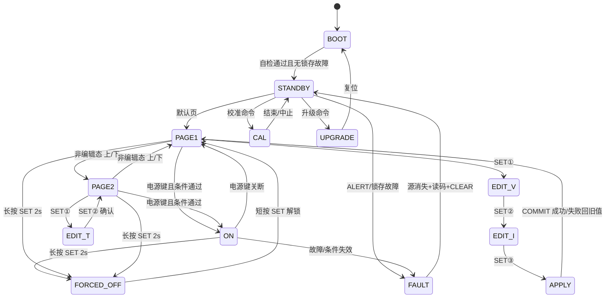
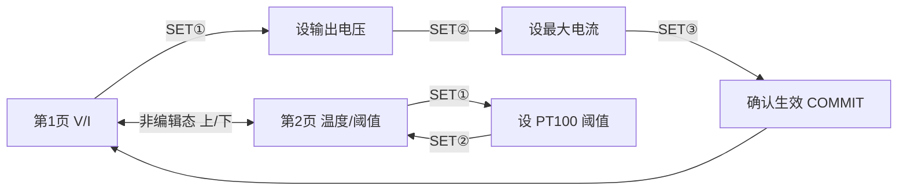
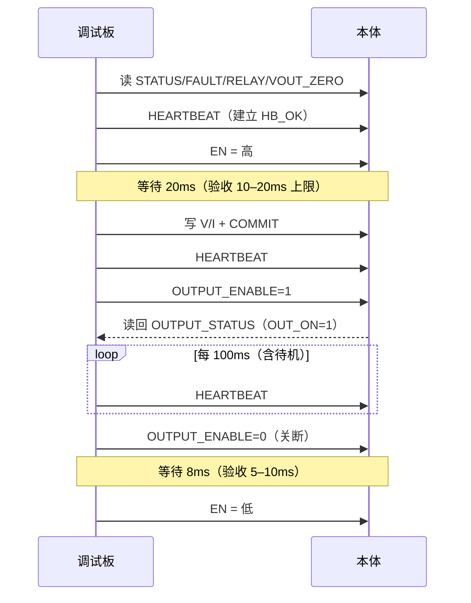

# 小型PSU电源 · 需求文件（唯一入口）

> 版本：v0.7｜更新时间：2026-11-18（+08:00）｜维护：T-0016（合并定版）/T-0007（系统级追加）/T-0009（调试板①）/T-0010（调试板②接口与结构）/T-0011（本体①电气与拓扑）
>
> 需求来源工单：T-0003（拆分前需求）、T-0004（第 1 部分：定位/功能/范围外）、T-0005（第 2 部分：针脚/寄存器/ALERT/校准）、T-0006（系统级时序）、T-0007（系统级：安全/指标/热/成本/待确认/参考对照）、T-0009（调试板：功能/按键/显示/主机侧使能/PT100）、T-0010（调试板：接口/结构/面板布局）、T-0011（跨单引用）、T-0012（第 2 部分抢救入库）、T-0013（一致性修订）、T-0016（合并为单文件并建立填写规则）。
>
> 合并说明：v0.3 由原 `.agent/requirements.md`（第 1 部分，v0.2，139 行）与 `.agent/requirements-part2.md`（第 2 部分，v0.2，337 行）合并。原第 2 部分文件已在 T-0016 删除，内容并入本文件第 2、3、5 章；逐节映射与删除原因见附录 D。历史版本可查 git 历史（T-0004/T-0005/T-0013）。
>
> 唯一入口：自 v0.3 起，需求只写本文件。`.agent/requirements-draft.md` 仅作历史追溯；任何新建的独立需求文档一律无效。
>
> 冲突处理：功能边界（第 1/3/4 章）与接口/寄存器（第 2/3 章）冲突时，以对应章节的定版文字为准；与 `.agent/requirements-draft.md` 不一致时以本文件为准。后续改需求走变更单，不在本文件直接改验收口径。

## 填写规则（后续所有工单必须遵守）

1. **报告必写落点**：每张后续工单的 done 报告必须写明「写入文件:章节」与章节范围（示例：`.agent/requirements.md:3.3.3`、`docs/interface.md:§2`）。禁止新建独立需求/设计文档；未写落点视为交付不完整。
2. **需求改动**：只改本文件对应章节，并在附录 C「变更记录」追加一行（日期/单号/改了什么）；不得另起文件，不得把需求复制到 `docs/`。
3. **设计展开**：设计细节只写 `docs/` 下 `architecture.md`、`module-design.md`、`interface.md`、`test-plan.md` 四份骨架的对应小节；需求与设计不得互相复制——需求只写“要什么”，设计只写“怎么做”。
4. **未成文不预造**：未完成章节写「待填（来源：T-00xx）」；待 owner 拍板的写「待确认（owner）」，不猜默认值。
5. **单一事实源**：需求以本文件为唯一入口；针脚/寄存器/ALERT/校准的数值细节在本文件对应章节，设计文档只引用章节号，不复制表格。

## 完成度表（章节 × 状态 × 负责单号）

> 状态只用三档：已定稿 / 待填写 / 待确认。文档地图见 `README.md` §7。

| 章节 | 状态 | 负责单号 |
|---|---|---|
| 第 1 章 定位与范围（1.1–1.7） | 已定稿 | T-0004（T-0013 修订） |
| 第 2 章 系统级：针脚/I2C/ALERT（2.1–2.3） | 已定稿 | T-0005（T-0013 修订） |
| 第 2 章 系统级：上电/掉电/使能/升级时序（2.4） | 已定稿 | T-0006（2026-11-18） |
| 第 2 章 系统级：安全/指标/热/成本/参考对照（2.5–2.10、2.12） | 已定稿 | T-0007（2026-11-18） |
| 第 2 章 系统级：待确认清单（2.11） | 待确认 | owner（默认值已给） |
| 第 3 章 电源本体：功能/寄存器/校准（3.1–3.4） | 已定稿 | T-0004、T-0005（T-0013 修订） |
| 第 3 章 电源本体：电气规格/拓扑/结构热设计（3.5） | 已定稿 | T-0011（2026-11-18）；owner 图/BOM 细节待实施单 |
| 第 4 章 电源调试板：功能（4.1） | 已定稿 | T-0004、T-0009（D-08～D-10 增补） |
| 第 4 章 电源调试板：按键/显示/使能时序（4.2） | 已定稿 | T-0009 |
| 第 4 章 电源调试板：接口与结构（4.4） | 已定稿 | T-0010（2026-11-18） |
| 第 4 章 电源调试板：待确认项（4.3） | 待确认 | owner（含 T-0009/T-0010 建议项） |
| 第 5 章 附录 C 变更记录 | 已定稿（后续只追加） | T-0016 |
| 第 5 章 附录 E 待确认清单 | 待确认 | owner |

---

# 1. 定位与范围

## 1.1 一句话定位

本项目是**数控可调直流电源（PSU, Programmable DC Power Supply）**：220VAC 市电输入，输出 0.5–48V / 0–5A，输出电压与电流由 I2C 设定，具备本地显示、按键、保护与状态回读。产品由**电源本体（P 类）**与**电源调试板（D 类）**两块板组成。

## 1.2 不是 UPS

- 不是 UPS（Uninterruptible Power Supply，不间断电源）；不含电池、不含逆变器、不做市电中断备份、不做双电源切换。
- 不承诺任何“不间断供电”“续航”“备电”能力；市电断开即无输出。
- 项目名中的“UPS”只存在于历史命名，不代表产品类型。

## 1.3 项目名与历史命名

- 现行项目名：**小型PSU电源**；项目名为历史命名，沿用旧仓库/工单，仅用于追溯。
- 仓库名 `small_UPS`、旧工单标题中的“小型 UPS”同样为历史命名。
- 后续文档、BOM、丝印、说明书、UI 一律使用“数控可调直流电源 / PSU”，不再用 UPS 表述产品。

## 1.4 系统构成

| 代号 | 名称 | 职责（功能级） |
|---|---|---|
| P | 电源本体 | 市电输入、隔离变换、输出调压/限流、输出使能与隔离、采样/保护/状态、I2C 从机、掉电保存、热替换所需能力（本版不实现多机均流） |
| D | 电源调试板 | 与本体金手指对接、本地显示与按键、设定 V/I、EN/软使能/心跳主机侧、ALERT 监视、PT100 温度采集 |
| 外部系统 | 系统级编排 | 热替换的系统级主控、机架、线束与更换流程（本版不实现多机并联均流）；不在本产品两板交付范围内 |

## 1.5 使用边界

- 由 220VAC 市电供电，内部存在高压；仅限受过电气安全培训的人员操作。
- 产品为室内使用；具体环境/安规/EMC/认证口径见 §2.5–§2.7，本章只定使用边界。
- 本体与调试板为竖立式，接插面 60（宽）×120（高）；必须按确认的方向与到位状态插合；不得在输出使能状态下插拔（热替换流程见 3.1 的 P-12）。

## 1.6 范围外

| ID | 范围外内容 | 说明 |
|---|---|---|
| O-01 | UPS、电池、逆变、备电、市电切换 | 不做不间断供电、不做电池管理、不做逆变输出、不做双电源切换；市电断开即无输出。 |
| O-02 | 无上位机：上位机软件、云平台、无线/网络通信、手机 App | 产品只提供本体 + 调试板；上位机/云/无线不在交付范围。 |
| O-03 | 硬件工程入库 | 硬件用立创EDA 维护于本地 `Hardware/`，原理图/PCB/工程/BOM/Gerber 一律不进 git；产品代码仓库只放固件，`.agent/` 仅放需求/流程文档。 |
| O-04 | 系统级热替换编排、机架、线束（本版不实现多机并联均流） | 本体只提供热替换所需能力；系统级主控、机架、线束与更换流程不在两板范围；SHARE/SYNC 仅预留。 |
| O-05 | 本文件不覆盖的详细设计 | 针脚表、I2C 寄存器表、按键/使能时序、指标与测法、机械/热设计、BOM/成本等由后续分单定稿后回写本文件；T-0007 已回写系统级安全/指标/机械热/成本（§2.5–§2.12），保护阈值待 T-0011、按键/显示待 T-0009/T-0010。 |

> “仓库只放固件”的准确含义：产品代码只放固件；`.agent/` 只放需求、看板、证据等工作流文件；硬件工程绝不入库。

## 1.7 编号与来源追溯

- `P-xx`：电源本体功能；`D-xx`：电源调试板功能。两条线只写“功能与验收要点”，不展开电路、针脚、寄存器地址或性能指标。
- “来源”列使用以下确认项代码；同一功能有多个来源时全部列出。

| 代码 | 确认来源 | 位置 |
|---|---|---|
| T4-1 | T-0004 验收第 1 条：定位 + 功能清单 + 范围外 | T-0004 工单文本 |
| T4-2 | T-0004 验收第 2 条：10 项必须覆盖的功能 | T-0004 工单文本 |
| T3-2 | T-0003 验收第 2 条：本体侧掉电保存（V/I 必存；原文允许含保护阈值；不含 PT100） | T-0003 验收 2 |
| T3-3 | T-0003 验收第 3 条：使能四条件、任一方否决 | T-0003 验收 3 |
| T3-4 | T-0003 验收第 4 条：EN 默认不使能、状态位 | T-0003 验收 4 |
| T3-8 | T-0003 验收第 8 条：测量链、校准系数存 EEPROM | T-0003 验收 8 |
| T3-11 | T-0003 验收第 11 条：风扇 FG 堵转告警与降额 | T-0003 验收 11 |
| T3-13 | T-0003 验收第 13 条：本体两级过温、PT100 走 Modbus | T-0003 验收 13 |
| T3-14 | T-0003 验收第 14 条：控制/采样/状态机/校准 | T-0003 验收 14 |
| T3-16 | T-0003 验收第 16 条：保护与输出隔离 | T-0003 验收 16 |
| D-P04 | 需求草稿 P-04：I2C 地址 0x30–0x3F、无广播 | `.agent/requirements-draft.md:13` |
| D-P07 | 需求草稿 P-07：本体 12V 待机供调试板 | `.agent/requirements-draft.md:16` |
| D-7 | 需求草稿第 7 节：范围外 | `.agent/requirements-draft.md:74-75` |

> 说明：T4-* 是 T-0004 的直接确认项；T3-* 是拆分前已确认、由 T-0004 承接的条目。若两者冲突，以 T4-* 为准并在变更单中记录。
>
> 说明：T-0005/T-0006/T-0007/T-0009/T-0010/T-0011 为后续变更单；本文件按其验收核对事实性冲突，只引用不改变验收口径。

# 2. 系统级

## 2.1 跨板 64 针金手指接口

### 2.1.1 机械与工艺基线

- 64 针 = A 面 32 + B 面 32，间距 2.54mm；PCB 1.6mm；金手指倒角 30°；硬金 ≥1µm。
- 接插面 60（宽）×120（高）竖面；本体竖立式（整机 60×120×180、PCB 立式 180×120，见 §2.7），调试板 60×120×35 贴前面。
- 金手指竖条偏左：中心距左约 15mm、宽 10–12mm、长 79mm；竖排由上到下 A1–A32 / B1–B32。上销 Ø5 距上边 10mm、下销 Ø8 距下边 20mm；右侧 4 位拨码（沉孔）。
- 不做防呆键位；代偿：A30–A32/B30–B32 GND 护边、功率/信号分区、短针、丝印方向、插反检测（信号针 >16V 立即断输出并报警）。
- 输出+ 20 针、输出− 20 针并联；单针按 ≥1A 设计，5A 总电流留裕量；接触电阻 ≤20mΩ/针。
- 短针铜箔比信号针短 3–5mm；短针最后啮合、最先断开。
- 金手指竖条约 79mm（插入承插腔，承插腔见 T-0010 第 2 条）；定位销前伸 15–18mm；插到底后前面板齐平。

### 2.1.2 针脚定义（A/B 各 32）

> 排布：竖立式，由上到下 A1–A32 / B1–B32；A/B 两面同序，1 在上、32 在下。

| 针位 | A 面 | B 面 | 方向（源→宿） | 用途 / 电平定义 |
|---|---|---|---|---|
| 1–10 | 输出+ | 输出+ | 本体→调试板/负载 | 功率输出正；0–48V，A/B 各 10 针并联，合计 5A |
| 11–20 | 输出− | 输出− | 负载→本体 | 功率回路返回；0V，A/B 各 10 针并联，与信号地单点连接 |
| 21 | 信号地 | 信号地 | 双向参考 | 0V 信号/采样参考；与功率地单点连接 |
| 22 | +12V 出 | +12V 回 | A：本体→调试板；B：调试板→本体继电器 | 12V±5%；A22 待机供电，B22 经短针构成继电器使能回路；两端各串 PTC |
| 23 | 短针 | 短针 | 12V 回路 | 短针，最后啮合/最先断开；与 B22 共同构成继电器使能回路，不在位则继电器不能吸合 |
| 24 | SDA | SCL | 双向 | I2C 数据/时钟；3.3V 开漏，4.7k 上拉，≤400kHz |
| 25 | ALERT | EN | A：本体→调试板；B：调试板→本体 | ALERT 低有效开漏；EN 3.3V 高有效，本体 10k 下拉，未驱动即不使能 |
| 26 | SENSE+ | SENSE− | 调试板/负载→本体 | 开尔文远端采样差分输入；0–48V，100Ω 串联 + TVS；不用时就近短接到输出端 |
| 27 | SHARE 预留 | SYNC 预留 | 双向（预留） | 3.3V 预留；本版不启用，悬空不接，不得驱动 |
| 28 | UART_TX | B28 备用 | A：本体→调试板 | 3.3V TTL 串口发送，空闲高，默认 115200 8N1；B28 保留不接 |
| 29 | UART_RX | B29 备用 | A：调试板→本体 | 3.3V TTL 串口接收，空闲高，默认 115200 8N1；B29 保留不接 |
| 30–32 | GND 护边 | GND 护边 | — | 0V 护边/插反检测参考；与信号地单点连接 |

> 计数核对：输出+ 20 + 输出− 20 + 信号地 2 + 12V 2 + 短针 2 + I2C 2 + ALERT/EN 2 + SENSE 2 + SHARE/SYNC 2 + UART 2 + 备用 2 + GND 护边 6 = 64 针。

### 2.1.3 每类针的用途与方向

- 功率针（1–20）：输出+ 由本体经调试板到负载，输出− 由负载回本体；A/B 双面并联降低接触电阻与电流密度；严禁输出+/−反接。
- 信号地（21）：只做信号参考，不承载功率电流；与输出− 在输出采样点单点连接，避免地环。
- 12V/短针（22/23）：A22 为本体待机 12V 供调试板；B22 为调试板回送本体继电器线圈的 12V，回路为 B22 → 继电器线圈 → A23/B23 短针 → 地。短针不在位 → 继电器不能吸合，输出不能使能。12V 两端各串自恢复保险（PTC）。
- I2C（24）：本体为从机，调试板为主机；3.3V 开漏；总线上 4.7k 上拉到 3.3V，全总线只保留一处（默认调试板/主机侧，本体侧预留但默认不贴；最终位置待 owner 确认，T-0012 D4）；总线电容 ≤400pF；100kHz 默认、400kHz 最大。
- ALERT/EN（25）：ALERT 仅通知，不参与保护；EN 为硬件使能门，低电平直接关断，不依赖 MCU/I2C。
- SENSE（26）：远端采样，差分；断线时本体回退本地采样并置故障；不使用时就近短接。
- SHARE/SYNC（27）：预留，本版不启用；不得接错或驱动。
- UART（28/29）：调试/服务口，3.3V TTL 非 RS-232；A28 本体发、A29 本体收；默认 115200 8N1；与 I2C 共用校准命令语义。
- 备用（B28/B29）：保留，不接；不得挪作其他用途。
- GND 护边（30–32）：插合时最先接触、最后断开，做插反检测参考；与信号地单点连接。

### 2.1.4 插拔与短针时序

- 插入方向：沿本体前后方向水平推入竖直接插面，不得斜插/旋转；拔出反向直拉。
- 不允许带电插拔（输出使能状态下）：先 I2C 关输出 → 等 RELAY_STATE=0 且 VOUT_ZERO=1 → 再拔。
- 插入：GND 护边先接触 → 信号/12V → 短针最后啮合；拔出相反。短针丢失立即释放继电器并置 SHORT_PIN_LOST。
- 插反检测：信号/低压针（21–29）任一脚 >16V 持续 >1ms → 硬件立即断 EN/继电器并置 REVERSE_INSERT；该保护不替代 ALERT。

## 2.2 I2C 电气与协议

### 2.2.1 电气

- 总线 3.3V；上拉 4.7kΩ 到 3.3V，全总线只装一处（默认调试板/主机侧；本体侧预留 4.7k 位置但默认不贴；最终位置待 owner 确认，T-0012 验收 3 登记 D4）；开漏；不接 5V，不做 5V 容忍。多机共线时禁止每台从机都并联上拉。
- 速率 ≤400kHz（100kHz 默认）；总线电容 ≤400pF（含针脚、连接器、线束）；串联 100Ω + ESD 保护。
- 7 位地址 0x30–0x3F（0x30 + 4 位拨码）；多机共线时地址必须唯一；不实现广播/General Call；只响应本机地址。
- 共地：调试板与本体通过信号地/输出− 单点共地；I2C 以该地为参考。
- 时钟拉伸 ≤10ms；主机连续拉低 SCL >25ms 视为总线异常，从机复位 I2C 状态机但不改变输出状态；总线死锁时主机发 9 个 SCL + STOP 恢复。

### 2.2.2 帧格式与数据编码

- 写：START + 地址+W + 寄存器地址 + 数据… + STOP；读：START + 地址+W + 寄存器地址 + Repeated START + 地址+R + 数据… + STOP。
- 寄存器地址自动递增；多字节小端（低字节在前）；有符号数为 16 位二进制补码；16 位占 addr、addr+1；32 位占 addr…addr+3。
- 保留寄存器读 0、写忽略；越界/只读写 NACK；多字节设定写影子寄存器，COMMIT=0x5A 后原子生效。
- 复位后所有输出关闭、软使能 0；V/I 设定从 EEPROM 恢复；校准表无效时用恒等映射，不改变设定值。

### 2.2.3 地址与多机

- 4 位拨码上电读取，运行中改变需重新上电；地址 0x30–0x3F；同一总线不得重复。
- 不支持广播；主机逐地址读写；多机 ALERT 共线，按 2.3.4 逐地址读取。
- 地址冲突表现为仲裁失败/读回异常；调试阶段逐台标记。

## 2.3 ALERT 规范

### 2.3.1 电气

- 引脚 A25；低有效开漏；调试板 10kΩ 上拉到 3.3V；本体仅 100Ω 串联 + ESD，不加上拉。
- 最大灌电流 10mA；耐压 ≥30V；ESD ≥±8kV 接触；未上电/故障机高阻，不得反向供电。
- 多机共线 wired-OR：任一机拉低即低。ALERT 只做通知，不替代保护；保护由硬件比较器/定时器 + 继电器/MOS 门独立完成。

### 2.3.2 锁存与释放

- 任一锁存故障（FAULT_FLAGS.LATCHED=1）→ ALERT 拉低。
- 主机必须先读 FAULT_CODE + FAULT_FLAGS（置“已读码”），再写 CLEAR=0xA5；仅当源消失且满足清除条件时清位。
- 未读码写 CLEAR 无效；源仍在写 CLEAR 无效；ALERT 保持低并再次触发。
- 全部锁存位清完且无实时故障 → 释放；释放时间 ≤1ms（条件满足后）；故障消失但未读码/CLEAR，ALERT 仍保持。
- 上电自检期间 ALERT 可短暂低；自检通过且无故障后释放，主机应忽略 <10ms 的上电毛刺（或等 10ms 再读）。

### 2.3.3 关键故障硬件直拉

- 以下故障不经 MCU GPIO，由硬件锁存/比较器直接拉低 ALERT 并同时关断输出：OVP、OCP/SCP、OTP、REVERSE_CURRENT、HEARTBEAT_LOST、SHORT_PIN_LOST。
- MCU 只负责锁存/上报/清位；MCU 死机不影响上述拉低与关断。
- EN_LOST 由 EN 信号本身直接关门（EN 低 → 驱动门低），不依赖 MCU；ALERT 由硬件状态机置位。
- 硬件直拉与软件置位为线与关系；软件不得单独释放硬件锁存，必须源消失 + CLEAR。

### 2.3.4 多机共线按地址逐读

- 主机在 ALERT 下降沿后，按 0x30–0x3F 逐地址读 FAULT_FLAGS；仅非零地址处理；不得广播。
- 每台读码后按各自条件 CLEAR；全部故障机清完，线才释放。
- 若所有地址均无故障而 ALERT 仍低：查总线/上拉/某机硬件锁存或短路，不得强行拉高。
- 地址唯一（0x30–0x3F）；冲突时先解决地址再谈 ALERT。

### 2.3.5 时序

- 硬件关键故障：硬件比较器/定时器触发 → 输出关断 ≤10µs；同一触发 → ALERT 拉低 ≤10µs（硬件锁存）。OVP 的 50µs 是确认窗口，不是 ALERT 延迟。
- 软件检测故障：检测到 → ALERT 拉低 ≤1ms。
- 读码 → CLEAR → 释放 ≤1ms（源已消失）；若源仍在，保持并置位。
- ALERT 不得作为唯一保护或唯一关断路径。

## 2.4 上电/掉电/使能/升级时序（定版）

> 本节由 T-0006 填写，只定系统级时序与动作；ALERT 电气/锁存见 §2.3，寄存器语义见 §3.3，校准见 §3.4。设计展开见 `docs/architecture.md` §5、`docs/interface.md` §3/§4、`docs/module-design.md` §1.6–§1.8。

### 2.4.1 上电、自检与掉电

- 上电顺序固定：辅助电源 → MCU 自检 → PFC 建 400V → LLC 建 55V → READY。任一步失败即停在安全态（输出级关断、继电器断开、ALERT 按 §2.3 上报），不得跳步使能。
- 异常分支：辅助电源超窗 → 不驱动 I2C/ALERT、不使能；MCU 自检失败 → INTERNAL 锁存、禁输出；PFC 母线 <320V → PFC_FAULT 锁存、禁输出；55V 母线 <50V → UNDERVOLTAGE（0x04）锁存、禁 buck；AC <180VAC → POWER_LOST（欠压）；AC <150VAC 或丢失 → POWER_LOST（掉电）。均不自动重试、不自动输出。
- READY 前 I2C 只读状态，写 OUTPUT_ENABLE 被忽略；READY 后才接受使能命令。上电默认 OUTPUT_ENABLE=0、继电器断开、PWM 关断；EEPROM 只恢复 V/I 设定，不恢复输出状态。
- 关断/掉电顺序：先禁 buck，再释放继电器；输出电容经反灌比较器（>0.2A、10µs）与理想二极管/ORing 阻断向 55V 母线倒灌；输出针不得高于 55V 母线。掉电后不再写 EEPROM。
- 去抖窗口由设计定；欠压确认不得短于 1 个工频周期，掉电可更快，但不得把已确认的掉电/欠压再放行输出。

### 2.4.2 使能、心跳与热调

- 使能链：OUTPUT_ENABLE 写 1 仅当 EN 高、I2C 软使能、短针在位、无锁存故障、心跳 <500ms、设定已 COMMIT、校准有效/恒等同时成立；任一项失效即关断并清软使能（单票否决）。EN 高有效、本体 10k 下拉；EN 由低变高需稳定 10–50ms 才参与使能，由高变低立即关门（≤1ms），低电平持续 20ms 去抖后锁存 EN_LOST。
- 开启：DAC/限流先置 0 → 吸合继电器（≤50ms 确认）→ buck 软启动 → OUT_ON。关断：禁 buck → 释放继电器（命令到释放 ≤50ms）→ 针侧泄放，100ms 内 VOUT_ZERO=1 → OUT_ON=0；100ms 后仍 >1V 置 VOUT_NOT_ZERO。
- 心跳：主机 100ms/次写 HEARTBEAT；500ms 未更新 → 关断并锁存 HEARTBEAT_LOST；心跳恢复后不自动输出，需重新使能。
- 热调：输出 ON 时允许实时改 V/I 设定。电压按 5–20V/s（默认 10V/s）软变化；电流限流在 100ms 内平滑过渡；OVP 阈值随 ramp 设定 +2V 跟踪（绝对 50V 不变）；不得产生输出冲击或误触发 OVP/OCP/UNDERVOLTAGE；进入故障按 §2.3/§3.3 锁存。
- 热调期间使能链仍逐周期检查；任一条失效立即走关断序列，不等待 ramp 完成。状态机见 `docs/interface.md` §3.4。

### 2.4.3 固件升级（Bootloader/IAP）

- 通道：金手指 UART A28/A29，3.3V TTL，115200 8N1；调试板 USB-UART 与本体 UART 字节流直通，不解析、不改写、不因版本拒绝。任何版本组合（调试板/本体）均可升级对方与自身；版本寄存器仅显示/记录，不作门禁。
- 独立 bootloader 16–24KB，仅 SWD 首烧，不随应用升级擦除；应用单区 + 镜像 CRC。上电先校验应用 CRC：有效且未收到升级请求则跳应用；CRC 失败或收到请求则停在 bootloader 等重传。
- 升级期间 EN 硬件拉低、继电器断开、PFC/LLC 输出级停止、buck 禁用；帧格式/状态机/失败恢复见 `docs/interface.md` §4。
- 升级中断（掉电/超时/CRC 错/帧错）不得跳转到无效应用；停在 bootloader，可重传；bootloader 自身不被应用区写操作覆盖。

### 2.4.4 保护动作、耐受与恢复

- 过流/短路/过压/过温/反灌/欠压/心跳丢失/短针丢失等触发后：≤10µs（硬件）或 ≤1ms（软件）切断输出并锁存；不自动重试、不自动重合闸。
- 恢复：源消失 + 已读 FAULT_CODE/FAULT_FLAGS + 写 CLEAR=0xA5 + 重新使能；CLEAR 同时清软使能，输出保持 OFF。清除语义见 §2.3.2、§3.3.5。
- 损坏边界：输出短接 5s、1.2 倍额定（6A）1min 均不得损坏；保护允许先动作，恢复后须人工重新使能。
- 本版不实现多机并联均流；SHARE/SYNC 仅预留不驱动，PARALLEL_MODE/CURRENT_SHARE_EN 读 0/写忽略（§3.1 P-11）。系统级热替换编排、机架、线束范围外（见 §1.6 O-04），本文件只保留本体能力（§3.1 P-12）。

## 2.5 引用标准与合规基线（定版）

系统定位沿用 §1.1：220VAC 输入、0.5–48V/5A 数控可调直流电源（非 UPS），由电源本体 P 与调试板 D 两板组成；本节只定跨板系统级标准、限值与裕量，不替代 T-0011 的电路设计。

| 领域 | 标准（版本） | 引用条款 | 本项目采用值/口径 |
|---|---|---|---|
| 产品安全 | IEC 62368-1:2018（GB 4943.1-2022 等同采用） | §5.4.2（电气间隙）、§5.4.3（爬电距离）、§5.4.4（固体绝缘）、§5.4.9（电气强度）、§5.6.6.3（接地阻抗）、§9/表 38（接触温度）、§6（防火）、附录 G（表 G.1–G.10） | 可触及金属 ≤55℃ 目标；间隙 ≥6mm、爬电 ≥8mm、耐压 1500VAC/1min、绝缘 ≥10MΩ@500V、PE ≤0.1Ω；污染度 2、海拔 ≤2000m |
| EMC 发射 | EN 55032:2015+A11:2020 / GB 9254.1-2021 Class B | 附录 A（Class B 限值） | 传导 150kHz–30MHz、辐射 30MHz–1GHz；设计留 ≥6dB 裕量 |
| ESD | IEC 61000-4-2:2008 | §5、表 1 | 接触 ±4kV、空气 ±8kV；性能判据 B |
| EFT | IEC 61000-4-4:2012 | §5、表 1 | AC 端口 ±2kV、5/50ns、5kHz；判据 B |
| 浪涌 | IEC 61000-4-5:2014+A1:2017 | §5、表 1 | AC 线-线 ±1kV、线-地 ±2kV、1.2/50µs；判据 B |
| 谐波 | IEC 61000-3-2:2018+A1:2020 Class D | §7、表 3 | 240W≤600W 适用 Class D；PFC 设计 PF ≥0.98、THD ≤10% 典型 |
| 输入电压 | IEC 60038:2009 / GB 156-2017 | IEC 60038 §3、表 1；GB 156 表 1 | 220V±10%（198–242VAC）；试验放宽 176–264VAC |
| 环境试验 | IEC 60068-2-1:2007 / -2-2:2007 / -2-78:2012 | 试验 Ab / Bb / Cab | 工作 0–40℃、储存 −20–+70℃、≤80% RH 不凝露、海拔 ≤2000m |

- 认证口径：安全按 IEC 62368-1（GB 4943.1）、EMC 按 EN 55032 Class B + IEC 61000-4-2/4/5 + IEC 61000-3-2 Class D；本版先做设计符合性，认证由后续安规单执行，未认证前说明书不得印认证标志。
- EMC 设计措施（EMI 滤波、Y 电容、共模电感、屏蔽/接地）由 T-0011 展开；本节只定标准、限值与 ≥6dB 设计裕量。

## 2.6 环境与安规（定版）

- 使用环境：室内、0–40℃、≤80% RH 不凝露、海拔 ≤2000m、污染度 2；储存 −20–+70℃。40℃ 为满载连续工作上限，超过 40℃ 降额（曲线由 T-0011 给）。
- 可触及金属外壳表面目标 ≤55℃（40℃ 环境、满载热平衡）；>55℃ 部位按 IEC 62368-1 §9/表 38 加警示标识并说明不可持续接触；出风口/散热片等非预期接触部位按标准限值单独评估。
- 绝缘：一次—二次、一次—PE 按 IEC 62368-1 §5.4.2/§5.4.3/§5.4.4、§5.4.9 与附录 G、污染度 2 设计；间隙 ≥6mm、爬电 ≥8mm、耐压 1500VAC/1min、绝缘电阻 ≥10MΩ@500V；PE 连续性 ≤0.1Ω（25A 试验电流，§5.6.6.3/表 32、G.7）。
- 耐压 1500VAC/1min 按工单定版值执行；若认证机构按加强绝缘判定需更高试验电压，由 T-0017 出具安规结论并走变更单，不在本单自行改值。
- 220V 侧：L/N 经双极船型开关（同时断开）与保险丝（L 线串联，典型 2A/250VAC 延时型，按 198VAC/240W/0.88 效率计算；分断能力按预期短路电流选型，最终由 T-0011 复核）、压敏/放电器与 X/Y 电容。
- 使能链路 fail-safe：EN 高有效、本体 10k 下拉，EN 未驱动/断线即不使能；EN 低直接关门，不依赖 MCU/I2C；任一故障清软使能并释放继电器（详见 §2.4.2/§3.3.6）。
- 输出为 SELV（≤48V），但与市电侧仍按隔离/爬电要求处理；输出端反灌、容性负载与短路按 §2.8 执行。
- 安全声明：本产品无急停/紧急切断装置，断电只能通过船型开关或拔插头；仅限受过电气安全培训人员使用，不得用于医疗、生命支持或其他失效即危险的负载；说明书必须原文写明。
- USB 指调试板 USB-UART 升级口（§2.4.3），本体无板载 USB；出厂测试按此执行。

## 2.7 整机方位、尺寸与机械基线（定版）

- 方位：竖立式；本体 60（宽）×120（高）×180（深，壳体，前伸不计入）；调试板 60×120×35，贴本体前面；整机总深 = 180+35 = 215mm（壳体；定位销 15–18mm 进入调试板承插腔，不叠加）；含香蕉头/按键正面凸出 ≤18mm 时最大包络 ≤233mm，不含线缆/插头。
- 投影：前/后 60×120；顶/底 180×60；左/右 180×120。顶/底不开窗；后板 60×60 风扇；左/右 180×120 鳍片窗（见 §2.9）。
- 重量：整机（本体+调试板+外壳，不含线材/包装）≤1.2kg。
- 插合面、定位销、拨码与金手指方位沿用 §2.1.1；本表只定整机外廓，不替代结构图。

## 2.8 性能指标与验收口径（定版）

> 判据前提：23±5℃、预热 15min、6 点校准有效（0.5/3.3/5/12/24/48V）、远端采样；满载=5A（不超过 240W），半载=2.5A。精度=（实测−设定）/设定×100%。

| 电压段 | 负载 | 设定精度（最大值） | 备注 |
|---|---|---|---|
| 0.5–10V | ≤1A | ≤0.1% | 轻载档 |
| 0.5–10V | 满载 5A | ≤0.3% | 满载档 |
| 10–24V | 满载 5A | ≤0.2% | 半载按本档判 |
| 24–48V | 满载 5A | ≤0.1% | 半载按本档判；24V 取较严档 0.1% |
| 全范围 | 未校准 | ±0.4% | 仅恒等映射；不宣称 6 点指标 |

- 分辨率/步进：对外 0.01V/0.01A；寄存器 LSB 1mV/1mA 仅为内部编码（§3.3.6），不得把 1mV 当 UI 步进。
- 负载调整率：同一设定点 10%→100% 负载，Vout 变化按本档精度限值判；不另设自定义限值。
- 动态：10%↔100% 阶跃，过冲/跌落 ≤1% 设定值，恢复 ≤500µs；电子负载快沿（记录实际斜率），20MHz 带宽测量。参考 RT300 ±200mV/200µs；本机按 1%/500µs 判，不以参考值替代。
- 容性负载：≤min(1000µF, 1000µF/A×设定电流)；满载 5A 时 1000µF。测试：输出 OFF→接电容→ON，电压过冲 ≤1%、无 OCP/OVP 误报；再叠加 10%→100% 阶跃。
- 纹波：输出 ≤50mVpp 必达、≤30mVpp 目标（20MHz BW、弹簧地环、满载与半载、6 点）；55V 母线 ≤100mVpp 设计、≤150mVpp 验收（20MHz BW，差分/同轴）。
- 效率：整机（220VAC 入—输出）热态 240W（48V/5A）≥88% 验收、≥90% 目标；不含 AC 线损与调试板自身耗电（测量时扣除/外供，方法见 test-plan §3）。空载 <1.5W（220VAC，输出 OFF，PFC 停振/跳周期）。
- 保护阈值（OCP/SCP/OVP/OTP/母线欠压）沿用 §3.3.3 与 T-0011 最终值；本节不重复。

## 2.9 风道、散热、噪音与重量（定版）

- 风道：后板 60×60×25 风扇（12V、带 FG）向内吹，正压；进风口贴防尘棉（可拆洗）；左/右 180×120 侧面鳍片窗排风，鳍片朝下；顶/底不开窗。单侧有效开窗面积 ≥1.5×风扇有效面积（60×60 扣轮毂约 29cm² → 单侧 ≥44cm²）。
- 风扇曲线：50/75℃（≤50℃ 低速、不得停转，具体占空比由 T-0011 定；≥75℃ 全速），50–75℃ 线性；回差 5℃；FG 堵转 >2s → FAN_STALL，限流降额并按 §3.3.3 处理。
- 热：40℃ 环境、满载 240W 连续 30min，内部环境/关键器件壳温（变压器/整流 MOS/电感/采样电阻）≤70℃；可触及外壳 ≤55℃；不得有器件超自身降额温度。测点与热电偶布置见 test-plan §6。
- 噪音：风扇全速、满载热平衡、1m、A 计权、自由场，≤35dB(A)；背景 ≤20dB(A)。按 1m 自由场声压级测量，声级计符合 GB/T 3785.1 2 级。
- 重量：≤1.2kg（同 §2.7）。

## 2.10 生产、追溯与成本（定版）

- EEPROM 生产信息区（独立于设定区/校准区）：SN（≤16 ASCII，默认 PSU-YYMMDD-NNNN）、生产日期（YYYYMMDD 或等效 2 字节，编码由 T-0010 定）、6 点电压+3 点电流校准次数与最近校准日期、硬件版本；掉电保存，上电可读。
- 校准日期/生产日期字段需在 §3.4.3 双区表扩展；本单只定数据项，不改变点表/CRC 语义，布局由 T-0010 定。
- 追溯：每台 SN 对应 CSV 记录（SN/生产日期/PCB rev/硬件版本/校准日期/6V+3I 点/结果/操作员），随批次留档；PCB 丝印 Rev 与 BOM/装配记录一致；校准周期建议 1 年，到期提示复校。
- 成本：小批 100 套 ≤600 元/套（上限 700）；打样 1,500–2,000 元/套；BOM 两栏（本体 P / 调试板 D）分别列物料、数量、小批单价与合计；成本口径含 PCB/物料/贴装/结构件/风扇/线材/测试工时，不含研发摊销、认证、包装、运费。
- 降本不得降低 §2.5–§2.9 的安全/EMC/热/精度判据；任何降本变更走变更单并回写 BOM。

## 2.11 系统级待确认清单（owner）

> 每项给默认值，标「待 owner 确认」；未确认前按默认值执行，确认后走变更单回写。

| # | 事项 | 默认值 | 状态 |
|---|---|---|---|
| 1 | 插槽型号 | 64P、2.54mm、双面接触、1.6mm 板厚卡边插槽（接触电阻 ≤20mΩ）；首样用通用 64P 卡边插槽，不锁定品牌 | 待 owner 确认 |
| 2 | 序列号规则 | PSU-YYMMDD-NNNN（15 ASCII，≤16 字节），按生产日期+4 位流水 | 待 owner 确认 |
| 3 | 是否加蜂鸣器 | 不加；故障靠显示 + ALERT，降本降噪 | 待 owner 确认 |
| 4 | PT100 模块型号 | 通用 Modbus RTU 模块（RS-485、9600/8N1、FC03、地址 1、−50–200℃、±0.5℃），首样用 MAX31865 方案 | 待 owner 确认 |
| 5 | 附送线材/保修 | 附 1.5m AC 线 + 1 套输出测试线；保修 12 个月（非人为损坏） | 待 owner 确认 |
| 6 | 包装与丝印（后置） | 后置；丝印含型号/输入输出/警示语，认证标志位预留，白底黑字 | 待 owner 确认 |

## 2.12 参考设计对照（定版）

> 对照样本：RT300-MKV（250–300W 级，DC 10–30V 入、0–50V/0–10A、升降压，来源 PCBWay 项目页）与 1000W 级可调电源（DP6020 1200W 开源板，DC 12–70V 入、0–60V/20A、非隔离降压）。若 owner 指定其他 1000W 机型，按同表替换，不改判据。

| 维度 | RT300-MKV | 1000W 级（DP6020） |
|---|---|---|
| 拓扑/输入 | 不适用：DC 输入升降压，无 PFC/隔离；同步整流混合级可借鉴 | 不适用：非隔离降压，无 PFC/隔离；大功率同步整流布局可借鉴 |
| 功率/输出 | 需改造：250–300W/50V/10A → 240W/48V/5A，降额与散热重做 | 需改造：1200W/60V/20A → 240W/48V/5A，热裕量可借鉴 |
| 控制/显示 | 可借鉴：数字环、AUTO CAL、2.8" IPS；需改造：去 RTOS/彩屏以降本 | 可借鉴：EG1163S 模拟环简洁；需改造：加 MCU 设定/回读/保护 |
| 测量/校准 | 可借鉴：高边采样、Σ-Δ ADC、全范围校准；需改造：6 点表 + EEPROM 追溯 | 可借鉴：四线锰铜采样；需改造：0.5% 精度不足，加校准与低温漂 |
| 动态/纹波 | 可借鉴：前馈+混合电容，48mVpp@24V/3A；需改造：500µs/50mVpp 全范围 | 不适用/需改造：纹波 >1%、动态跌落 0.8%（恢复时间未标），需加 LC/前馈 |
| 保护/安规 | 可借鉴：OVP/OCP/OPP/SCP、防反接、防倒灌；需改造：EN 链/隔离/安规 | 可借鉴：热插拔浪涌、风扇温控；不适用：无防倒灌，不能直充电池 |
| 热/结构 | 可借鉴：型材/风道；需改造：60×120×180 竖插、后吹侧排 | 可借鉴：TO-220 散热、风扇曲线；需改造：40mm 风扇改 60mm 降噪 |
| 成本/可制造 | 可借鉴：模块化；不适用：CNC 外壳成本高 | 可借鉴：开源 BOM/单板；需改造：加 PFC/LLC/外壳，成本上升 |

- 结论：两套参考均不能直接照搬；可借鉴数字控制、校准、高边/四线采样、同步整流与热布局，必须改造为 220VAC 隔离 + PFC + LLC + 同步 buck，并补 EN 链、安规与追溯。
- 资料：RT300-MKV 项目页 https://www.pcbway.com/project/sponsor/RT300_MKV_250W_CNC_Buck_Boost_Converter_5d69d0ef.html；DP6020 1200W https://oshwhub.com/stm32eda/shuo-kong-ke-diao-dian-yuan-60v-20a-1200w-dp6020-dian-yuan-ban 。

# 3. 电源本体

## 3.1 本体功能清单（P 类）

| ID | 功能 | 验收要点（功能级） | 来源 |
|---|---|---|---|
| P-01 | 市电输入与隔离变换 | 本体独立完成 220VAC 输入、主动 PFC、隔离变换与输出调压；调试板只负责人机与主机侧使能，不承担功率变换。PF ≥0.98、效率 ≥88%/目标 ≥90%、空载 <1.5W 等电气指标见 §2.8（T-0011 负责实现与曲线）。 | T4-1、T-0011 |
| P-02 | 输出电压设定与保证范围 | 设定范围 0.00–48.00V；**保证指标范围 0.5–48V**。低于 0.5V 可设定/可输出，但不保证精度、纹波、负载调整率等指标，界面与说明书必须提示；原因见 3.2。 | T4-2 |
| P-03 | 输出电流设定 | 电流限值 0–5A 连续可设；与电压设定共同构成工作点。 | T4-2 |
| P-04 | 输出使能链（EN） | 输出使能 = EN 高 **AND** I2C 软使能 **AND** 短针在位（12V）**AND** 无故障；四条同时成立才允许开启，开启需重新下发命令；任一条不成立即关断（单票否决）。EN 未驱动时默认不使能（fail-safe）。 | T3-3、T3-4 |
| P-05 | I2C 从机与地址 | 从机地址 0x30–0x3F，由本体拨码设定；不实现广播/通用广播；只响应本机地址。 | T4-2、D-P04 |
| P-06 | 设定掉电保存 | 本体 EEPROM 只保存输出电压与最大电流设定（可含过流/过压阈值）；**不保存 PT100 阈值**（属调试板侧）。断电重启或更换调试板后恢复本机 V/I 设定。 | T3-2 |
| P-07 | ALERT 中断 | 本体检测到故障/告警时通过 ALERT 线通知调试板；故障锁存，调试板读故障码并执行 CLEAR 后释放；状态变化可复查。 | T4-2、T3-4 |
| P-08 | 保护集合 | 至少覆盖：过压、欠压、过流、短路、过温、输出倒灌、EN 丢失、心跳丢失、短针丢失、继电器粘连；保护动作后进入确定的安全状态。 | T3-16 |
| P-09 | 本体过温两级 | 本体 NTC 温度监测分两级：一级告警并限流/降额，输出可继续；二级关断输出并锁存，不自动恢复。传感器断线/短路可识别；读不到温度时禁输出并报“电源故障”。 | T3-13 |
| P-10 | 风扇监控 | 风扇转速反馈（FG）监测；堵转/无反馈时告警并按降额策略限流，避免无风散热下继续满载。风道见 §2.9（T-0011 负责结构与热仿真）；本文件只定监控功能。 | T3-11、T-0011 |
| P-11 | 并联均流（本版不实现） | 本版不实现多台本体并联均流；SHARE/SYNC 针仅预留、不启用，PARALLEL_MODE/CURRENT_SHARE_EN 保留不实现；单机独立运行，不使用广播。热替换能力见 P-12。 | T-0006 验收 1（取代 T4-2 均流项） |
| P-12 | 热替换支持 | 本体提供热替换所需能力：插入后默认不使能；可软件关断并确认输出已隔离、无危险残压；状态可读后再允许拔出。输出使能状态下禁止插拔；更换流程由系统级编排执行。 | T4-2、T3-16 |
| P-13 | 测量、回读与校准 | 采样输出电压/电流用于显示与保护；校准系数存本体 EEPROM，上电可恢复；支持 6 点电压（0.5/3.3/5/12/24/48V）+ 3 点电流（1/2.5/5A）校准流程，EEPROM 含 CRC/版本/次数/温度。 | T3-8、T3-14、T-0005 #4、T-0007 #5 |
| P-14 | 调试板辅助供电 | 本体提供 12V 辅助电源给调试板；输出关断时辅助电源仍工作，保证显示、按键、I2C 通信可用。 | D-P07 |

## 3.2 为什么 0.5V 以下不保证指标

- 后级为同步 buck 调压：设定电压越低，占空比越小；到 0.5V 附近已接近控制器最小可控脉宽、栅极驱动与电流采样消隐窗口的极限。
- 低于 0.5V 时控制环进入跳周期/脉冲省略，输出纹波、负载调整率、设定精度不再可控，继续标称“全指标”会误导使用。
- 因此产品口径定为：**设定 0–48V；保证 0.5–48V；0–0.5V 可输出但不保证指标**。该边界是设计取舍，不是缺陷；界面、说明书、测试报告都必须原文提示。
- 不得用“设定分辨率高”推导“全量程高精度”；两者是不同概念。精度矩阵（0.5–10V 轻载 ≤0.1%、0.5–10V 满载 ≤0.3%、10–24V 满载 ≤0.2%、24–48V 满载 ≤0.1%、未校准 ±0.4%）、步进 0.01V/0.01A 与纹波判据见 §2.8；本节只解释 0.5V 保证边界。

## 3.3 I2C 寄存器表（初稿）

> 初稿说明：地址/位定义在本表冻结前可经变更单调整；固件、上位机、调试板均以本表为准。未列地址保留，读 0、写忽略。

### 3.3.1 寄存器映射

| 地址 | 名称 | R/W | 宽度 | 单位/LSB | 复位 | 说明 |
|---|---|---|---|---|---|---|
| 0x00–0x01 | PROTOCOL_VERSION | R | 16 | — | 0x0100 | 协议版本 v1.0，高字节主/低字节次 |
| 0x02–0x03 | FW_VERSION | R | 16 | — | 0x0100 | 固件版本，高字节主/低字节次 |
| 0x04–0x05 | DEVICE_ID | R | 16 | — | 0x5053 | 固定标识值 0x5053 |
| 0x06–0x07 | OUTPUT_STATUS | R | 16 | bitfield | 0x0000 | 输出状态，见 3.3.2 |
| 0x08 | FAULT_CODE | R | 8 | 码 | 0x00 | 最高优先级故障码，见 3.3.3 |
| 0x09–0x0C | FAULT_FLAGS | R | 32 | bitfield | 0x00000000 | 锁存故障位 + 汇总，见 3.3.4 |
| 0x0D | CLEAR | W | 8 | — | — | 写 0xA5；须先读码，见 3.3.5 |
| 0x0E | RELAY_STATE | R | 8 | 枚举 | 0x00 | 0=断开，1=闭合，2=未知（辅助触点） |
| 0x0F | VOUT_ZERO | R | 8 | 布尔 | 0x01 | 1=输出针 ≤1V；是否可拔出还需 RELAY_STATE=0 且 OUT_ON=0 |
| 0x10–0x11 | VOUT_SET_COARSE | R/W | 16 | 1mV | 0x0000 | 0–48000（0–48.000V）；影子 |
| 0x12–0x13 | VOUT_FINE_TRIM | R/W | 16 有符号 | 1mV | 0x0000 | −50…+50mV；与粗设定相加 |
| 0x14–0x15 | I_MAX_SET | R/W | 16 | 1mA | 0x0000 | 0–5000mA；影子 |
| 0x16 | OUTPUT_ENABLE | R/W | 8 | 布尔 | 0x00 | 软使能；写 1 需四条件及 3.3.6 前置，见 3.3.6 |
| 0x17 | 保留 | — | 8 | — | 0 | 写 0 |
| 0x18–0x19 | VOUT_MEAS | R | 16 | 1mV | — | 实测输出电压 |
| 0x1A–0x1B | IOUT_MEAS | R | 16 | 0.1mA | — | 实测输出电流，分辨率 ≤1mA |
| 0x1C–0x1D | TEMP_INTERNAL | R | 16 有符号 | 0.1°C | — | 内部温度 |
| 0x1E | HEARTBEAT | W | 8 | — | — | 任意写；100ms/次；500ms 超时；读 0 |
| 0x1F | 保留（原 PARALLEL_MODE） | — | 8 | — | 0 | 本版不实现多机均流；读 0、写忽略（T-0006 验收 1） |
| 0x20 | 保留（原 CURRENT_SHARE_EN） | — | 8 | — | 0 | 本版不实现均流；读 0、写忽略（T-0006 验收 1） |
| 0x21 | 保留 | — | 8 | — | 0 | 写 0 |
| 0x22 | CAL_CTRL | W | 8 | 命令 | — | 0x01 开始 V，0x02 开始 I，0x03 写入点，0x04 COMMIT，0x05 中止，0x06 恢复恒等 |
| 0x23 | CAL_INDEX | W | 8 | V:0–5 / I:0–2 | — | 校准点序号（V 6 点、I 3 点） |
| 0x24–0x25 | CAL_SET_POINT | W | 16 | V:1mV / I:0.1mA | — | 该点设定值 |
| 0x26–0x27 | CAL_MEAS_POINT | W | 16 | 同 0x24 | — | 该点实测值 |
| 0x28–0x29 | CAL_CHECKSUM | R/W | 16 | CRC16 | 0xFFFF | 6 点电压 / 3 点电流表校验和 |
| 0x2A–0x2B | CAL_VERSION | R/W | 16 | 版本 | 0x0000 | 校准表版本；COMMIT 后生效 |
| 0x2C | CAL_STATUS | R | 8 | 枚举 | 0x00 | 0=idle，1=busy，2=ok，3=CRC 错，4=版本错，5=点错，6=未校准，7=条件不满足 |
| 0x2D | CAL_ACTIVE | R | 8 | 布尔 | 0x00 | 0=恒等映射，1=已校准 |
| 0x2E | 保留 | — | 8 | — | 0 | 写 0 |
| 0x2F | COMMIT | W | 8 | — | — | 写 0x5A 原子应用 V/I 设定 |
| 0x30–0x3F | 保留 | — | — | — | 0 | 读 0、写忽略；留给后续扩展（寄存器地址，与 7 位从机地址无关） |

### 3.3.2 OUTPUT_STATUS 位定义

| 位 | 名称 | 含义 |
|---|---|---|
| 0 | OUT_ON | 实际输出已开启（继电器闭 + 功率级工作） |
| 1 | EN_PIN | B25 EN 为高 |
| 2 | SHORT_PIN | 12V 短针回路在位 |
| 3 | HEARTBEAT_OK | 距上次心跳 <500ms |
| 4 | FAULT_ACTIVE | 存在实时故障（FAULT_FLAGS.bit30=1） |
| 5 | RELAY_CLOSED | 继电器辅助触点闭合 |
| 6 | CV | 恒压模式 |
| 7 | CC | 恒流模式 |
| 8 | SETTING_DIRTY | 影子设定未 COMMIT |
| 9 | CAL_ACTIVE | 校准表已加载 |
| 10 | 保留 | 原 PARALLEL_MASTER；本版不实现均流，读 0 |
| 11 | 保留 | 原 PARALLEL_SLAVE；本版不实现均流，读 0 |
| 12 | 保留 | 原 SHARE_ACTIVE；本版不实现均流，读 0 |
| 13 | VOUT_ZERO | 输出 ≤1V |
| 14–15 | 保留 | 读 0 |

### 3.3.3 FAULT_CODE（8 位，取最高优先级）

> 下表触发阈值只用于定义故障语义，最终数值由保护/硬件分单确认；本表不构成性能指标。

| 码 | 名称 | 触发/动作 | 清除条件 |
|---|---|---|---|
| 0x00 | NONE | 无 | — |
| 0x01 | OCP | 电流 > 设定限值 +5% 或硬件阈值，>10µs；硬件断输出 | 故障消失 + CLEAR |
| 0x02 | SCP | 电流 >8A，或 Vout<0.3V 且 I>6A，>10µs；硬件断输出 | 故障消失 + CLEAR |
| 0x03 | OVP | Vout > 设定值 +2V 或 >50V，>50µs；断输出 | 故障消失 + CLEAR |
| 0x04 | UNDERVOLTAGE | Vout <90% 设定 >100ms（非 CC），或 55V 母线 <50V；断输出 | 恢复 + CLEAR |
| 0x05 | OTP | NTC ≥95°C；硬件断输出并锁存 | NTC<80°C + CLEAR；不自动恢复 |
| 0x06 | NTC_OPEN | NTC 开路/超窗口；禁输出 | 恢复 + CLEAR |
| 0x07 | NTC_SHORT | NTC 短路/超窗口；禁输出 | 恢复 + CLEAR |
| 0x08 | FAN_STALL | FG 无沿 >2s；告警 + 降额 | 风扇恢复 + CLEAR |
| 0x09 | SHORT_PIN_LOST | B22 <10V；继电器释放 | 短针恢复 + CLEAR |
| 0x0A | EN_LOST | EN 低 >1ms 硬件关门，20ms 去抖锁存 | EN 高 + 重新使能 + CLEAR |
| 0x0B | HEARTBEAT_LOST | 500ms 无心跳；硬件断输出 | 心跳恢复 + CLEAR |
| 0x0C | REVERSE_CURRENT | 反灌 >0.2A，>10µs；硬件断输出 | 反灌消失 + CLEAR |
| 0x0D | IMBALANCE（保留） | 本版不实现多机均流，不产生（T-0006 验收 1） | — |
| 0x0E | PARALLEL_FAULT（保留） | 本版不实现多机均流，不产生（T-0006 验收 1） | — |
| 0x0F | RELAY_WELD | 辅助触点与命令不一致 >50ms；禁输出 | 检修 + CLEAR |
| 0x10 | VOUT_NOT_ZERO | 关断 100ms 后 Vout >1V；禁止宣称可拔出 | Vout ≤1V + CLEAR |
| 0x11 | CAL_INVALID | 校准 CRC/系数无效；禁输出 | 重新校准或恢复恒等 + CLEAR |
| 0x12 | EEPROM_CRC | 设定/校准 CRC 错；安全默认、禁输出 | 重写 + CLEAR |
| 0x13 | REVERSE_INSERT | 信号针 >16V；硬件断输出 | 正确插入 + CLEAR |
| 0x14 | INTERNAL | 看门狗/自检/母线异常；断输出 | 自检通过 + CLEAR |
| 0x15 | PFC_FAULT | PFC 母线 <320V 或 PFC 故障；禁输出并锁存 | 源消失 + CLEAR |
| 0x16 | POWER_LOST | AC 150VAC 掉电 / 180VAC 欠压；断输出 | 恢复 + CLEAR；不自动输出 |
| 0x17–0xFF | 保留 | — | — |

> 0x15/0x16 为 T-0013 按 T-0005 第 3 条、T-0006 第 8 条新增的编号，待 owner 确认；旧 0x15–0xFF 保留区相应后移为 0x17–0xFF。55V 母线 <50V 归 0x04 UNDERVOLTAGE（T-0006 按验收第 8 条定；原 INTERNAL/UNDERVOLTAGE 待确认项关闭）。
>
> 优先级：OCP/SCP > OVP > OTP > REVERSE_CURRENT > EN_LOST/HEARTBEAT_LOST > PFC_FAULT/POWER_LOST > UNDERVOLTAGE > IMBALANCE/PARALLEL_FAULT（保留） > 其它；FAULT_FLAGS 保留全部锁存位，不因显示低优先级码而丢位。

### 3.3.4 FAULT_FLAGS（32 位，含锁存位）

- bit[n]（n=0…22）对应 FAULT_CODE=0x00+n 的锁存位；bit0 固定 0。对应关系：bit1 OCP、bit2 SCP、bit3 OVP、bit4 UNDERVOLTAGE、bit5 OTP、bit6 NTC_OPEN、bit7 NTC_SHORT、bit8 FAN_STALL、bit9 SHORT_PIN_LOST、bit10 EN_LOST、bit11 HEARTBEAT_LOST、bit12 REVERSE_CURRENT、bit13 保留（原 IMBALANCE）、bit14 保留（原 PARALLEL_FAULT）、bit15 RELAY_WELD、bit16 VOUT_NOT_ZERO、bit17 CAL_INVALID、bit18 EEPROM_CRC、bit19 REVERSE_INSERT、bit20 INTERNAL、bit21 PFC_FAULT、bit22 POWER_LOST。
- bit23–29 保留写 0；bit30 FAULT_ACTIVE（实时存在故障）；bit31 LATCHED（至少一位锁存；软件可见汇总，不替代硬件 ALERT 引脚状态）。
- 锁存语义：故障置位后保持，直到源消失 + 已读码 + CLEAR；不因故障消失自动清零；上电初值 0。
- 读 FAULT_CODE 与 FAULT_FLAGS（两者都读）后置“已读码”标志；只读其一不满足 CLEAR 条件。
- 全部锁存位清零且 bit30=0 后 ALERT 释放。

### 3.3.5 CLEAR

- 写 0x0D=0xA5；读回 0 表示已处理。
- 先读码后 CLEAR；未读码写入被忽略（读回 0，位不变）；读码后新置位的故障需重新读码，CLEAR 不清除未读的新故障。
- 仅源消失且满足 3.3.3 清除条件才清对应位；源仍在则保持。
- CLEAR 同时清软使能 OUTPUT_ENABLE=0，输出保持 OFF，必须重新走完整开启序列（防自动重合闸）。
- CLEAR 不清设定、不清校准、不清 EEPROM 设定。
- 关键故障（OVP、OCP/SCP、OTP、REVERSE_CURRENT、EN_LOST、HEARTBEAT_LOST、PFC_FAULT）不允许“只看一眼就恢复”，必须条件 + CLEAR + 重新使能。

### 3.3.6 关键寄存器语义

- VOUT_SET_COARSE + VOUT_FINE_TRIM：有效设定 = 粗设定×1mV + fine×1mV；范围 0–48.000V；有效 LSB 1mV；coarse 0–48000、fine −50…+50；越界钳位。写影子，COMMIT=0x5A 原子生效；输出开启时按软启动/斜率控制平滑变化（斜率由软启动分单定）；EEPROM 只保存已 COMMIT 的值。
- 设定步进：界面/按键与对外设定步进为 0.01V/0.01A（T-0007 第 5 条）；寄存器 LSB 1mV/1mA 为内部编码精度，不表示对外步进。
- I_MAX_SET：1mA/LSB，0–5000mA；0 表示 0A（不是“无限流”）；对外步进 0.01A；输出开启时按软启动/斜率控制平滑变化（斜率由软启动分单定）。
- OUTPUT_ENABLE：写 1 仅在 EN 高、SHORT_PIN=1、无锁存故障、HEARTBEAT_OK、校准有效或恒等、设定已 COMMIT 时接受；否则忽略并在 OUTPUT_STATUS/FAULT_CODE 给原因。任一故障 → 硬件清软使能并释放继电器（断开输出）；恢复必须重新使能。
- HEARTBEAT：任意写，100ms/次；500ms 无写 → HEARTBEAT_LOST、输出关断；读 0。
- PARALLEL_MODE / CURRENT_SHARE_EN：本版不实现多机并联均流，0x1F/0x20 保留，读 0、写忽略；SHARE/SYNC 仅预留、不驱动；单机运行，不使用广播（T-0006 验收 1）。
- RELAY_STATE：0 断开、1 闭合、2 未知；继电器位于输出级之后、金手指输出针之前；2 或与命令不一致 >50ms → RELAY_WELD；命令到释放 ≤50ms（T-0006 第 10 条）。
- VOUT_ZERO：Vout ≤1V 为 1；与 RELAY_STATE 一起判断“可安全拔出”；关断 100ms 后仍 >1V → VOUT_NOT_ZERO。
- PROTOCOL_VERSION=0x0100 对应本表 v1.0；FW_VERSION 高字节主/低字节次；均只读。
- 无固件版本兼容门禁：不做版本兼容性判定，任何版本组合（调试板/本体）均可经 UART 字节流直通升级，不因版本不匹配禁止升级或禁使能；版本寄存器仅用于显示与记录。升级期间 EN 拉低、停 PFC/LLC 输出级（T-0006 验收 3/11）。

### 3.3.7 掉电保持边界

- EEPROM 设定区只保存已 COMMIT 的 V/I 设定；不保存输出使能、心跳、fine-trim、故障历史。
- 校准表存独立校准区（见 3.4.3）；PT100 阈值属调试板侧，不在本表。
- 上电恢复设定但输出一律 OFF；换调试板或重启后必须重新使能。

## 3.4 校准数据接口（定版）

### 3.4.1 数据模型

- 两个通道：V（电压）6 点、I（电流）3 点；V 索引 0–5，点值 0.5/3.3/5/12/24/48V；I 索引 0–2，点值 1/2.5/5A；每点保存 `(设定值 set_i, 实测值 meas_i)`。
- 单位/编码：V 用 mV（1mV/LSB），I 用 0.1mA（0.1mA/LSB）；16 位无符号。
- V 范围 0–48000mV；I 范围 0–50000（0–5000.0mA）；set_i 严格递增；meas_i 严格递增（保证可逆）；不满足则 COMMIT 失败。
- 校准表 = 通道 + 点数（N）+ N 点 + 版本（u16）+ 次数（u16）+ 温度（2 字节）+ CRC16；每通道独立表，互不覆盖。次数/温度为 T-0005 第 4 条要求；温度编码与采样点待 owner 确认。
- 未校准（两区均无有效表）→ 恒等映射：meas=set，增益 1.0、偏置 0；CAL_ACTIVE=0，不报故障。本节数据模型/COMMIT/校验/版本/恢复语义为定版；寄存器地址引用 3.3.1 初稿，地址调整不改变本节语义。

### 3.4.2 写入与 COMMIT（I2C）

1. 输出必须 OFF：OUTPUT_ENABLE=0、RELAY_STATE=0、VOUT_ZERO=1；否则 CAL_CTRL 被忽略，CAL_STATUS=7。
2. `CAL_CTRL=0x01`（V）或 `0x02`（I）开始；CAL_STATUS=busy；旧表继续用于运行，直到 COMMIT 成功。
3. 对 V 取 i=0…5、对 I 取 i=0…2：写 CAL_INDEX=i、CAL_SET_POINT、CAL_MEAS_POINT，写 `CAL_CTRL=0x03` 锁存该点；任一点越界/非递增 → CAL_STATUS=5，会话保持，可重写该点或中止。
4. 写 CAL_VERSION（u16，必须大于当前有效版本；首次可为 1）和 CAL_CHECKSUM（主机按 3.4.3 计算）；次数/温度由本机在 COMMIT 时写入（次数+1；温度采样点待 owner 确认）。
5. `CAL_CTRL=0x04` COMMIT：本体重算 CRC、校验点数/版本/范围/次数/温度；通过则写 EEPROM 非活动区、回读校验、切换活动区，CAL_STATUS=2、CAL_ACTIVE=1；失败则旧表不变，CAL_STATUS=3/4/5。
6. `CAL_CTRL=0x05` 中止；`0x06` 恢复恒等（仅输出 OFF 时接受；擦除校准表，CAL_ACTIVE=0，版本归 0）。
- 校准态限流：电压通道 0.5A；电流通道＝目标点 +1A；校准期间忽略普通设定/使能命令（T-0006 第 12 条）。
- 校准会话一次只允许一个通道；切换通道需先中止/COMMIT。30s 无命令自动中止（不动旧表）。

### 3.4.3 校验和与版本

- CRC16-CCITT-FALSE：poly=0x1021，init=0xFFFF，不反射，xorout=0x0000。
- 计算范围（小端字节序）：`'C','A','L','6'` + channel(1，0=V、1=I) + version(2) + N×(set(2)+meas(2))；V 为 4+1+2+24=31 字节，I 为 4+1+2+12=19 字节。次数/温度为元数据，不参与本 CRC；是否纳入 CRC 及 temp 编码待 owner 确认（T-0005 第 4 条）。magic `'CAL6'` 为本修订建议值（旧 `'CAL5'` 仅适用 5 点表，已作废）；最终 magic 待 owner 确认。
- 版本 u16：有效范围 1–65535，单调递增、不回绕；0 保留给“未校准”；到顶后先 CAL_RESTORE 再重编版本。版本不匹配/回退 → CAL_STATUS=4，拒绝。
- EEPROM 双区 A/B：每区含 magic、channel、version、point_count、cal_count、temp、N 点、CRC16；写非活动区并回读校验后切换；掉电时旧区仍有效；上电选版本更高的有效区。
- 两区都无 magic → 未校准（恒等）；任一区有 magic 但 CRC/结构错、且另一区也无有效表 → CAL_INVALID，禁输出，ALERT；需重新校准或 CAL_CTRL=0x06 恢复恒等后 CLEAR。若一区损坏、另一区有效，则用有效区并记录告警。

### 3.4.4 运行时插值

- 前提：ADC 原始读数与设定值同量纲，N 点表（V 6 / I 3）同时覆盖设定链与测量链的增益/偏置；这是本接口的建模约定，不引入第二张测量校准表。
- 正向（显示/预测）：以 set 为横轴、meas 为纵轴，分段线性：`m(s) = m_i + (s−s_i)×(m_{i+1}−m_i)/(s_{i+1}−s_i)`。
- 反向（设定修正）：目标实际值 `a`，在 meas 轴找区间，反解 `s(a) = s_i + (a−m_i)×(s_{i+1}−s_i)/(m_{i+1}−m_i)`；写入 DAC 的设定值为 s(a)。
- 显示修正：ADC 原始读数先归一化到 set 域（同一单位），再按正向折线 `m(r)` 得实际值；用于显示/回读。
- 区间外按最近段斜率线性外推（保持增益/偏置连续），结果仍钳位到 0–48V/0–5A；不得外推为负值；显示侧同样处理。
- 系数：上电由 N 点预计算每段斜率/截距；恒等时斜率 1、截距 0；校准表切换在输出 OFF 时生效，运行中不热切换。
- 分段边界：`s_0` 以下、`s_{N−1}` 以上按最近段斜率外推；反向 `m_0` 以下、`m_{N−1}` 以上同样外推；外推结果钳位到量程。

### 3.4.5 串口下发（UART）

- 物理：A28/A29，3.3V TTL，115200 8N1，无流控，空闲高，`\r\n` 结束；非 RS-232，不接 ±12V。
- 命令（ASCII，解析不区分大小写，参数单位同 3.4.1）：`CAL BEGIN V`/`CAL BEGIN I`、`CAL POINT <idx> <set> <meas>`、`CAL VERSION <ver>`、`CAL CRC <crc16>`、`CAL COMMIT`、`CAL ABORT`、`CAL RESTORE`、`CAL STATUS`。T-0006 第 12 条列 BEGIN/SET/MEAS/COMMIT/READ/ABORT；本文件以 CAL POINT 合并 SET+MEAS、CAL STATUS 承担 READ，命令名映射待 owner 确认。
- 响应：`OK`、`ERR <code>`、`STATUS <state> <active> <version>`；错误码与 CAL_STATUS 一致。
- UART 与 I2C 共用同一校准会话和校验/版本/双区规则；同一时刻只允许一个会话；另一传输通道的命令返回 ERR busy；30s 超时中止。
- A28/A29 同时用于固件升级字节流直通；不做版本兼容判定，任何版本组合可升级（T-0006 验收 3/11）。
- 不要求菜单 UI；UART 仅调试/服务口，不作为产品控制主通道；I2C 为主通道。

### 3.4.6 恢复路径

- 上电：读双区 → 选有效最高版本 → 载入；CAL_ACTIVE=1；输出仍 OFF，需重新使能。
- 无表 → 恒等；CAL_ACTIVE=0；允许输出（未校准不报故障）。
- 表损坏（两区均无有效表且存在 magic/CRC 错）→ CAL_INVALID、禁输出、ALERT；重新校准 COMMIT 或 CAL_RESTORE 后 CLEAR。
- 校准表存本体 EEPROM，不随调试板；PT100 阈值不在此表。
- 换调试板/重启不影响本体校准；版本/CRC 回读可用于上位机核对。

## 3.5 本体电气规格、功率拓扑与结构热设计（定版）

> 本节由 T-0011 填写，只定电源本体（P 侧）“要什么”与验收硬约束；设计计算、器件参数与损耗/热阻预算见 `docs/architecture.md` §2.1–§2.5、`docs/module-design.md` §1.1–§1.5、`docs/test-plan.md` §3.1/§6.2。系统级指标已在 §2.5–§2.9 定版，本节不重复，只补本体段级分解；效率/PF/空载/纹波/精度/热/风道的系统级判据仍以 §2.5–§2.9 为准。

### 3.5.1 功率拓扑与能量流

- 固定链路：220VAC → 输入保护/EMI → 整流桥 → 有源 Boost PFC（400V，65kHz）→ 半桥 LLC（100kHz）+ 同步整流 → 55V±1V 母线 → 同步 buck（200kHz）→ 0–48V/5A → 输出滤波/继电器/金手指。PFC 不设旁路，LLC 承担一次—二次隔离，buck 在 SELV 侧调压。
- 辅助/待机电源从整流后高压母线取电（隔离 flyback），输出 12V/5V/3.3V；输出 OFF 时辅助电源、MCU、I2C、ALERT 仍工作，PFC 停振/跳周期。
- 三段均为闭环：PFC 稳 400V；LLC 稳 55V；buck 稳 0–48V 并限流 0–5A。任何一段故障按 §2.4/§3.3 锁存并禁输出，不得由后级“带病”继续。

### 3.5.2 整机方位、板卡与结构预留

- 本体 60（宽）×120（高）×180（深，壳体）竖立式；PCB 立式，板面 180×120；调试板 60×120×35 贴前面；整机总深 = 180+35+前伸，前伸 ≤18mm 时包络 ≤233mm（§2.7）。
- 本体内部分两块 PCB：功率板 180×120（PFC/LLC/buck/散热器），接口板 60×120（金手指、I2C/EN/ALERT/UART、12V 分配、SWD）。两板用 2×20P 或 2×32P 板对板连接器，功率与信号分区，连接器不承受插拔力。
- 功率板/接口板各 4×Ø3.2 安装孔（距板边 ≥5mm，M3 铜柱），孔位与外壳/散热器支架对应；散热器、风扇、后板独立固定，**散热器不承力**，不得把插拔力/线缆拉力传到 PCB 或焊点。
- 维修可拆：拆后板/风扇 → 拆 4×M3 → 拔板对板/风扇/金手指排线 → 功率板可整体取出；电解电容、保险丝、风扇为可更换件。

### 3.5.3 母线电压与器件耐压（定版，附计算）

- 母线：PFC 输出 400V（工作窗 320–420V，<320V 报 PFC_FAULT）；后级母线 55V±1V（54–56V）。输出 0–48V/5A，保证指标 0.5–48V（§3.2）。
- buck 最大占空比按 95% 设计。5A 时通路压降：上管 3mΩ + 电感 DCR 5mΩ + 采样 2mΩ = 10mΩ → 50mV；下管 3mΩ 仅在同步续流期导通，不计入同一条串联通路。
- 所需最小静态母线 = 48/0.95 + 0.05（通路）+ 0.50（纹波调节余量）+ 0.10（母线纹波）+ 2.00（5A 阶跃跌落）= **53.18V ≈53.2V**。55V−1V=54V，较 53.2V 留 0.8V（1.5%）裕量；54V 时实际最大占空比 48.05/54=89.0%，56V 时 85.8%，均低于 95%。
- 器件耐压：buck 上下管、同步整流管、55V 输出电容一律按 **80V 或 100V** 级选型（55/80=68.75%，55/100=55%）；**禁用 60V/63V 器件**（55/60=91.7%，无浪涌/振铃裕量）。PFC MOS/二极管 650V（400/650=61.5%），PFC 母线电容 450V（400/450=88.9%，105℃），整流桥 800V，LLC 原边 650V，X2 275VAC，Y2 250VAC。
- 55V 母线电容、buck 输出电容按 100V/105℃ 选型；任何“55V 用 63V 电容”的 BOM 变更一律拒绝。

### 3.5.4 输入链路与 EMI/安规

- 固定顺序：220VAC → **T2A/250V 延时保险丝（L 线）** → 双极船型开关（L/N 同断，10A/250V）→ **NTC 5D-15 或 10D-11** → **MOV 07D471K 或 14D561K** → **X2 0.22–0.47µF/275VAC** → **共模电感 10–20mH** → **Y 2×2.2nF/250VAC 接 PE** → 整流桥（≥8A/800V）→ PFC。
- 保险丝核算：240W/(198V×0.88)=1.38A，T2A 延时型 ≥1.45× 稳态；176V 试验最坏 1.55A 仍小于 2A；NTC 冷态 5Ω/10Ω（5D-15/10D-11）限制上电浪涌。MOV 默认 07D471K，2kV 浪涌余量不足时升 14D561K；X2/Y2 耐压不得低于 275VAC/250VAC。
- Y 电容泄漏：2×2.2nF 在 220V/50Hz 下约 0.30mA，设计 ≤0.5mA；PE 连续性 ≤0.1Ω（§2.6）。
- 220V 侧—SELV/PE：爬电 ≥8mm、电气间隙 ≥6mm（§2.5，污染度 2）；保险丝、开关、NTC、MOV、X2 布置在进线侧，强/弱电分区，Y 电容单点接 PE，共模电感与变压器下方禁止走弱电信号。

### 3.5.5 有源 PFC（Boost，400V，65kHz）

- 拓扑：CCM 平均电流 Boost PFC，开关频率 65kHz；PF ≥0.98（50–100% 负载）、THD ≤10% 且各次谐波满足 IEC 61000-3-2 Class D（§2.5）。
- PFC 电感：**2.0–2.2mH**，饱和电流 ≥4A，DCR ≤0.25Ω，PC95/铁硅铝；按 180VAC 峰值 254.6V、65kHz、ΔI≈0.65A 计算，峰值电流约 2.45A，留 ≥1.6× 饱和裕量。
- PFC 母线电容：**220–330µF/450V，选 270µF/450V/105℃**；400→320V、260W 保持时间 ≥30ms；100Hz 纹波约 7.7Vpp；纹波电流 ≥1.5A。
- 开关/二极管：650V SJ MOS + 650V SiC 二极管（或超快恢复），整流桥 800V/8A；PFC 控制器固定 65kHz，带输出过压/欠压、输入欠压、软启动与 burst/跳周期（待机用）。
- 400V 母线 100Hz 纹波设计 ≤10Vpp，由 LLC 增益吸收；不得用提高 55V 母线纹波的方式换效率。

### 3.5.6 LLC 半桥 + 同步整流（400V→55V，100kHz）

- 拓扑：半桥 LLC，开关频率 100kHz，副边全波同步整流；额定 240W，55V 母线 54–56V。
- 变压器：ETD39/PC95，变比 **Np:Ns=28:8（n=3.5）**；励磁电感 Lm≈600µH，谐振电感 Lr≈100µH，谐振电容 Cr≈25nF（630V 薄膜），fr=1/(2π√(LrCr))≈100.7kHz，Zr=√(Lr/Cr)≈63Ω，满载 Q≈0.52；320–420V 输入时增益约 0.92–1.21，死区 200ns。
- 原边 MOS 650V；副边 SR MOS **80V 或 100V**、Rds(on) ≤5mΩ；55V 输出电容 **100V/105℃、总容量 ≥400µF**（如 4×100µF 低 ESR），55V 母线纹波 ≤100mVpp 设计/≤150mVpp 验收（20MHz BW）。
- 变压器需满足一次—二次加强绝缘/爬电 ≥8mm；SR 驱动须防共通、防反灌；LLC 增益在 320V 下限仍能稳 55V。

### 3.5.7 同步 buck（55V→0–48V，200kHz）

- 拓扑：同步 buck，开关频率 200kHz，输入 54–56V，输出 0–48V/5A；最大占空比 95% 约束见 §3.5.3。
- 电感：**33µH/8A，DCR ≤5mΩ**；48V 时 ΔI≈0.92A（18.5%），12V 时 ΔI≈1.4A；饱和 ≥7A。
- 输出电容：**≥200µF/100V 低 ESR**（4×47µF + 10µF 陶瓷，ESR ≤10mΩ）；输出纹波 ≤50mVpp 必达/≤30mVpp 目标（20MHz BW，满载/半载 6 点）。
- 功率级：上下管 **80V/100V、Rds(on) ≤3mΩ**，采样电阻 2mΩ（Kelvin 四线），栅极驱动独立；0.5V 以下进入最小脉宽/跳周期，指标不保证（§3.2）。
- 环路：电压环 + 电流限流环，软启动/热调斜率按 §2.4.2；输出反灌 >0.2A/10µs 关断；输出电容与 55V 母线之间加 ORing/理想二极管，防止倒灌。

### 3.5.8 布局与独立散热器

- 功率器件（PFC MOS/二极管、LLC 原边 MOS、SR、buck 上下管、整流桥）沿板面成一行排列，共用一个**独立铝散热器**（后期 CNC）；散热器基板 ≤110×55mm、鳍高 ≤25mm，总高 ≤50mm（≤壳内可用宽度 60mm 减壁厚），Rth_sa ≤1.2℃/W（强制风冷）。
- 散热器用 4×M3 铜柱/压紧簧片独立固定，**不承力**；PCB 只承受器件引脚/压紧力，插拔力、线缆拉力、风扇/后板重量不得传到散热器或 PCB。
- PFC 电感、LLC 变压器、400V 母线电容、输出电感/电容在 60mm 宽度内沿 180mm 深度前后错位，避免高度叠加；强/弱电分区，PFC/LLC 下方禁走采样线，采样/驱动/功率地单点汇接。
- PCB 预留散热器安装孔、风扇支架孔、后板固定孔、板对板定位柱；孔位与外壳 3D 匹配，首样用纸板/亚克力验证拆装顺序。

### 3.5.9 风道、风扇与后板（定版）

- 风道：后板 **60×60×25 风扇 HA60251V4-0000-C99（12V，带 FG）向内吹**，正压；进风口贴可拆洗防尘棉；左/右 **180×120 侧面鳍片窗排风，鳍片朝下**，单侧有效开窗面积 ≥1.5×风扇有效面积（60×60 扣轮毂约 29cm² → 单侧 ≥44cm²）；**顶/底不开窗**；内部导流板把冷风导向散热器/变压器/电感后从两侧排出。
- 风扇曲线：≤50℃ 40% 占空比（不得停转），50–75℃ 线性升至 100%，≥75℃ 全速；回差 5℃；FG 无沿 >2s 报 FAN_STALL 并限流降额（§2.9）。
- 后面板：上下各 60×60。上块凸台，左侧 45mm 居中放船型开关与 IEC 带保险丝入口，右侧 15mm 竖向放保险丝座；下块 25mm 深凹槽装风扇，风扇不凸出后板；其余开孔由 owner 画图时定。
- 散热预算：总损耗 ≈29W，40℃ 环境、240W 连续 30min，关键器件壳温/内部环境 ≤70℃，可触及外壳 ≤55℃；器件损耗与热阻分解见 `docs/test-plan.md` §6.2，散热器承担约 10W，Rth_sa ≤1.2℃/W。

### 3.5.10 SWD 口（定版）

- 外壳**不开 SWD 开孔**；SWD 排针仅置于 PCB 上（2×5 1.27mm 或 4–6P 2.54mm，含 3.3V/SWDIO/SWCLK/NRST/GND），拆开外壳可访问，丝印标 “SWD_DEBUG，仅首烧/救援”。
- 仅用于首次烧写 bootloader 与 bootloader 损坏时救援；应用为**单区 + 镜像 CRC**，bootloader 不参与升级，功能固件升级失败不会变砖（§2.4.3）。
- SWD 不得引出到面板/侧面，不得在整机装配后无意短接；量产/出厂不通过 SWD 升级应用。

### 3.5.11 效率、待机、纹波与精度

- 整机效率：220VAC 输入、热态 240W（48V/5A），**≥88% 验收、≥90% 目标**；不含 AC 线损与调试板自身耗电（调试板 12V 外供/扣除，方法见 `docs/test-plan.md` §3）。29W 预算对应 89.2%，90% 目标对应总损耗 ≤26.7W。
- 三段分解（48V/5A 预算）：PFC 95.9%、LLC 96.7%、buck 96.8%，加辅助/风扇 1.6W，总 29.0W；5 电压点（3.3/5/12/24/48V）损耗表见 `docs/test-plan.md` §3.1，实测替换预算值。
- 待机：220VAC、输出 OFF、PFC 停振/跳周期，**<1.5W**；辅助 flyback 从整流后母线取电，风扇停转，继电器断开；不得靠假负载或风扇常转“稳定”待机。
- 纹波：输出 ≤50mVpp 必达/≤30mVpp 目标；55V 母线 ≤100mVpp 设计/≤150mVpp 验收；400V 母线 100Hz ≤10Vpp 设计。精度矩阵/动态/容性负载按 §2.8，不在本节另立数值。

### 3.5.12 保护、维修与待确认

- 保护阈值沿用 §3.3.3/T-0006 定版（OCP/SCP/OVP/OTP/母线欠压等），本单不另立第二套数值；硬件检测容差按 OCP ±3%、SCP ±5%、OVP ±1%、OTP ±2℃、PFC 320V ±2%、55V 50V ±2% 设计，最终以保护单实测为准。
- 维修：保险丝、NTC/MOV、风扇、电解电容、SR/buck MOS 可更换；拆后板不破坏安全间距；更换功率器件后需重新压紧散热器并做 1500VAC/1min 耐压（§2.6）。
- 待确认（owner/结构图）：后板右侧 15mm 保险丝座与 IEC 内置保险丝的电气关系；其余后板开孔；散热器 CNC 细节；PFC/LLC 控制器具体型号。上述不影响本节拓扑/耐压/热预算，按 owner 图与 BOM 实施单落地。

# 4. 电源调试板

## 4.1 调试板功能清单（D 类）

| ID | 功能 | 验收要点（功能级） | 来源 |
|---|---|---|---|
| D-01 | 与本体对接 | 64 针卡边插槽竖直安装，与本体金手指对接；插入方向/到位/短针时序见 2.1.4；输出使能状态下禁止插拔。 | T4-1、T-0009 #2 |
| D-02 | 本地显示 | 红色双行 4 位共 8 位数码管，两页：第 1 页电压/电流，第 2 页 PT100 温度/阈值；异常提示见 4.2.2。红绿双色状态灯为可选件，联动规则见 4.2.2（三态定义待 owner 确认）。 | T4-1、T-0010 #4、T-0009 #2/#5 |
| D-03 | 本地按键与设定 | 5 个界面键（屏下左/右/SET，屏侧上/下）+ 1 个独立电源键；短按选位/改数，SET 三段完成 V→I→确认；长按 SET 2s 强制关断并锁存；步进 0.01V/0.01A；见 4.2.1/4.2.3。 | T4-1、T-0007 #5、T-0009 #3 |
| D-04 | EN/软使能/心跳主机侧 | 条件检查→EN↑→20ms→I2C 写 V/I+COMMIT+心跳+使能→读回 OUT_ON；关断 I2C 使能=0→5–10ms→EN↓；100ms 心跳；失败拉低 EN 报警；见 4.2.4。 | T4-2、T3-3、T3-4、T-0009 #4 |
| D-05 | ALERT 监视与故障处理 | 监视 ALERT，读 FAULT_CODE/FAULT_FLAGS 并显示；源消失+读码后 CLEAR；任何故障先拉低 EN；显示见 4.2.2。 | T4-2、T3-4、T-0009 #5 |
| D-06 | PT100 温度采集 | 外接 RS485 Modbus RTU 模块，9600/8N1、地址 1、FC03；500ms 采样；3 次失败判掉线；阈值存调试板侧；掉线/超温默认禁输出+报警；见 4.2.5。 | T4-2、T3-13、T-0009 #6 |
| D-07 | 辅助电源与掉电行为 | 本体 12V 供电；重启/掉电后重新建立通信；输出恢复必须重走开机序列；GPIO 复位后 EN 必须为低。 | D-P07、T3-3、T-0009 #4 |
| D-08 | USB-C 与 PC 通信 | USB FS CDC（数据 only，不取电/不充电）；PC 侧虚拟串口；用于状态/日志读取与升级数据通道；见 4.2.6。 | T-0009 #2 |
| D-09 | 升级数据透传 | PC↔USB-C↔A28/A29↔本体 bootloader 字节流透明转发；D 不解析/不设版本门禁；升级态 EN 低、显示 UP；D 自身升级拓扑见 4.2.6。 | T-0006 §2.4.3、T-0009 #2 |
| D-10 | 输出使能按钮 | 独立电源键短按请求开/关输出，不直连 EN；仅由 MCU 在 4.2.4 条件满足后执行；不替代 EN 硬件门/短针回路。 | T-0009 #2/#4 |

## 4.2 按键交互、显示与主机侧时序（T-0009 定稿）

### 4.2.1 面板与按键基线

- 竖版面板：屏幕在上，屏下左/右/SET，屏侧上/下；电源键独立（具体坐标由 T-0010 定）。
- 8 位 = 2 行×4 位；第 1 页第 1 行电压、第 2 行电流；第 2 页第 1 行温度、第 2 行阈值；面板丝印区分两页。
- 按键去抖 20–30ms；短按 ≤0.8s；长按 2.0s±0.2s；长按连发：0.5s 后 5Hz 步进。
- 上电默认输出 OFF、EN 低；V/I/阈值只有确认后才生效；编辑态 30s 无按键自动丢弃，不写存储。
- 按键/电源键不直接驱动 EN 或继电器；所有输出动作必须经 4.2.4 的主机侧状态机。

### 4.2.2 页面、显示与异常提示

| 状态/页面 | 第 1 行（4 位） | 第 2 行（4 位） | 规则 |
|---|---|---|---|
| 第 1 页 正常 | 电压 `48.00` | 电流 ` 5.00` | 10Hz 更新；输出 OFF 时显示实测值（0.00） |
| 第 1 页 设 V | 电压值 | 电流值 | 被编辑行 2Hz 闪烁；左/右选位，上/下 ±0.01V |
| 第 1 页 设 I | 电压值 | 电流值 | 被编辑行 2Hz 闪烁；上/下 ±0.01A |
| 第 1 页 确认 | 两行 | 两行 | 两行同步闪 3 次（约 1.5s）；成功回正常，失败显示 `Err` 并保留旧值 |
| 第 2 页 正常 | 温度 `25.3` | 阈值 `80.0` | 10Hz 更新；SET 进入阈值编辑 |
| 第 2 页 设阈值 | 温度 | 阈值 | 阈值行 2Hz 闪烁；上/下 ±0.1°C；SET 确认并写调试板存储 |
| 超温 | `ot` 与温度 1s 交替 | 阈值 | 红色状态灯常亮；强制关断并锁存，见 4.2.5 |
| 故障 | `F` + 2 位十六进制码（如 `F05`） | 故障名滚动 | 每秒轮播 1 条；8 位跨行滚动 2 字符/s；按 §3.3.3 优先级 |
| I2C 通信中断 | `E01` | 原因/空白 | 2Hz 闪烁；拉低 EN 并锁存，见 4.2.4 |
| PT100 掉线/无效 | `E02` | 原因/空白 | 2Hz 闪烁；禁输出+报警，见 4.2.5 |
| 开启失败 | `E04` | 原因/空白 | 常亮 3s 后转故障页；不自动重试 |
| 关断未归零 | `E05` | `RELAY`/`VOUT` | 常亮；禁止宣称可拔出，等本体重试/人工处理 |
| 校准态 | `CAL` | `V` 或 `I` | 常亮；禁止普通设定/使能；长按 SET 仍可强制关断 |
| 升级态 | `UP` | `d` 或 `P` | 常亮；EN 低、输出 OFF；按键除强制关断外忽略 |
| 强制关断锁存 | `OFF` | `LOC` | 1s 交替；短按 SET 解锁，输出不自动恢复 |

- 数码管 8 位（2×4）；整屏刷新 ≥100Hz（无可见闪烁），测量/温度数据 10Hz 更新；闪烁 2Hz；滚动 2 字符/s。
- 显示优先级：强制关断 > 锁存故障 > 超温 > 通信中断 > 校准/升级 > 正常页面；高优先级覆盖时不丢底层故障锁存。
- 双色状态灯（可选）：待机灭、输出 ON 且正常绿常亮、故障/锁存/超温红常亮、告警（温度距阈值 ≤5°C 或通信重试）红 2Hz 闪烁；三态定义待 owner 确认。

### 4.2.3 按键交互、页面切换与状态机

- 非编辑态：上/下切换第 1/2 页；左/右无动作；短按电源键请求开/关输出；短按 SET 进入设定。
- 第 1 页 SET 三段：SET① 进入设输出电压 → SET② 进入设最大电流 → SET③ 确认生效（I2C 写影子 + COMMIT）。左/右选位，上/下改数；V 范围 0.00–48.00V（<0.5V 不保证指标，见 3.2），I 范围 0.00–5.00A；超界钳位。
- 第 2 页 SET 两段：SET① 进入 PT100 阈值编辑 → SET② 确认并写调试板非易失存储；范围 0.0–150.0°C，步进 0.1°C；超界钳位。
- 输出 ON 时允许改 V/I（热调，本体按 §2.4.2 软变化）；阈值确认后立即生效，若新阈值 ≤ 当前温度则立即按超温处理。
- 长按 SET 2s（任意页面/编辑/故障/校准/升级态）：立即拉低 EN，随后 I2C 写 OUTPUT_ENABLE=0，置本地 `FORCED_OFF` 锁存；显示 `OFF`/`LOC`；再短按 SET 解锁回待机，输出仍需电源键重新开启。
- 编辑态短按电源键忽略（防误触）；长按 SET 仍强制关断；30s 无按键取消编辑。
- 电源键短按：OFF 态发起开启序列，ON 态发起关断序列；条件不满足时不拉高 EN，显示原因并保持 OFF；不自动重试。

> 图中只画主路径；任意状态（含编辑、FAULT、CAL、UPGRADE）长按 SET 2s 均进入 `FORCED_OFF`，解锁后回 `PAGE1`。

### 4.2.4 主机侧使能、关断与心跳序列

开启前置条件（任一不满足即不拉高 EN，显示原因并保持 OFF）：

1. 在位：SHORT_PIN=1、12V 正常、无 REVERSE_INSERT。
2. 无故障：FAULT_FLAGS.LATCHED=0 且 FAULT_ACTIVE=0。
3. 温度正常：PT100 有效且在阈值内（见 4.2.5）。
4. 通信正常：I2C 可读写；校准有效或恒等；当前不在校准/升级态。
5. 设定有效：V/I 在范围内且已 COMMIT；输出侧 RELAY_STATE=0、VOUT_ZERO=1。
6. EN 当前为低、输出 OFF；D 已完成自检。

开启序列（主机侧，时间从 EN 上升沿起算）：

1. I2C 预读 STATUS/FAULT/RELAY/VOUT_ZERO；写一次 HEARTBEAT 建立 HEARTBEAT_OK。
2. 拉高 EN（推挽 3.3V；本体 10k 下拉）；等待 20ms。验收窗口为 10–20ms，取上限以同时满足本体 §2.4.2 的 EN 稳定 ≥20ms；后续 I2C 事务再提供 ≥1ms 裕量。
3. I2C 连续写：VOUT_SET_COARSE/FINE + I_MAX_SET → COMMIT=0x5A → HEARTBEAT → OUTPUT_ENABLE=1（顺序不得颠倒；设定未 COMMIT 时本体拒绝使能）。
4. 在 100ms 内轮询读回 OUTPUT_STATUS，要求 OUT_ON=1 且无新锁存故障（本体继电器闭合 ≤50ms + 软启动，读回窗口不得短于 100ms）。
5. 成功：进入 ON；心跳按 100ms 持续发送（不因 ON/OFF 切换中断）；显示输出 ON。
6. 失败：立即 I2C 写 OUTPUT_ENABLE=0（总线可用时）、EN 拉低、置本地 `OPEN_FAIL` 锁存，显示 `E04`；不自动重试，需人工按电源键重走序列。

关断序列：

1. I2C 写 OUTPUT_ENABLE=0；NACK 时 5ms 内重试 1 次，仍失败则直接进入第 3 步并报警。
2. 等待 8ms（验收 5–10ms）。
3. 拉低 EN（硬件立即关门，≤1ms）。
4. 100ms 内读 RELAY_STATE/VOUT_ZERO，要求 RELAY_STATE=0 且 VOUT_ZERO=1；否则显示 `E05`，禁止宣称可拔出，交本体 VOUT_NOT_ZERO/RELAY_WELD 处理。
5. 心跳不停止：待机态继续 100ms 周期发送，避免本体 500ms 后锁存 HEARTBEAT_LOST；仅升级/复位/掉电时停止。

心跳与异常：

- 100ms±10ms 周期写 HEARTBEAT，自检通过后持续发送（含待机、ON、校准）；连续 3 次 I2C 失败或本体 500ms 超时 → 拉低 EN、置 `COMM_LOST` 锁存、显示 `E01`，不自动恢复输出。
- D 复位/掉电时 EN 必须为低：本体 10k 下拉保证复位期间为低；固件上电第一步把 EN 配为输出低，bootloader 同样保持低；禁止上拉或浮空。
- 长按 SET 2s 的强制关断优先于一切软件序列：EN 立即拉低，再写 I2C 使能=0；本体可能锁存 EN_LOST，解锁后按读码+CLEAR 处理，不自动重合闸。
- 任何使能链条件失效（EN/软使能/短针/故障/心跳/校准/COMMIT）按本体单票否决执行；D 侧不得绕过 EN 或短针回路。

### 4.2.5 PT100/RS485 通道

| 项目 | 口径 |
|---|---|
| 物理层 | RS485 半双工，A/B/GND + 12V 模块供电；双绞线，屏蔽单端接地；120Ω 终端可跳选（T-0010 定） |
| 协议 | Modbus RTU，9600bps、8N1、无流控，从站地址 1，功能码 FC03（读保持寄存器） |
| 采样 | 500ms 周期读 1 个寄存器；单次事务超时 100ms；温度数据 10Hz 显示 |
| 数据 | 有符号 16 位、0.1°C/LSB；量程 −50.0–200.0°C；寄存器地址/字节序按模块手册（型号待 owner，见 §2.11） |
| 掉线判定 | 连续 3 个采样周期（≥1.5s）超时/CRC 错/非法应答，或读数越界/开路/短路 → 温度无效 |
| 掉线处理 | 立即拉低 EN + I2C 写 OUTPUT_ENABLE=0，置本地 `PT100_LOST` 锁存，显示 `E02`；默认禁输出，不自动恢复 |
| 恢复 | 连续 3 次有效读数后解除无效；输出仍需人工重新使能；阈值判断恢复需回差 |
| 超温 | 温度 ≥ 阈值 → 立即强制关断并锁存 `OT`，显示 `ot`；温度 ≤ 阈值−2.0°C 后才允许重新使能 |
| 阈值存储 | 调试板侧非易失存储（MCU 内部 Flash 数据页，或 T-0010 选外部 EEPROM）A/B 双槽 + CRC16 + 版本；不写本体 EEPROM |
| 阈值默认 | 80.0°C；范围 0.0–150.0°C，步进 0.1°C；两槽均无效时用 80.0°C 并显示 `tH?`，允许重新设定；默认值与回差待 owner 确认 |

- 待机态也持续采样；温度无效期间禁止开启输出，已开启则按掉线处理强制关断。
- 超温/掉线为调试板侧本地锁存，不进本体 FAULT_CODE；本体 OTP 仍按 §3.3.3 独立生效，二者不互相替代。
- PT100 模块故障不得被当成“温度正常”；读数陈旧 >1.5s 按无效处理。

### 4.2.6 USB-C 与升级数据透传

- USB-C 走 STM32G431 内置 USB FS CDC（USB-UART 功能），数据 only，不取电、不充电；PC 侧为虚拟串口；加 ESD/共模抑制（T-0010 定）。
- 普通态：PC 可读取状态/故障/版本与日志，可发起升级；本版不允许 PC 直接设定 V/I 或开关输出（控制主通道仍是本地面板 + I2C）。
- 本体升级（P）：PC → USB-C CDC → D 应用透传 → A28/A29 → 本体 bootloader；D 不解析、不改写、不设版本门禁；进入前 EN 低、停心跳、输出 OFF、显示 `UP`/`P`。
- 调试板自身升级（D）：PC → USB-C CDC → D bootloader；D 应用收到 ASCII `UP D`+CRLF 后置备份 RAM magic 并复位；D bootloader 沿用 `docs/interface.md` §4.1 帧格式，EN 保持低，显示 `UP`/`d`。
- 本体升级入口：D 应用收到 `UP P`+CRLF 后进入透传；D 应用失效时，D bootloader 也提供 USB-C→A28/A29 透传，保证本体仍可升级。
- 两模式互斥；升级中拔 USB/掉电/帧错：停在 bootloader 等重传，不跳无效应用；升级完成后复位，输出保持 OFF，需重新使能。
- 命令名 `UP P`/`UP D` 为 T-0009 建议值，待 T-0006 帧/上位机工具固化（见 4.3）；任何版本组合均可升级，不做版本兼容判定。

## 4.3 调试板待确认项

- PT100 温度阈值默认值/回差（调试板侧保存，不写本体 EEPROM）：建议 80.0°C / 2.0°C，待确认（owner）。
- 状态灯三态定义：待确认（owner）；T-0009 已给联动建议（4.2.2）。
- 页面切换键映射：建议非编辑态上/下切页；待确认（owner）。
- 强制关断解锁键：建议短按 SET 解锁；待确认（owner）。
- PT100 模块型号/寄存器地址/字节序：按实物确认（默认值见 §2.11）。
- USB-C 升级模式命令名 `UP P`/`UP D`：待 T-0006/上位机工具固化。
- 卡边插座型号：2.54mm/2×32/竖直/1.6mm 板，待实物确认；选型下限见 4.4.2。
- 数码管字高：0.40" 适配屏侧上/下；0.56" 双行模块高约 38mm，屏侧键无空间，需 owner 取舍（T-0010 建议 0.40"）。
- 表面处理颜色：随本体定版；T-0010 暂按黑色哑光阳极氧化，若本体改色需同步。

## 4.4 硬件接口与结构（T-0010 定稿）

> 本节只定调试板侧“要什么/不得低于什么”；连接器选型细节、坐标表与公差展开见 `docs/interface.md` §1.2，模块划分见 `docs/module-design.md` §2.1。坐标系：面板左下角（正面看），x 向右、y 向上、z 指向本体内，单位 mm。

### 4.4.1 外形、方位与承插腔

- 调试板外形 60（宽）×120（高）×35（深）mm，竖立式，贴本体前面的 60×120 接插面；35mm 为壳体深度，不含香蕉头护套/按键帽的正面凸出与 USB 插头/线缆的侧面凸出。
- 承插腔：内腔不小于 55×115×33.0mm（宽×高×深，居中），背面开口；容纳本体前伸——金手指竖条 79mm（竖排 y=20.5–99.5）+ 定位销 15–18mm；插到底后调试板前面与本体前面齐平，接缝 ≤0.2mm、错位 ≤0.1mm。
- 深度分配：前板 2.0 + 后腔 33.0 = 35.0mm；腔内销位净空 ≥20.4mm（销长 18 + 裕量），销插入定位块深度 ≥10mm。
- 前板/后壳与本体同色同工艺（随本体；暂定黑色哑光阳极氧化，Ra≤1.6，膜厚 15–20µm）；不得有锐边/外露螺钉（背面固定螺钉除外）。

### 4.4.2 金手指插座

- 2.54mm 卡边插座，2×32=64 针，竖直安装（长轴沿 y、开口朝本体 +Z），接受 1.6mm 金手指板；双面触点、镀金 ≥0.3µm、额定 ≥1A/针、插拔寿命 ≥500 次；**型号待实物确认**，选型不得低于上述参数。
- 位置：槽中心 x=15.0±0.2、y=60.0±0.2；槽 79.0×2.0mm；插座本体 x=10–20、y=18–102；1 脚在上（丝印三角）。右侧 x≥40 为拨码避让区，不得布置插座/元件。
- 插入深度 10±1mm，接触擦拭 ≥3mm；插座固定耳/定位柱承受插拔力，不得由焊点承受；插拔力以实物规格为准，面板/PCB 不得可见变形。

### 4.4.3 USB Type-C（数据 only）

- USB 2.0 Type-C 母座，数据 only、不取电/不充电；G431 内置 USB FS CDC；VBUS 不接板内 5V，CC1/CC2 各 5.1kΩ 下拉。
- 防护：TVS 阵列（结电容 ≤3pF，ESD ±8kV 接触/±15kV 空气，IEC 61000-4-2 level 4）+ 共模扼流圈（90Ω@100MHz，额定 ≥100mA，DCR ≤0.5Ω）；差分 90Ω，走线 ≤50mm，连接器侧 TVS 先于 CMC。
- 开口在左侧面（−X），中心 y=60、距前面 12mm；开口 9.2×3.6mm，不得朝本体（+Z）；插头插入净空 ≥15mm；丝印 `USB-C DATA`。

### 4.4.4 RS485/PT100 供电端子

- 4 位 3.81mm 插拔端子，针序 A/B/GND/+12V，丝印；A/B 半双工 RS485，TVS（SMBJ6.5CA 或等效），120Ω 终端可跳选（默认断开），偏置 680Ω 可按现场选贴；协议/地址/采样见 4.2.5。
- +12V 取自 A22 待机 12V，经 PTC 0.5A 供 PT100 模块，最大 200mA；输出端 TVS（SMBJ15A 或等效）；GND 与信号地同点连接。
- 位置 x=22.0–37.24、y=28–38mm；导线 24–16AWG，扭矩 0.2N·m；与香蕉头/按钮间距 ≥2mm。

### 4.4.5 香蕉头

- 一对 Ø4mm 带护套面板香蕉头，孔距 19.0±0.2mm，正红（+）/负黑（−），额定 ≥5A/60VDC，接触电阻 ≤5mΩ；面板开孔 Ø12.2mm，螺母固定，扭矩 1.5N·m；护套正面凸出 ≤18mm（选型约束）。
- 红线接输出+（金手指 A/B 1–10），黑线接输出−（A/B 11–20）；18AWG 硅胶线，长度 ≤80mm，双绞；丝印 `+`/`−`。
- 位置：红 (8,10)、黑 (27,10)；面板可视元素间距 ≥2mm，与下定位块内部投影 ≥1mm。

### 4.4.6 按键与显示

- 5 个普通轻触按键：6×6mm、不带灯、寿命 ≥10 万次、操作力 2.5±0.5N、行程 0.25–0.5mm；去抖/短按/长按见 4.2。
- 输出使能按钮：独立 Ø12mm 瞬时按钮，寿命 ≥10 万次、IP40、红色帽/丝印 `POWER`；一端 GND、一端 GPIO（上拉），不直连 EN；动作见 4.2.4/D-10。
- 显示：红色双行 4 位共 8 位数码管，外形 ≤50×26mm（本设计 48×25），字高 ≥0.40"，宽约 50mm，适配 60mm 面宽；窗口 44×21mm，黑色亚克力/PC 面板；型号待实物确认。
- 面板布局：屏幕在上；屏下左/右/SET；屏右侧上/下（竖排）。坐标、最小间距与示意图见 `docs/interface.md` §1.2.3；0.56" 双行模块（高约 38mm）与屏侧上/下冲突，不采用；若 owner 要求 0.56"，需重定布局。

### 4.4.7 定位、顶丝与磁吸

- 上销 Ø5 圆孔（H8）在上定位块；下销 Ø8×12mm 腰形孔在下定位块；两销中心 (10,110)、(40,20)，销插入深度 ≥10mm；腰形孔允许 ±2mm 装配公差。
- 下销 D 平面朝 +X；M3×4 不锈钢顶丝（A2-70，平端）从右侧顶紧，扭矩 0.5N·m + 中强度防松胶；右侧壁 Ø3.2mm 沉孔 + 齐平胶塞，不凸出外观。
- 磁吸 2 颗 N35 Ø8×3mm，中心 (55,112)、(55,8)，磁吸面与后壳端面齐平；磁吸边缘距本体继电器/采样禁布区（本体侧前壳投影 x≤30，由 T-0011 复核）≥21mm；顶丝/螺钉用不锈钢，避免磁化。
- 后壳四角 M2.5×6 不锈钢螺钉固定，埋铜螺母；接缝与本体齐平；装配后不得有可触及锐边/松动。

# 5. 附录

## 附录 A：验收覆盖对照

### A.1 T-0004 验收 2

| 必须覆盖项 | 本文件位置 | 状态 |
|---|---|---|
| 输出电压 0.5–48V（设定 0–48V，低于 0.5V 不保证并说明原因） | P-02、3.2 | 已覆盖 |
| 电流 0–5A | P-03 | 已覆盖 |
| I2C 地址 0x30–0x3F、无广播 | P-05 | 已覆盖 |
| 掉电保存 V/I 设定 | P-06 | 已覆盖 |
| EN 使能链路 | P-04、D-04 | 已覆盖 |
| ALERT 中断 | P-07、D-05 | 已覆盖 |
| 并联均流 | P-11 | 已覆盖（T-0006 已取消实现，P-11 保留为预留说明） |
| 热替换支持 | P-12 | 已覆盖 |
| 本体过温两级 | P-09 | 已覆盖 |
| 调试板 PT100 走 Modbus 模块 | D-06 | 已覆盖 |

### A.2 T-0005 验收 1–5

| 验收 | 本文件位置 | 结论 |
|---|---|---|
| 1 64 针针脚表（含用途/电平/方向） | 2.1.2、2.1.3、2.1.4 | 覆盖；A28 UART_TX、A29 UART_RX、B28/B29 备用按本文件口径 |
| 2 I2C 寄存器表（V 粗设/微调、I、使能、状态、实测、温度、心跳、并联/均流预留、故障含 PFC_FAULT、CLEAR、继电器、零压、版本） | 3.3.1–3.3.6 | 覆盖；地址/位定义为初稿 |
| 3 6 点电压 + 3 点电流校准（写入+COMMIT、校验和/版本/次数/温度、插值、恒等、I2C/串口） | 3.4.1–3.4.6 | 覆盖 |
| 4 I2C 电气（3.3V、4.7k、≤400kHz、≤400pF、地址唯一） | 2.2.1、2.2.3 | 覆盖 |
| 5 ALERT（低有效开漏、10k、锁存至读码+CLEAR、硬件直拉、多机逐读） | 2.3.1–2.3.5 | 覆盖 |
| 6 规模 ≤400 行 / ≤8 文件；不写功能清单与指标 | 全文 | T-0005 当时只写接口；系统级指标由 T-0007 后续在 §2.8 追加，功能清单见第 3/4 章 |

## 附录 B：边界声明

- 本文件已由 T-0007 在 §2.5–§2.12 定系统级安全/指标/热/成本/待确认/参考对照，T-0009 在 §4.2 定调试板按键/显示/主机侧使能/PT100/升级透传，T-0010 在 §4.4 定调试板接口与结构；未定稿的只剩保护阈值（T-0011）。功能边界仍按第 1/3/4 章。
- 本文件的待 owner 确认项见 §2.11、§4.3 与附录 E.2；未确认前按已给默认值执行，不另猜。
- 变更控制：功能边界变更走变更单；不得直接修改本文件验收口径。

## 附录 C：变更记录

> 后续每次需求改动必须在本表追加一行（日期/单号/改了什么）；只追加，不删历史行。

| 日期 | 单号 | 改了什么 |
|---|---|---|
| 2026-11-17 | T-0004 | 建立第 1 部分 v0.1：定位、P/D 功能清单、范围外。 |
| 2026-11-17 | T-0005 | 建立第 2 部分 v0.1：64 针、I2C、寄存器、ALERT、校准。 |
| 2026-11-17 | T-0012 | 第 2 部分抢救入库（v0.2）。 |
| 2026-11-17 | T-0013 | 一致性修订：取消多机均流、补 PFC_FAULT/POWER_LOST、竖排/偏左/定位销、0.01V/0.01A 步进、无版本兼容门禁。 |
| 2026-11-18 | T-0016 | 合并第 1/2 部分为单文件 v0.3；统一 5 章；建立完成度表与填写规则；删除 `requirements-part2.md`（内容并入第 2/3/5 章，映射见附录 D）。 |
| 2026-11-18 | T-0011 | 填写 §3.5 本体①：PFC/LLC/buck 拓扑、55V 母线与 80/100V 耐压计算、输入 EMI 链、布局/热/风道/后板/SWD、效率与待机；完成度表与 README 同步。 |
| 2026-11-18 | T-0006 | 填写 §2.4：上电/自检/掉电、使能/心跳/热调、Bootloader/升级、保护动作与耐受；新增使能链/热调/升级/PFC 联动的系统级口径，未改既有章节验收阈值。 |
| 2026-11-18 | T-0006（G2 复审） | 按验收第 8 条关闭 55V 母线码位待确认：定 0x04 UNDERVOLTAGE；同步 §2.4.1、§3.3.3、§3.5、附录 E.2；未改其他阈值。 |
| 2026-11-18 | T-0007 | 系统级 v0.4：引用标准/环境安规/尺寸/精度与动态/纹波效率/热与噪音/追溯成本/待确认/参考对照（§2.5–§2.12）；同步 3.5、附录 A.2/B/E.2、test-plan §1/2/3/5/6、architecture §1.1。 |
| 2026-11-18 | T-0009 | 调试板 v0.5：§4.1 增补 D-08～D-10（USB-C/升级透传/电源键）；§4.2 定稿按键三段设定、两页显示与异常码、控制/页面状态机、EN 开启/关断主机序列与 100ms 心跳、PT100 Modbus 通道、USB-C 升级拓扑；§4.3 补 6 项建议口径。未改本体电气保护与寄存器验收阈值。 |
| 2026-11-18 | T-0010 | 调试板 v0.6：新增 §4.4 硬件接口与结构（60×120×35 承插腔、2.54mm 64 针竖直卡边插座、USB-C 数据口、RS485/PT100 供电端子、Ø4 香蕉头、5 键+电源键、48×25 双行 8 位数码管、Ø5/Ø8 定位块/顶丝/2×N35 磁吸）；§4.3 补 3 项待确认；修正 §2.7 总深口径为 215mm（销在腔内不叠加，含正面凸出 ≤233mm）。未改本体电气。 |

## 附录 D：合并来源、删除说明与历史差异留痕

### D.1 合并来源映射

| 原文件 | 原章节 | 现位置 |
|---|---|---|
| `.agent/requirements.md`（第 1 部分，v0.2） | 1 产品定位 | 1.1–1.5 |
| 同上 | 2.1 编号与追溯规则 | 1.7 |
| 同上 | 2.2 电源本体（P 类） | 3.1 |
| 同上 | 2.3 电源调试板（D 类） | 4.1 |
| 同上 | 2.4 为什么 0.5V 以下不保证指标 | 3.2 |
| 同上 | 3 范围外 | 1.6 |
| 同上 | 附录 A/B | 5 A.1/B |
| `.agent/requirements-part2.md`（第 2 部分，v0.2） | 1 64 针金手指针脚表 | 2.1 |
| 同上 | 2 I2C 电气与协议 | 2.2 |
| 同上 | 3 I2C 寄存器表 | 3.3 |
| 同上 | 4 ALERT 规范 | 2.3 |
| 同上 | 5 校准数据接口 | 3.4 |
| 同上 | 6 验收覆盖与边界 | 5 A.2 |
| 同上 | 7 与既有文档的差异（留痕） | 5 D.3 |
| 同上 | 8 初稿边界 | 5 E |

### D.2 删除 `requirements-part2.md` 的原因

- 需求必须单一入口。v0.3 起只保留 `.agent/requirements.md`；第 2 部分内容已全部并入本文件，原文件删除，避免两个“唯一事实源”并存。
- 删除不是丢内容：逐节映射见 D.1，历史全文仍可在 git 历史（T-0005/T-0012/T-0013）中追溯。
- 删除由 T-0016 执行；后续任何工单不得再新建独立需求文档。

### D.3 与既有文档的差异（原第 2 部分第 7 节留痕）

- T-0003 草稿第 4.2 节把 A28/A29/B28/B29 全列为备用；本文件按验收把 A28 定为 UART_TX、A29 定为 UART_RX，B28/B29 仍备用，旧表作废。另外，T-0003 第 4.3/7.1 节的本体侧 4.7k 上拉改为全总线只装一处（默认调试板/主机侧），避免多机并联上拉过强。
- T-0003 草稿第 7.2 节无 PROTOCOL_VERSION，FAULT_CODE 编号/命名与验收不完全一致，IOUT_MEAS 为 1mA；本文件补协议版本、按验收重排故障码与名称、IOUT_MEAS 改 0.1mA（满足 ≤1mA）。
- T-0003 草稿第 5.2 节“先读码再 CLEAR”保留并强化为“未读码 CLEAR 无效”；硬件直拉清单明确。
- T-0003 草稿第 10.5 节两点/五点校准改为本文件定版“6 点电压 + 3 点电流 + COMMIT 校验和/版本/次数/温度 + 双区 EEPROM”（T-0013 按 T-0005 第 4 条修订）。
- T-0013 修订：取消多 PSU 均流（T-0006 验收 1）、新增 PFC_FAULT/POWER_LOST（T-0005 第 3 条、T-0006 第 8 条）、明确设定步进 0.01V/0.01A（T-0007 第 5 条）、补“无固件版本兼容门禁”（T-0006 验收 3）、补竖排/偏左/上下定位销（T-0005 第 1/2 条）。
- 与第 1 部分：不重复功能清单/指标；第 1 部分 P-07 的 ALERT 描述由本文件 2.3 细化，不改变功能边界。

## 附录 E：初稿边界与待确认清单

### E.1 初稿边界

- 寄存器地址/位定义、FAULT_CODE 编号、UART ASCII 帧为初稿；冻结前可经变更单调整，固件与调试板以变更后的表为准。
- 未列寄存器/命令一律保留；不得把保留位用于未定义功能。
- 电气安全相关参数（母线电压、器件耐压、限流、散热）不在本文件变更范围；如与后续硬件单冲突，以硬件安全评审为准并回写本表。

### E.2 待 owner 确认

- 4.7k 上拉最终位置。
- 校准温度字段编码/采样点；次数/温度是否纳入 CRC；magic 最终取值。
- 状态灯三态定义。
- PFC_FAULT/POWER_LOST 编号（55V 母线码位已由 T-0006 定为 0x04，不再待确认）。
- CAL 命令名映射（CAL POINT 合并 SET+MEAS、CAL STATUS 承担 READ）。
- 调试板 §4.3 的 6 项：PT100 阈值默认值/回差、状态灯三态、页面切换键、强制关断解锁键、PT100 模块型号/寄存器、USB-C 升级命令名；T-0009 已给建议值/默认动作，待 owner 确认。
- T-0010 §4.3 的 3 项：卡边插座型号（待实物）、0.40"/0.56" 数码管字高取舍（建议 0.40"）、表面处理颜色（随本体）。
- T-0007 系统级 6 项默认值（插槽/SN/蜂鸣器/PT100/线材保修/包装丝印）：见 §2.11，均标「待 owner 确认」。
