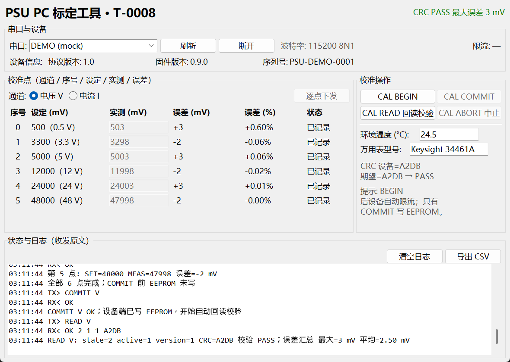

# PSU PC 标定工具

## 模块化标定工具（T-0025 起；会话 T-0026；GUI T-0027）

`tools/calib/` 是拆分后的模块；T-0026 的 `session.py` 实现一次一个通道的会话状态机
（`CAL BEGIN` → 逐点 `SET`/`MEAS` → `COMMIT` → 回读 `READ` → `ABORT`）。
GUI 见下节；CSV 归 T-0028；本模块不提供普通 V/I 设定或输出开关命令。

- 命令单位：V 用 mV、I 用 mA；设备校准表按需求 §3.4.1 以 0.1mA 编码，回读 CRC 时 ×10 校验。
- 错误码：设备 `ERR <code> <msg>` 的 code 取 CAL_STATUS 0–7（0 idle/1 busy/2 ok/3 CRC/4 版本/5 点/6 未校准/7 条件）。
- 安全：`CAL BEGIN` 由设备把 V 限流降到 0.5A、I 降到目标点+1A；会话中普通命令回 busy；
  超时/设备 ERR/输入非法立即 `ABORT`，仅 `COMMIT` 写 EEPROM。
- 离线自测：`$env:PYTHONPATH="tools"; py -3 -B .agent/evidence/T-0026-p1-selftest.txt`

## 完整界面（T-0027）

```powershell
py -3 -m pip install pyserial
$env:PYTHONPATH="tools"; py -3 -m calib
```

界面：串口下拉/刷新/连接 + 设备信息；V/I 通道；序号/设定/实测/误差实时表（V 6 点、I 3 点，
均可见可编辑）；CAL BEGIN、逐点下发、记录实测 MEAS、CAL COMMIT、CAL READ 回读校验、
CAL ABORT 中止；状态与收发原文日志（失败红色 + `!`）。COMMIT 前不写 EEPROM。
截图：`.agent/evidence/T-0027-p0-ui-after.png`。

## 旧版一体化工具（T-0008）

PC 端串口逐点校准工具：连接 PSU 本体 UART（115200 8N1），按通道下发 6 点电压 / 3 点电流，
人工录入万用表实测值，COMMIT 后自动 READ 回读 CRC 校验，并导出 CSV 留档。
仅依赖 Python 3 自带的 tkinter 与第三方 `pyserial`；不设 V/I 普通设定、不开关输出。



## 安装与启动

```powershell
py -3 -m pip install pyserial          # 唯一额外依赖
py -3 tools\calib_tool.py              # 启动 GUI
py -3 tools\calib_tool.py --demo       # 无硬件离线演示（内置 mock 设备）
py -3 tools\calib_tool.py --selftest   # 协议/CRC/CSV 离线自测，输出 RESULT: PASS
```

Windows 也可用 `python` 或 `py` 启动；源码运行方式不需要打包。可选单文件打包：

```powershell
py -3 -m pip install pyinstaller
pyinstaller --onefile --windowed --name PSU_Calib tools\calib_tool.py
```

## 界面与操作流程

1. **刷新/连接**：串口下拉框自动列出 `pyserial` 枚举的端口（含 USB-UART），点“连接”。
   连接成功后自动发 `INFO` 读取协议版本、固件版本、SN；设备不支持时显示 `N/A`，不阻断校准。
2. **选择通道**：电压 V（6 点：0.5/3.3/5/12/24/48 V）或电流 I（3 点：1/2.5/5 A）。
3. **CAL BEGIN**：设备进入校准态并由设备内部把电压通道限流降到 0.5 A（电流通道为目标点 +1 A）；
   工具在界面显示该限流值，不额外下发非协议命令。只有 COMMIT 才写 EEPROM。
4. **逐点下发**：先 `SET` 当前点，等待用万用表读数；在“实测”输入框填入后点“记录本点 MEAS”。
   误差（绝对值与百分比）实时显示；非法/超容差输入会明确提示并自动 ABORT，不发送 MEAS，
   也不写 EEPROM。
5. **CAL COMMIT**：全部点记录后启用；成功后自动 `READ`，按 T-0006 §3.4.3 的
   `CAL6 + channel + version + N×(set,meas)` CRC16-CCITT-FALSE 与设备回读值比对。
6. **CAL READ 回读校验**：可重复回读；缺 CRC 字段时显示“未完成校验”，不静默放行。
7. **导出 CSV**：日志区右上角按钮；含时间、环境温度、万用表型号、协议/固件版本、SN、
   通道、点号、设定/实测/误差、设备 CRC、期望 CRC、结果。

## 串口协议（与工单 T-0008 明列命令一致）

ASCII 文本行、`\r\n` 结束、大小写不敏感；设备回 `OK` 或 `ERR <code> <msg>`。

```text
CAL BEGIN <ch>            ch = V / I
SET  <ch> <idx> <value>   value 单位：V 通道 mV，I 通道 mA
MEAS <ch> <idx> <value>
COMMIT <ch>
READ <ch>
ABORT <ch>
INFO                      （可选）设备信息查询
```

`READ` 成功回包约定为 `OK <state> <active> <version> <crc>`（也兼容 `STATUS ...`）；
`INFO` 回包约定为 `OK INFO <proto> <fw> [sn]` 或 `INFO ...`。
工单列出的验证码为 `SET/MEAS/READ`；仓内 T-0006 文档 §3.4.5 曾写 `CAL POINT` / `CAL STATUS`，
两处命令名有差异，本工具按工单明列命令实现，README 保留此偏差供固件对齐。

## 异常与安全

- 串口断开/读写超时/无法解析响应/设备 `ERR`：弹窗明确提示，自动发送 `ABORT <ch>`，清空会话并断开，
  不执行 COMMIT，因此不会写 EEPROM。
- 输入非法/超量程（超过量程 +10% 容差）：提示并自动发送 ABORT，不执行 COMMIT，不写 EEPROM。
- 关闭窗口/断开连接时若校准未结束，先自动 ABORT；所有收发原文带时间戳显示在日志区。
- 本工具不发送普通 V/I 设定或输出开关命令，符合需求附录 I.4 的服务/标定工具边界。

## 文件

- `tools/calib_tool.py`：GUI、串口、协议、Mock 与 `--selftest` 一体。
- `tools/README.md`：本文件。
- 截图：`.agent/evidence/T-0008-p0-ui-before.png`（启动空态）、`T-0008-p0-ui-after.png`（完成校准态），均 1180×840。
